<div class="cover">
<h1>Diecast Collector</h1>
<p class="subtitle">Manual do Usuário</p>
<p class="meta">Versão 0.1.0 (versionCode 1)<br>
Árvore de trabalho — 28/11/2026<br>
Android 8.0 (API 26) ou superior<br>
Português brasileiro</p>
</div>
**Versão documentada**: 0.1.0 (versionCode 1)
**Referência**: árvore de trabalho em 2026-11-28, após a renomeação para **Diecast Collector**
(capturas regeradas em 22/11/2026 no emulador `diecast_test`; o texto acompanha as revisões
posteriores, registradas no fim do capítulo 35)
**Plataforma**: Android 8.0 (API 26) ou superior
**Idioma**: português brasileiro

> Este manual descreve **somente** o aplicativo implementado na versão acima. A produção é
> exclusivamente documental: nenhum arquivo de código, banco, recurso ou configuração do
> app foi alterado. Onde uma tela ou estado não pôde ser executado ou capturado, o texto diz
> isso no ponto de uso e registra o motivo em `LIMITACOES_DOCUMENTACAO.md`.

## Sumário

1. [Navegação principal](#1-navegacao-principal)
2. [Antes de começar](#2-antes-de-comecar)
3. [Primeiros passos](#3-primeiros-passos)
4. [Estrutura do domínio](#4-estrutura-do-dominio)
5. [Painel](#5-painel)
6. [Catálogo](#6-catalogo)
7. [Busca](#7-busca)
8. [Cadastro inicial](#8-cadastro-inicial)
9. [Formulário de variante e primeiro exemplar](#9-formulario-de-variante-e-primeiro-exemplar)
10. [Incompletos](#10-incompletos)
11. [Edição de modelo](#11-edicao-de-modelo)
12. [Edição de variante](#12-edicao-de-variante)
13. [Adicionar exemplar](#13-adicionar-exemplar)
14. [Lista de exemplares](#14-lista-de-exemplares)
15. [Detalhe do exemplar](#15-detalhe-do-exemplar)
16. [Coleções](#16-colecoes)
17. [Detalhe de coleção](#17-detalhe-de-colecao)
18. [Formulário de coleção](#18-formulario-de-colecao)
19. [Séries](#19-series)
20. [Leitura de código de barras](#20-leitura-de-codigo-de-barras)
21. [Duplicados](#21-duplicados)
22. [Negociação](#22-negociacao)
23. [Lista de desejos](#23-lista-de-desejos)
24. [Formulário de desejo](#24-formulario-de-desejo)
25. [Financeiro](#25-financeiro)
26. [Localizações](#26-localizacoes)
27. [Conteúdo da localização](#27-conteudo-da-localizacao)
28. [Ajustes](#28-ajustes)
29. [Backup e restauração](#29-backup-e-restauracao)
30. [Relatórios](#30-relatorios)
31. [Importação](#31-importacao)
32. [Dados da coleção](#32-dados-da-colecao)
33. [Sobre](#33-sobre)
34. [Privacidade](#34-privacidade)
35. [Exemplo completo: Nissan Skyline GT-R R34](#35-exemplo-completo-nissan-skyline-gt-r-r34)

# 1. Navegação principal

> **Tela**: todas as telas de primeiro nível · **Acesso**: barra inferior · **Capturas**: `capturas/01-painel-vazio.png`, `capturas/05b-painel-com-dados.png`

<div class="fig-row">
<figure>
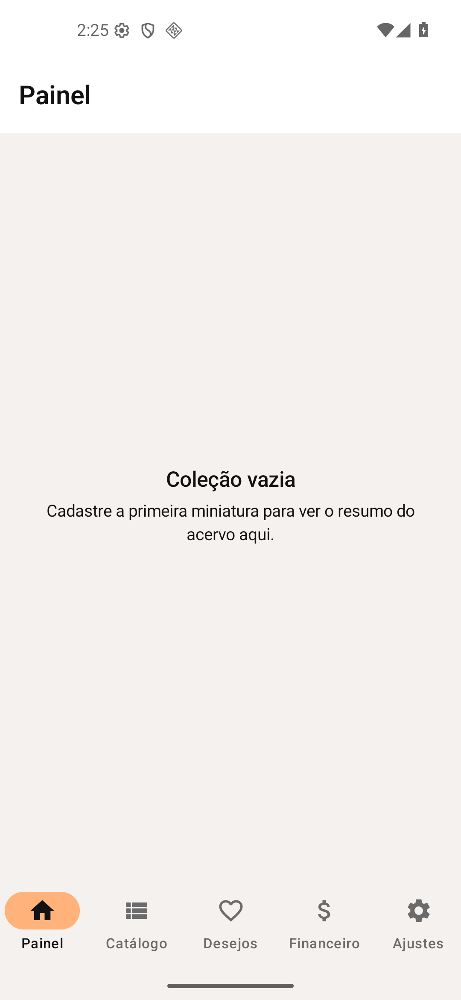
<figcaption>Figura 1.1 — Painel vazio</figcaption>
</figure>

<figure>
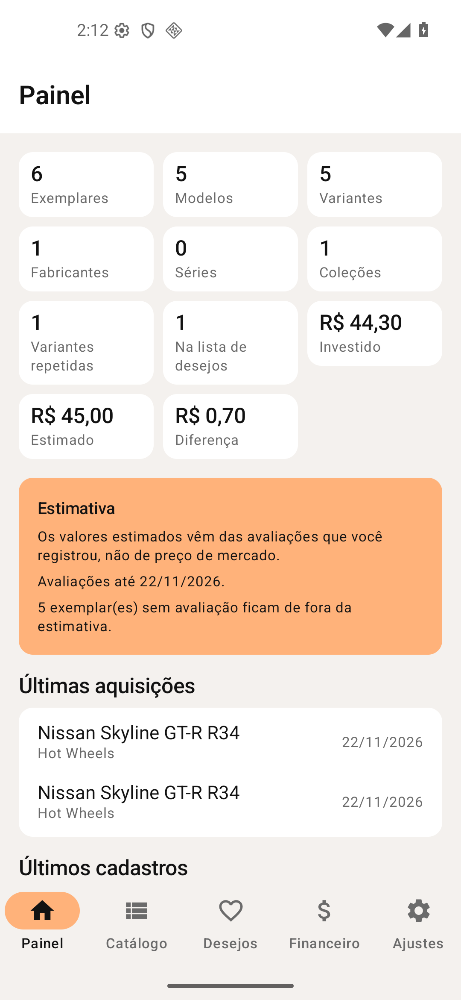
<figcaption>Figura 1.2 — Painel com dados</figcaption>
</figure>
</div>

### Finalidade

A barra inferior dá acesso direto às cinco áreas do aplicativo sem empilhar telas: Painel,
Catálogo, Desejos, Financeiro e Ajustes.

### Como acessar

A barra aparece na parte de baixo das telas de primeiro nível. Ela **não** aparece em telas
filhas (detalhe de exemplar, busca, formulários, backup etc.), que voltam pelo botão
«Voltar» ou pelo gesto de voltar do Android.

### Identificação visual

| Aba | Ícone | Posição | O que abre |
|---|---|---|---|
| **Painel** | casa | 1ª, à esquerda | resumo do acervo |
| **Catálogo** | lista | 2ª | lista de miniaturas |
| **Desejos** | coração | 3ª, centro | lista de desejos |
| **Financeiro** | cifrão | 4ª | investido, estimado e gastos |
| **Ajustes** | engrenagem | 5ª, à direita | hub de opções do app |

A aba ativa fica destacada; as demais aparecem com ícone e rótulo em cor secundária.

### Elementos da tela

| Elemento | Tipo | Onde fica | O que faz | Resultado |
|---|---|---|---|---|
| **Painel** | aba | barra inferior, 1ª | abre o resumo do acervo | tela Painel |
| **Catálogo** | aba | barra inferior, 2ª | abre a lista de miniaturas | tela Coleção |
| **Desejos** | aba | barra inferior, 3ª | abre a lista de desejos | tela Lista de desejos |
| **Financeiro** | aba | barra inferior, 4ª | abre o resumo financeiro | tela Financeiro |
| **Ajustes** | aba | barra inferior, 5ª | abre as opções do app | tela Ajustes |

### Como utilizar

1. Toque na aba desejada.
2. Trocar de aba não empilha telas: cada aba volta ao seu início e preserva o estado anterior
   (lista rolada, filtro aplicado).
3. Para sair de uma tela filha, use **Voltar** na barra superior ou o gesto/botão do Android.

### Exemplos

Na captura `01-painel-vazio.png`, a coleção está vazia e a aba **Painel** aparece destacada.
Com o acervo do exemplo já cadastrado (`05b-painel-com-dados.png`), a mesma barra continua
visível, agora com números no resumo.

### Regras e validações

- A barra só existe em rotas de primeiro nível; dentro de Busca, Exemplares, Backup etc. ela
  desaparece para dar lugar às ações da tela.
- O estado de cada aba é preservado ao alternar entre elas.

### Mensagens e situações especiais

- **Tela filha sem barra**: comportamento esperado, não é erro.
- **Voltar do sistema**: retorna à tela anterior; na primeira tela, sai do app.

### Dicas

- Use as abas para alternar entre consulta (Catálogo), planejamento (Desejos), conferência de
  valores (Financeiro) e configuração (Ajustes) sem perder o contexto.

### Problemas comuns

| Sintoma | Causa provável | O que fazer |
|---|---|---|
| A barra desapareceu | você está em uma tela filha | use **Voltar** para retornar |
| A aba abriu no início | comportamento normal | role novamente ou reaplique o filtro |

---

# 2. Antes de começar

> **Tela**: introdução · **Acesso**: abertura do app · **Capturas**: `capturas/01-painel-vazio.png`

<div class="fig-row">
<figure>
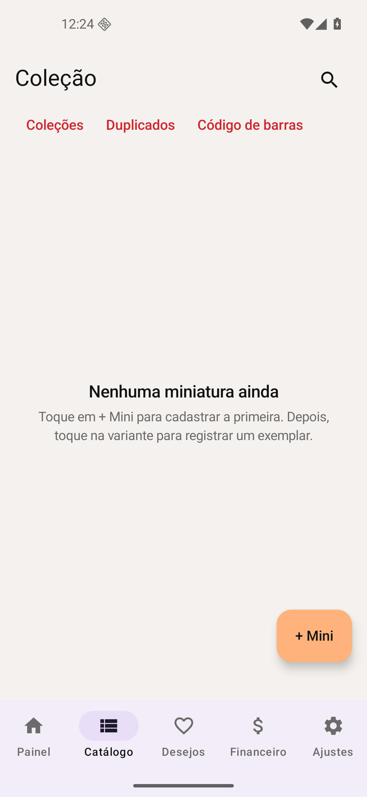
<figcaption>Figura 2.1 — Catalogo vazio</figcaption>
</figure>

<figure>
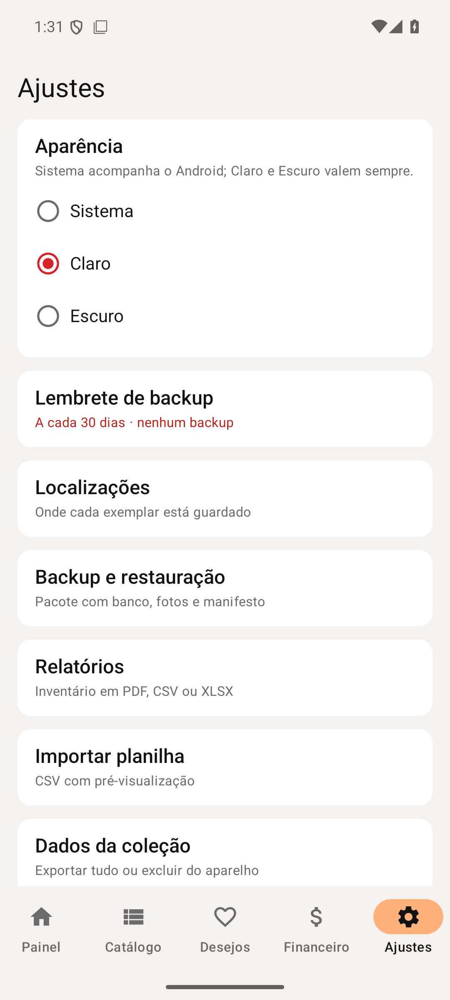
<figcaption>Figura 2.2 — Ajustes</figcaption>
</figure>
</div>

### Finalidade

Explicar os conceitos que o aplicativo usa, o que ele faz, o que ele **não** faz e onde os
dados ficam, antes do primeiro cadastro.

### Como acessar

Abra o aplicativo. A primeira tela é o **Painel**; com a coleção vazia, ele mostra
«Coleção vazia» e a instrução para cadastrar a primeira miniatura.

### Identificação visual

Título **Painel** na barra superior, mensagem central «Coleção vazia» e a barra inferior com
as cinco abas.

### Conceitos essenciais

| Conceito | Definição | Exemplo |
|---|---|---|
| **Modelo** | o veículo em miniatura, independente de pintura ou edição | Nissan Skyline GT-R R34 |
| **Variante** | a versão específica do modelo: cor, rodas, série, ano | Skyline R34 azul, 2025, 1:64 |
| **Exemplar** | a unidade física que você possui | o Skyline azul na caixa 12 |
| **Série** | agrupamento do fabricante ao qual a variante pertence | Mainline 2025 |
| **Coleção** | lista planejada com quantidade esperada por item | «Skyline 2025» |
| **Localização** | onde o exemplar está guardado | Caixa 12 |
| **Aquisição** | compra registrada (data, preço, frete, desconto, loja) | R$ 19,90 + R$ 4,50 |
| **Avaliação** | estimativa de valor em uma data | R$ 45,00 em 22/11/2026 |

### Requisitos

- Android 8.0 (API 26) ou superior.
- Aplicativo instalado por APK (sideload). Não há conta, login nem loja.
- Funciona **offline**: catálogo, fotos, busca, filtros, finanças e relatórios são locais.

### O que o app não faz

- Não sincroniza entre aparelhos nem usa nuvem.
- Não identifica o carrinho sozinho por código de barras: a leitura apenas sugere dados.
- Não emite os “11 relatórios” de documentos antigos: gera o **inventário** em PDF, CSV ou XLSX.
- Não importa planilha XLSX: a importação é **CSV**.

### Onde os dados ficam

No armazenamento privado do app, no próprio aparelho. Desinstalar o app apaga os dados, a
menos que exista um pacote de backup guardado fora dele.

### Como utilizar

1. Leia os conceitos acima; eles aparecem em todas as telas.
2. Siga para «Primeiros passos» (capítulo 3) para cadastrar a primeira miniatura.
3. Faça o primeiro backup ao final, como descrito no passo 10.

### Exemplos

O exemplo do manual usa o **Nissan Skyline GT-R R34 azul, 2025, 1:64**, cadastrado com
aquisição de R$ 19,90 + R$ 4,50 de frete e avaliação de R$ 45,00.

### Regras e validações

- Modelo, variante e exemplar são entidades distintas; não funda as três em um único cadastro.
- Dois exemplares da mesma variante são duplicados; duas variantes do mesmo modelo não são.

### Mensagens e situações especiais

- «Coleção vazia» aparece no Painel quando não há exemplares ativos.
- Sem internet, todas as funções continuam disponíveis.

### Dicas

- Cadastre o modelo uma vez e crie variantes para cada cor/edição; depois só acrescente
  exemplares.

### Problemas comuns

| Sintoma | Causa provável | O que fazer |
|---|---|---|
| «Coleção vazia» mesmo após instalar | nenhum exemplar cadastrado ainda | cadastre a primeira miniatura |
| Dados “sumiram” | app desinstalado ou dados limpos | restaure um pacote de backup |

---

# 3. Primeiros passos

> **Tela**: roteiro completo · **Acesso**: abertura do app · **Capturas**: `capturas/01-painel-vazio.png` a `capturas/29b-backup-criado.png`

<div class="fig-row">
<figure>
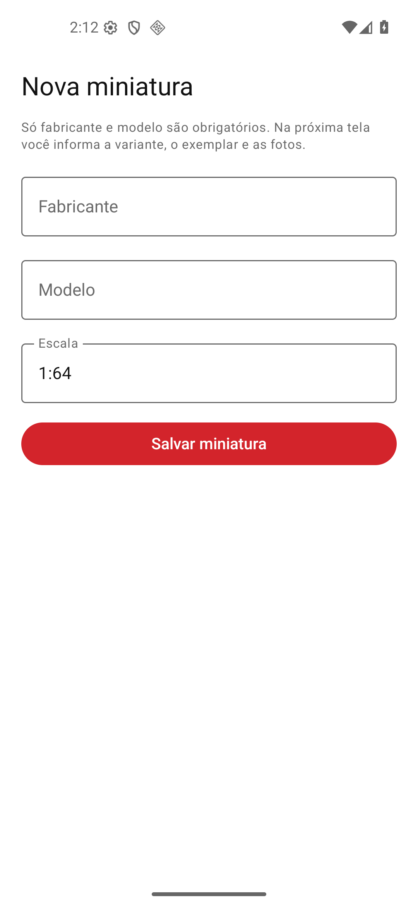
<figcaption>Figura 3.1 — Cadastro inicial</figcaption>
</figure>

<figure>
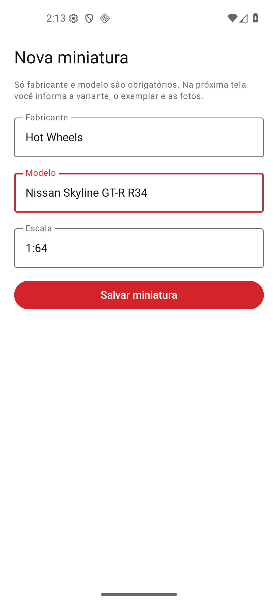
<figcaption>Figura 3.2 — Cadastro preenchido</figcaption>
</figure>
</div>
<div class="fig-row">
<figure>
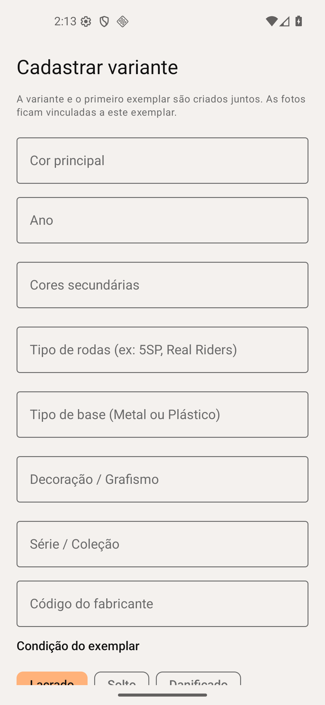
<figcaption>Figura 3.3 — Formulario variante vazio</figcaption>
</figure>

<figure>
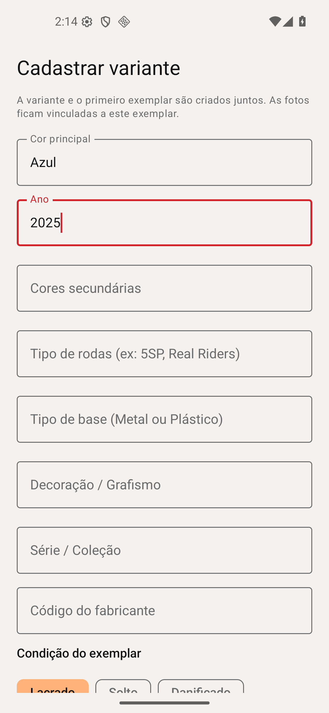
<figcaption>Figura 3.4 — Formulario variante preenchido</figcaption>
</figure>
</div>
<div class="fig-row">
<figure>
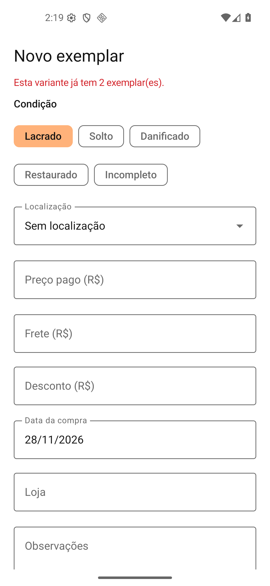
<figcaption>Figura 3.5 — Adicionar exemplar</figcaption>
</figure>

<figure>
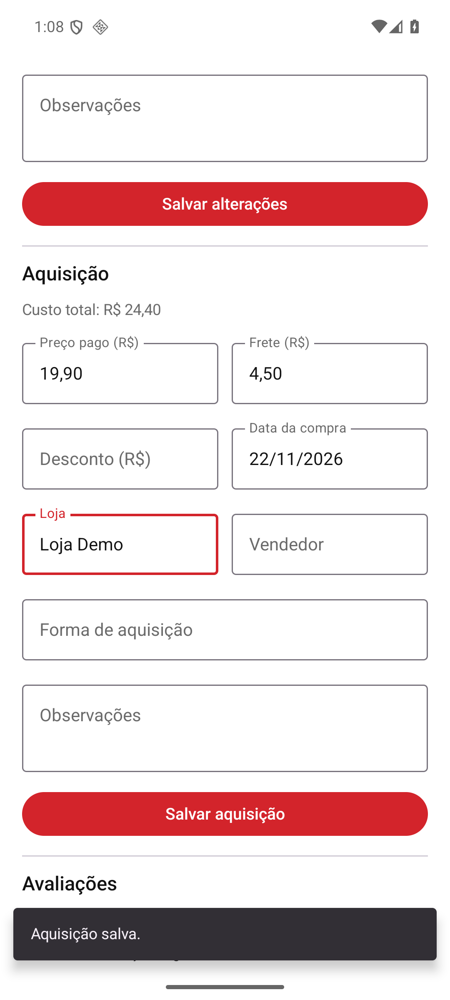
<figcaption>Figura 3.6 — Detalhe exemplar aquisicao</figcaption>
</figure>
</div>
<div class="fig-row">
<figure>
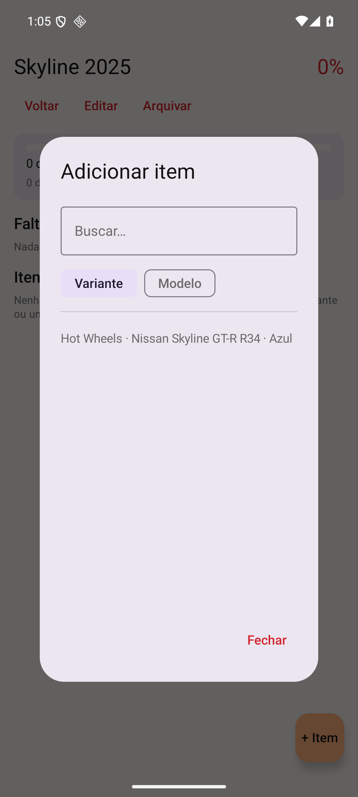
<figcaption>Figura 3.7 — Adicionar item colecao</figcaption>
</figure>

<figure>
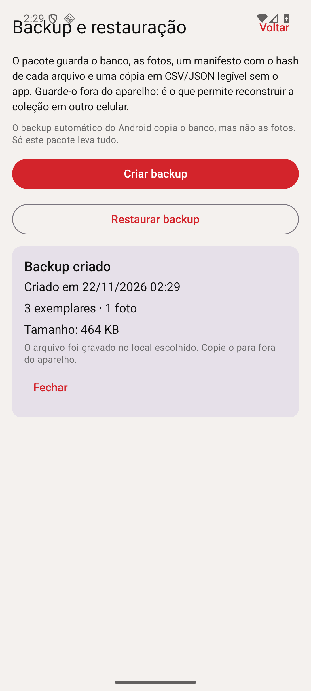
<figcaption>Figura 3.8 — Backup criado</figcaption>
</figure>
</div>

### Finalidade

Levar uma instalação vazia até uma coleção pequena, com fotos, aquisição, localização,
coleção e o primeiro backup, na ordem em que o aplicativo permite.

### Como acessar

Abra o app e siga os passos abaixo na sequência. Nenhum passo exige conhecimento de código.

### Identificação visual

Cada passo indica a tela e o rótulo exato do botão. As capturas mostram o resultado esperado.

### Como utilizar

1. **Abra o Catálogo.** Toque na aba **Catálogo**. A tela mostra «Nenhuma miniatura ainda».
2. **Inicie o cadastro.** Toque em **+ Mini**.
3. **Informe fabricante e modelo.** Em «Nova miniatura», preencha **Fabricante**
   (`Hot Wheels`) e **Modelo** (`Nissan Skyline GT-R R34`). A **Escala** já vem `1:64`.
   Toque em **Salvar miniatura**.
4. **Cadastre a variante e o primeiro exemplar.** Em «Cadastrar variante», preencha
   **Cor principal** (`Azul`) e **Ano** (`2025`). Escolha a **Condição do exemplar**
   (por exemplo, **Lacrado**). Opcionalmente, use **Galeria** ou **Câmera** em
   «Fotografias» para anexar imagens. Toque em **Salvar variante e exemplar**.
5. **Confira o catálogo.** A tela volta para **Coleção** e mostra o modelo com
   «Hot Wheels · 2025 · 1 exemplar».
6. **Abra o exemplar.** Toque em **Ver exemplares** e depois no código interno
   (por exemplo, `HW-000001`).
7. **Registre a aquisição.** Na seção **Aquisição**, preencha **Preço pago (R$)** (`19,90`),
   **Frete (R$)** (`4,50`), **Data da compra** e **Loja**. Toque em **Salvar aquisição**.
   O app mostra «Custo total: R$ 24,40».
8. **Registre uma avaliação.** Em **Avaliações**, preencha **Valor estimado (R$)** (`45,00`)
   e **Fonte** (`colecionador`). Toque em **Registrar avaliação**. O app mostra
   «Valor estimado atual: R$ 45,00».
9. **Guarde o exemplar em uma localização.** Volte aos **Ajustes** → **Localizações** →
   **+ Local**, nome `Caixa 12`, tipo **Caixa**, **Salvar**. Volte ao exemplar, em
   **Localização atual** escolha `Caixa 12` em **Mover para** e toque em **Mover**.
10. **Crie uma coleção.** No **Catálogo** → **Coleções** → **+ Coleção**, nome
    `Skyline 2025`, **Salvar coleção**. Abra a coleção, toque em **+ Item**, escolha a
    variante e confirme. O progresso passa a **100%**.
11. **Confira os números.** Abra o **Painel** e depois o **Financeiro**: o investido deve ser
    `R$ 24,40`, o estimado `R$ 45,00` e a diferença `R$ 20,60`.
12. **Faça o primeiro backup.** **Ajustes** → **Backup e restauração** → **Criar backup**.
    Escolha a pasta no seletor do sistema e confirme. O app mostra «Backup criado», com data,
    contagem de exemplares/fotos e tamanho. Copie o arquivo para fora do aparelho.

### Exemplos

As capturas `03-cadastro-inicial.png` e `04-cadastro-preenchido.png` mostram o passo 3;
`05-formulario-variante-vazio.png` e `06-formulario-variante-preenchido.png`, o passo 4;
`15b-detalhe-exemplar-aquisicao.png`, o passo 7; `15c-detalhe-exemplar-avaliacao.png`, o
passo 8; `15e-detalhe-exemplar-movido.png`, o passo 9; `17c-detalhe-colecao-com-item.png`, o
passo 10; `25-financeiro.png`, o passo 11; e `29b-backup-criado.png`, o passo 12.

### Regras e validações

- Só **Fabricante** e **Modelo** são obrigatórios no primeiro passo; a escala precisa estar no
  formato `1:N`.
- A variante e o primeiro exemplar nascem juntos; as fotos ficam ligadas a esse exemplar.
- O código interno do exemplar é gerado pelo app (`HW-000001`, `HW-000002`…) e é único.
- O custo total é preço + frete − desconto.

### Mensagens e situações especiais

- «Nenhuma miniatura ainda»: catálogo vazio.
- «Esta variante já tem 1 exemplar(es).»: aviso ao abrir **Novo exemplar**.
- «Backup criado»: pacote gravado; inclui banco, fotos e manifesto.
- Se a permissão de câmera for recusada, a galeria continua funcionando.

### Dicas

- Cadastre a localização antes de mover o exemplar; assim ele já nasce no lugar certo.
- Faça o backup antes de trocar de aparelho ou limpar os dados do app.

### Problemas comuns

| Sintoma | Causa provável | O que fazer |
|---|---|---|
| «Salvar miniatura» não avança | fabricante ou modelo em branco; escala fora de `1:N` | preencha os campos e confira a escala |
| Não encontro «Incompletos» | não há cadastro incompleto | o botão só aparece quando há pendência |
| O backup não abre em outro app | o pacote é um ZIP próprio do app | restaure pelo próprio app |

---

# 4. Estrutura do domínio

> **Tela**: conceitual · **Acesso**: leitura · **Capturas**: `diagramas/dominio.svg`

### Finalidade

Mostrar como o aplicativo organiza o acervo: fabricante, modelo, variante, exemplar,
fotografia, série, coleção, localização, aquisição e avaliação.

### Como acessar

Este capítulo não tem tela própria; os conceitos aparecem em Catálogo, Coleções,
Localizações, Financeiro e nos formulários.

### Identificação visual

O diagrama `diagramas/dominio.svg` resume os relacionamentos.

### Entidades e relacionamentos

| Entidade | Campos que o usuário informa | Relação |
|---|---|---|
| **Fabricante** | nome, país | tem vários modelos e séries |
| **Marca** | nome | pertence a um fabricante |
| **Veículo real** | marca, modelo, ano, país | é representado por um modelo |
| **Modelo** | nome, escala, carroceria, material, país, observações | pertence a um fabricante; tem várias variantes |
| **Série** | nome, série superior, ano | pertence a um fabricante |
| **Cor** | nome, valor hexadecimal | cor principal e secundárias da variante |
| **Variante** | cor, cores secundárias, rodas, base, decoração, ano, números, edição, código do fabricante, embalagem | pertence a um modelo; tem vários exemplares |
| **Exemplar** | código interno, condição, embalagem, status, localização, observações | pertence a uma variante |
| **Fotografia** | ângulo, arquivo, principal/ordem | pertence a um exemplar |
| **Aquisição** | data, preço, frete, desconto, loja, vendedor, forma | pertence a um exemplar |
| **Avaliação** | data, valor, fonte, observações | pertence a um exemplar (histórico) |
| **Coleção / item** | nome, descrição, coleção superior; item esperado | agrupa variantes ou modelos |
| **Localização** | nome, tipo, localização superior | guarda exemplares e sublocalizações |
| **Negociação** | tipo, status, contraparte, canal, valor | pertence a um exemplar do acervo (duplicado ou único) |

### Como utilizar

1. Cadastre o fabricante e o modelo.
2. Crie a variante (cor, ano, série) junto do primeiro exemplar.
3. Acrescente exemplares quando tiver mais de uma unidade da mesma variante.
4. Organize com coleções e localizações; registre aquisição e avaliações no exemplar.

### Exemplos

`Hot Wheels` → `Nissan Skyline GT-R R34` → variante `Azul 2025` → exemplar `HW-000001`
(condição `Lacrado`, localização `Caixa 12`, aquisição R$ 24,40, avaliação R$ 45,00).

### Regras e validações

- Um modelo tem N variantes; uma variante tem N exemplares.
- Duplicidade é detectada por **variante + exemplar**, nunca pelo nome do modelo.
- Identificadores são internos e estáveis; corrigir um nome não quebra relacionamentos.
- Exclusão de entidade com dependentes é bloqueada; use arquivamento.

### Mensagens e situações especiais

- «Sem variante cadastrada»: modelo criado e variante não concluída.
- «Falta: cor principal, ano»: variante incompleta.

### Dicas

- Use séries e coleções para recortes diferentes: série é do fabricante; coleção é sua.

### Problemas comuns

| Sintoma | Causa provável | O que fazer |
|---|---|---|
| Dois “carros iguais” não aparecem em Duplicados | são variantes diferentes | confira cor/ano/série antes de tratar como duplicata |
| Não consigo excluir um exemplar | há vínculos (fotos, aquisição, histórico) | use **Arquivar exemplar** |

---

# 5. Painel

> **Tela**: `dashboard` · **Arquivo**: `feature/dashboard/DashboardScreen.kt` · **Acesso**: aba **Painel** · **Capturas**: `capturas/01-painel-vazio.png`, `capturas/05b-painel-com-dados.png`

<div class="fig-row">
<figure>

<figcaption>Figura 5.1 — Painel vazio</figcaption>
</figure>

<figure>

<figcaption>Figura 5.2 — Painel com dados</figcaption>
</figure>
</div>

### Finalidade

Mostrar, em uma tela, o tamanho do acervo, o valor investido e estimado, as últimas entradas
e o progresso das coleções.

### Como acessar

Toque na aba **Painel** na barra inferior.

### Identificação visual

Título **Painel**. A tela tem três blocos: grade de indicadores, cartão de estimativa e listas
de últimas aquisições/cadastros. Com a coleção vazia, mostra apenas a mensagem central.

### Elementos da tela

| Elemento | Tipo | Onde fica | O que faz | Resultado |
|---|---|---|---|---|
| **Exemplares** | indicador | grade, 1ª posição | conta exemplares com status “possuído” | número |
| **Modelos** | indicador | grade | conta modelos que têm exemplar possuído | número |
| **Variantes** | indicador | grade | conta variantes com exemplar possuído | número |
| **Fabricantes** | indicador | grade | conta fabricantes com exemplar possuído | número |
| **Séries** | indicador | grade | conta séries em uso | número |
| **Coleções** | indicador | grade | conta coleções ativas | número |
| **Variantes repetidas** | indicador | grade | conta variantes com mais de um exemplar possuído | número |
| **Na lista de desejos** | indicador | grade | conta desejos em aberto | número |
| **Investido** | indicador | grade | soma preço + frete − desconto | valor em R$ |
| **Estimado** | indicador | grade | soma da última avaliação de cada exemplar | valor em R$ |
| **Diferença** | indicador | grade | estimado − investido | valor em R$ |
| **Estimativa** | etiqueta | cartão de estimativa | identifica que o número é estimativa | — |
| **Últimas aquisições** | lista | corpo | mostra as aquisições mais recentes | modelo, fabricante, data |
| **Últimos cadastros** | lista | corpo | mostra os cadastros mais recentes | modelo, fabricante, data |
| **Progresso das coleções** | lista | corpo | mostra «N de M itens» por coleção | — |

### Como utilizar

1. Abra a aba **Painel**.
2. Leia os indicadores de cima para baixo; os financeiros ficam no fim da grade.
3. Confira no cartão de estimativa a data da avaliação mais recente e quantos exemplares
   ficaram fora por não ter avaliação.
4. Use as listas para reencontrar o que entrou por último.

### Exemplos

Com o acervo fictício do manual, que tem duas unidades do Skyline e uma única avaliação de
R$ 45,00: `6` Exemplares, `5` Modelos, `5` Variantes, `1` Fabricante, `0` Séries, `1` Coleção,
`1` Variante repetida, `1` Na lista de desejos, **Investido R$ 44,30**,
**Estimado R$ 45,00**, **Diferença R$ 0,70** — e «5 exemplar(es) sem avaliação ficam de fora
da estimativa».

Cada miniatura sem aquisição nem avaliação (como o `Dodge Charger 1970`) soma um exemplar,
modelo e variante, mas não mexe em **Investido**, **Estimado** e **Diferença**; o rodapé da
estimativa conta quantos exemplares ficaram de fora.

### Regras e validações

- Todos os indicadores consideram apenas exemplares com status **possuído**; vendidos,
  trocados e arquivados ficam de fora.
- **Modelos** conta apenas modelos que têm exemplar possuído, por isso um modelo sem variante
  não aparece.
- O estimado usa a avaliação mais recente de cada exemplar; sem avaliação, o exemplar não
  entra na soma.
- As datas do cartão e das listas aparecem no formato `dd/mm/aaaa` (`28/11/2026`); o banco
guarda a data em ISO e o aplicativo só formata na tela.

### Mensagens e situações especiais

| Mensagem | Quando aparece | O que fazer |
|---|---|---|
| «Coleção vazia» | nenhum exemplar possuído | cadastre a primeira miniatura |
| «Cadastre a primeira miniatura para ver o resumo do acervo aqui.» | idem | use **Catálogo** → **+ Mini** |
| «Não foi possível ler a coleção» | falha ao ler o banco | feche e abra o app; se persistir, verifique o banco local |
| «Nada registrado ainda.» | listas sem itens | — |
| «Nenhuma coleção ativa.» | sem coleções | crie uma em **Coleções** |

### Dicas

- Registre avaliações no detalhe do exemplar para o **Estimado** refletir o acervo.
- A **Diferença** é estimativa, não lucro realizado.

### Problemas comuns

| Sintoma | Causa provável | O que fazer |
|---|---|---|
| Investido menor que o esperado | aquisição sem preço contribui com zero | abra o exemplar e informe o preço |
| Modelos menor que o catálogo | modelo sem variante/exemplar não conta | complete o cadastro em **Incompletos** |

---

# 6. Catálogo

> **Tela**: `catalog` · **Arquivo**: `feature/catalog/CatalogScreen.kt` · **Acesso**: aba **Catálogo** · **Capturas**: `capturas/02-catalogo-vazio.png`, `capturas/07-catalogo-com-miniatura.png`, `capturas/02b-catalogo-com-incompleto.png`

<div class="fig-row">
<figure>

<figcaption>Figura 6.1 — Catalogo vazio</figcaption>
</figure>

<figure>
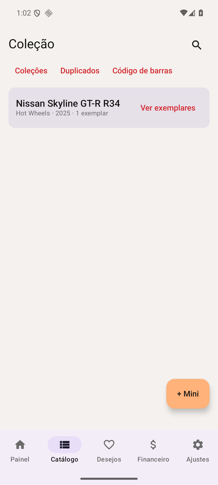
<figcaption>Figura 6.2 — Catalogo com miniatura</figcaption>
</figure>
</div>
<div class="fig-row">
<figure>
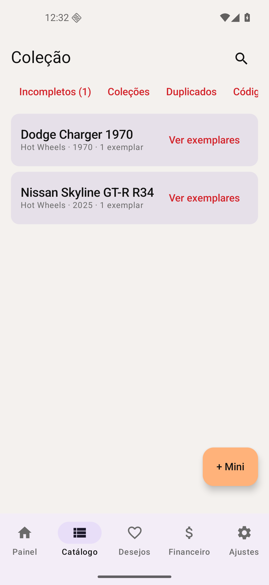
<figcaption>Figura 6.3 — Catalogo com incompleto</figcaption>
</figure>

<figure>
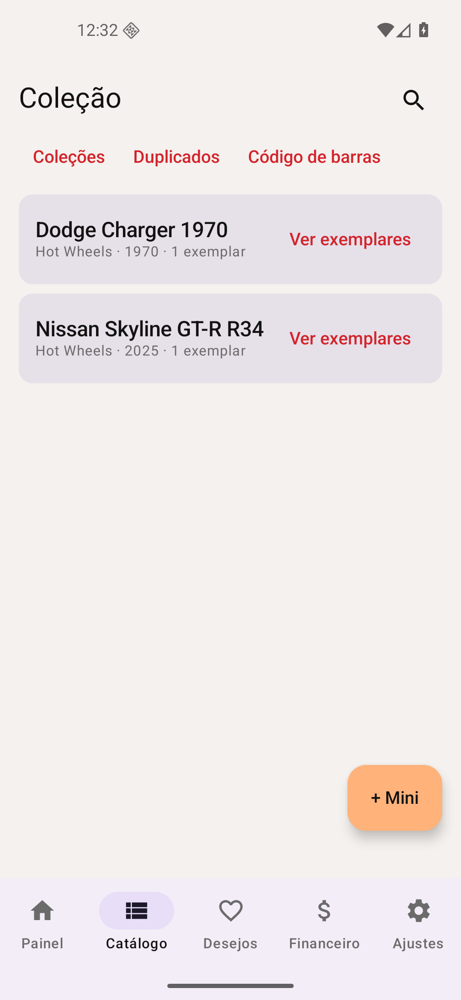
<figcaption>Figura 6.4 — Catálogo com dois modelos; o Skyline tem um exemplar com foto anexada,
que o cartão não exibe</figcaption>
</figure>
</div>

### Finalidade

Listar as miniaturas do acervo agrupadas por variante e dar acesso ao cadastro, à busca, às
coleções, aos duplicados e à leitura de código de barras.

### Como acessar

Toque na aba **Catálogo**.

### Identificação visual

Título **Coleção**. No topo, uma linha de ações (Incompletos, Coleções, Duplicados, Código de
barras) e o ícone de busca. No corpo, um cartão por variante. No canto inferior direito,
o botão **+ Mini**.

### Elementos da tela

| Elemento | Tipo | Onde fica | O que faz | Resultado |
|---|---|---|---|---|
| **(ícone de lupa)** | ícone | barra superior, à direita | abre a busca | tela Busca |
| **Incompletos (N)** | botão | topo, 1ª ação | abre cadastros pendentes | tela Cadastros incompletos |
| **Coleções** | botão | topo | abre as coleções | tela Coleções |
| **Duplicados** | botão | topo | abre os grupos de repetidos | tela Duplicados |
| **Código de barras** | botão | topo | abre a leitura | tela Código de barras |
| **+ Mini** | botão flutuante | canto inferior direito | inicia o cadastro | tela Nova miniatura |
| cartão da variante | item de lista | corpo | abre o cadastro de exemplar | tela Novo exemplar |
| **Ver exemplares** | botão | cartão | abre a lista de unidades | tela Exemplares |
| «N exemplar(es)» | indicador | cartão | mostra a contagem de exemplares | — |

### Como utilizar

1. Toque em **+ Mini** para cadastrar uma miniatura nova.
2. Toque no cartão da variante para **adicionar outro exemplar** da mesma variante.
3. Toque em **Ver exemplares** para listar, abrir ou mover as unidades existentes.
4. Use **Incompletos** quando o botão aparecer, para completar cadastros parados.
5. Use o ícone de busca para filtrar o acervo.

### Exemplos

Após o roteiro do capítulo 3, o catálogo mostra «Nissan Skyline GT-R R34» com
«Hot Wheels · 2025 · 1 exemplar». Com um modelo sem variante, aparece também
**Incompletos (1)** no topo (`02b-catalogo-com-incompleto.png`).

### Regras e validações

- O botão **Incompletos (N)** só aparece quando há pelo menos um cadastro pendente.
- O cartão agrupa por **variante**; dois exemplares da mesma variante aparecem em um único
  cartão com a contagem.
- Toque no cartão **não** abre o detalhe do exemplar; abre o cadastro de uma nova unidade.
  Para o detalhe, use **Ver exemplares**.

### Mensagens e situações especiais

| Mensagem | Quando aparece | O que fazer |
|---|---|---|
| «Nenhuma miniatura ainda» | catálogo vazio | toque em **+ Mini** |
| «Toque em + Mini para cadastrar a primeira. Depois, toque na variante para registrar um exemplar.» | idem | siga a instrução |
| «nenhum exemplar» | variante sem unidade ativa | toque em **Ver exemplares** → **+ Exemplar** |

### Dicas

- **Ver exemplares** é o caminho para o detalhe, aquisição, avaliação e movimentação.
- Use **Coleções** para acompanhar o que falta comprar.

### Problemas comuns

| Sintoma | Causa provável | O que fazer |
|---|---|---|
| Toquei na variante e abriu “Novo exemplar” | comportamento esperado | use **Ver exemplares** para o detalhe |
| Não vejo “Incompletos” | não há pendências | — |
| A lista não atualiza após salvar | voltar de tela deve recarregar | se persistir, reabra o app |

---

# 7. Busca

> **Tela**: `catalog/search` · **Arquivo**: `feature/search/SearchScreen.kt` · **Acesso**: ícone de lupa no Catálogo · **Capturas**: `capturas/07-busca.png`

<div class="fig-row">
<figure>
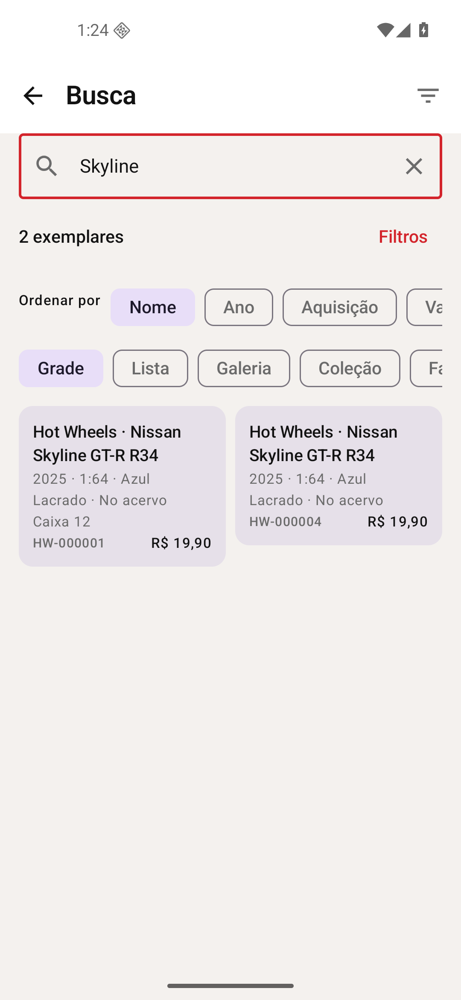
<figcaption>Figura 7.1 — Busca</figcaption>
</figure>
</div>

### Finalidade

Encontrar exemplares por texto e combinar filtros, alternando entre grade, lista, galeria e
agrupamentos.

### Como acessar

No **Catálogo**, toque no ícone de lupa («Buscar no acervo») na barra superior.

### Identificação visual

Título **Busca**, campo de texto no topo, botão **Filtros** e seletor **Ordenar por**. O
resultado aparece abaixo, com a contagem.

### Elementos da tela

| Elemento | Tipo | Onde fica | O que faz | Resultado |
|---|---|---|---|---|
| campo de busca | campo | topo | procura por «Nome, série, coleção ou código» | resultados filtrados |
| **Filtros** | botão | topo | abre o painel de filtros | seções de filtro |
| **Limpar tudo** | botão | topo | remove busca e filtros | lista completa |
| **Ordenar por** | seletor | topo | escolhe a ordem | **Nome**, **Ano**, **Aquisição** ou **Valor** |
| **Grade** | opção | topo | mostra cartões | — |
| **Lista** | opção | topo | mostra linhas | — |
| **Galeria** | opção | topo | mostra fotos principais | — |
| **Coleção** | agrupamento | topo | agrupa por coleção | — |
| **Fabricante** | agrupamento | topo | agrupa por fabricante | — |
| **Série** | agrupamento | topo | agrupa por série | — |
| **Fabricante** (filtro) | filtro | painel | restringe ao fabricante | chips |
| **Modelo** | filtro | painel | restringe ao modelo | chips |
| **Série** | filtro | painel | restringe à série | chips |
| **Coleção** | filtro | painel | restringe à coleção | chips |
| **Ano** | filtro | painel | restringe ao ano | chips |
| **Cor principal** | filtro | painel | restringe à cor | chips |
| **Escala** | filtro | painel | restringe à escala | chips |
| **Condição** | filtro | painel | restringe à condição | chips |
| **Situação** | filtro | painel | restringe ao status do exemplar | chips |
| **Localização** | filtro | painel | restringe à localização | chips |
| **Faixa de preço** | filtro | painel | **Mínimo (R$)**, **Máximo (R$)** e **Aplicar faixa** | resultados na faixa |
| **Limpar filtros** | botão | painel | zera os filtros | — |
| **Fechar** | botão | painel | fecha o painel | — |

### Como utilizar

1. Digite no campo de busca; o resultado é atualizado enquanto você digita.
2. Toque em **Filtros** e marque um ou mais valores. Chips ativos aparecem no topo.
3. Ajuste a ordem em **Ordenar por** e o formato em **Grade**, **Lista** ou **Galeria**.
4. Agrupe por **Coleção**, **Fabricante** ou **Série** para recortes.
5. Toque em um resultado para abrir o **detalhe do exemplar**.

### Exemplos

Busque `Skyline` e o app lista as duas unidades do exemplo. Filtre **Condição** `Lacrado` e
**Localização** `Caixa 12` para ver apenas o que está guardado nessa caixa.

### Regras e validações

- A busca é tolerante a acentos e maiúsculas/minúsculas (índice de texto do banco).
- Os filtros são combináveis; «Nenhuma opção cadastrada.» aparece em filtro sem valores.
- «Nenhum exemplar encontrado.» com a dica de ajustar a busca ou limpar filtros.
- A **Galeria** destaca a foto principal e marca quem ainda não tem foto.

### Mensagens e situações especiais

| Mensagem | Quando aparece | O que fazer |
|---|---|---|
| «Nenhum exemplar encontrado.» | busca/filtros sem resultado | ajuste o texto ou **Limpar filtros** |
| «Ajuste a busca ou limpe os filtros.» | idem | idem |
| «Nenhuma opção cadastrada.» | filtro sem dados | cadastre o dado ou ignore o filtro |

### Dicas

- Use **Faixa de preço** para achar o que está dentro do orçamento.
- O agrupamento por **Fabricante** ajuda em acervos com várias marcas.

### Problemas comuns

| Sintoma | Causa provável | O que fazer |
|---|---|---|
| Busca sem resultado com filtro ativo | filtro restritivo | **Limpar filtros** |
| Foto não aparece na galeria | exemplar sem foto principal | adicione foto no cadastro da variante |

---

# 8. Cadastro inicial

> **Tela**: `catalog/create` · **Arquivo**: `feature/catalog/CreateCatalogEntryScreen.kt` · **Acesso**: **+ Mini** no Catálogo · **Capturas**: `capturas/03-cadastro-inicial.png`, `capturas/04-cadastro-preenchido.png`

<div class="fig-row">
<figure>

<figcaption>Figura 8.1 — Cadastro inicial</figcaption>
</figure>

<figure>

<figcaption>Figura 8.2 — Cadastro preenchido</figcaption>
</figure>
</div>

### Finalidade

Criar o **modelo** e iniciar o cadastro da miniatura. Fabricante e modelo são obrigatórios;
a variante, o exemplar e as fotos vêm na tela seguinte.

### Como acessar

**Catálogo** → **+ Mini**. Se você veio da leitura de código de barras, o código lido chega
preenchido no formulário da variante.

### Identificação visual

Título **Nova miniatura**. Texto de apoio: «Só fabricante e modelo são obrigatórios…».
Três campos e o botão **Salvar miniatura**. Os campos abrem **vazios**: nada do que foi
digitado numa abertura anterior reaparece.

### Elementos da tela

| Elemento | Tipo | Onde fica | O que faz | Resultado |
|---|---|---|---|---|
| **Fabricante** | campo de texto | corpo, 1º | informa o fabricante | cria ou reaproveita o fabricante |
| **Sugestões de fabricante** | lista | sob o campo Fabricante | fabricantes já cadastrados que combinam com o texto digitado | preenche o campo |
| **Modelo** | campo de texto | corpo, 2º | informa o modelo | cria o modelo |
| **Sugestões de modelo** | lista | sob o campo Modelo | modelos já cadastrados que combinam com o texto digitado, com a escala | preenche o campo |
| **Escala** | campo de texto | corpo, 3º | define a escala | padrão `1:64` |
| **Salvar miniatura** | botão | corpo | grava e avança | tela **Cadastrar variante** |

### Como utilizar

1. Toque em **Fabricante** e comece a digitar (`Hot`). Se a marca já existir, aparece a
   sugestão; toque nela para reaproveitar o cadastro, ou continue digitando para criar uma nova.
2. Toque em **Modelo** e digite (`Skyline`). Escolha a sugestão quando o modelo já existir.
3. Confira a **Escala** (`1:64`).
4. Toque em **Salvar miniatura**.
5. Continue na tela **Cadastrar variante** (capítulo 9).

### Exemplos

Captura `04-cadastro-preenchido.png`: fabricante `Hot Wheels`, modelo
`Nissan Skyline GT-R R34`, escala `1:64`.

### Regras e validações

- **Fabricante** e **Modelo** são obrigatórios e limitados a 120 caracteres.
- A escala deve estar no formato `1:N`, com N entre 1 e 999.
- O aplicativo reaproveita fabricante já existente pelo nome.
- A sugestão só aparece depois de tocar no campo e digitar ao menos duas letras; campo vazio
  ou com uma letra não mostra lista.
- Ao tocar numa sugestão, o campo recebe o nome e o cartão de sugestões fecha. Nomes
  equivalentes ao digitado (mesma marca ou modelo, mesmo com outra caixa ou pontuação) não
  são sugeridos, e a lista mostra no máximo 5 opções.
- Se você sair antes de concluir a variante, o modelo fica em **Incompletos**.

### Mensagens e situações especiais

| Mensagem | Quando aparece | O que fazer |
|---|---|---|
| «Informe o fabricante.» | nome em branco | preencha o campo |
| «Informe o modelo.» | nome em branco | preencha o campo |
| «Escala deve estar no formato 1:N, como 1:64.» | escala inválida | corrija para `1:64` |

### Dicas

- Use o nome comercial completo do modelo; a cor e o ano ficam na variante.
- Deixe a escala `1:64` para a maioria dos Hot Wheels.
- Prefira escolher a sugestão em vez de redigitar o nome: isso evita fabricantes e modelos
  repetidos com grafias diferentes.

### Problemas comuns

| Sintoma | Causa provável | O que fazer |
|---|---|---|
| Não avança | campo obrigatório vazio | preencha fabricante e modelo |
| Escala recusada | formato diferente de `1:N` | use `1:64` |

---

# 9. Formulário de variante e primeiro exemplar

> **Tela**: `catalog/variant/{modelId}` · **Arquivo**: `feature/catalog/VariantFormScreen.kt` · **Acesso**: após **Salvar miniatura**; item de **Incompletos** · **Capturas**: `capturas/05-formulario-variante-vazio.png`, `capturas/06-formulario-variante-preenchido.png`

<div class="fig-row">
<figure>

<figcaption>Figura 9.1 — Formulario variante vazio</figcaption>
</figure>

<figure>

<figcaption>Figura 9.2 — Formulario variante preenchido</figcaption>
</figure>
</div>
<div class="fig-row">
<figure>
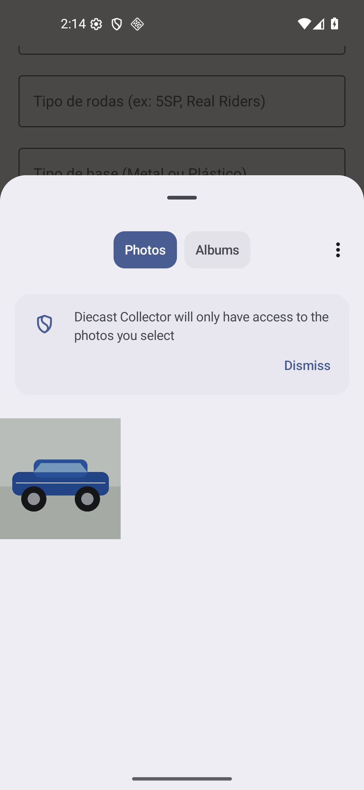
<figcaption>Figura 9.3 — Seletor de fotos aberto por Galeria</figcaption>
</figure>

<figure>
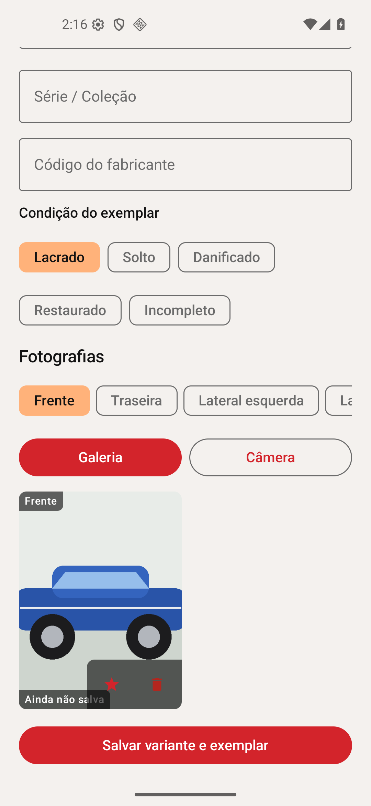
<figcaption>Figura 9.4 — Foto escolhida, marcada como «Ainda não salva» até gravar</figcaption>
</figure>
</div>

### Finalidade

Cadastrar a **variante** (cor, ano, rodas, base, decoração, série, código do fabricante) e o
**primeiro exemplar** (condição), anexando fotos a essa unidade física.

### Como acessar

Fluxo normal: **Catálogo** → **+ Mini** → **Salvar miniatura**.
Fluxo de correção: **Incompletos** → toque no modelo sem variante.

### Identificação visual

Título **Cadastrar variante** e o aviso de que variante e primeiro exemplar são criados juntos.
Formulário rolável, com a seção **Fotografias** ao final e o botão **Salvar variante e exemplar**.

### Elementos da tela

| Elemento | Tipo | Onde fica | O que faz | Resultado |
|---|---|---|---|---|
| **Cor principal** | campo | 1ª linha, à esquerda | cor que identifica a variante | nome exibido da variante |
| **Ano** | campo numérico | 1ª linha, à direita | ano de lançamento | — |
| **Cores secundárias** | campo | corpo | cores separadas por vírgula | — |
| **Tipo de rodas (ex: 5SP, Real Riders)** | campo | corpo | tipo de roda | — |
| **Tipo de base (Metal ou Plástico)** | campo | corpo | material da base | — |
| **Decoração / Grafismo** | campo | corpo | decoração | — |
| **Série / Coleção** | campo | corpo | série do fabricante | — |
| **Código do fabricante** | campo | corpo | código da embalagem | vindo da leitura de código de barras, quando houver |
| **Condição do exemplar** | chips | corpo | **Lacrado**, **Solto**, **Danificado**, **Restaurado**, **Incompleto** | condição do exemplar |
| **Fotografias** | grade | corpo | fotos do exemplar | — |
| **Frente / Traseira / Lateral esquerda / Lateral direita** | botões de ângulo | seção de fotos | escolhem o ângulo | foto vinculada ao ângulo |
| **Galeria** | botão | seção de fotos | abre o seletor de imagens | foto adicionada |
| **Câmera** | botão | seção de fotos | abre a câmera | foto adicionada |
| **Salvar variante e exemplar** | botão | fim do formulário | grava variante + exemplar + fotos | volta à tela anterior |

### Como utilizar

1. Preencha **Cor principal** e **Ano**.
2. Opcionalmente, informe cores secundárias, rodas, base, decoração, série e código.
3. Escolha a **Condição do exemplar**.
4. Se quiser fotos, toque em **Galeria** ou **Câmera** e escolha o ângulo.
5. Role até o fim e toque em **Salvar variante e exemplar**.

### Exemplos

Cor principal `Azul`, ano `2025`, condição `Lacrado`; o catálogo passa a mostrar
«Hot Wheels · 2025 · 1 exemplar».

### Regras e validações

- O primeiro exemplar é criado junto; não existe variante sem unidade neste fluxo.
- A cor e o ano compõem o nome exibido da variante; deixá-los em branco gera cadastro
  incompleto.
- O código lido por leitura de código de barras é reaproveitado como **Código do fabricante**.
- A recusa de permissão de câmera não impede usar a galeria.
- Cada foto é vinculada ao exemplar criado e pode ser marcada como principal.

### Mensagens e situações especiais

| Mensagem | Quando aparece | O que fazer |
|---|---|---|
| «Permissão de câmera recusada…» | permissão negada | use **Galeria** |
| «Remover esta foto?» | ao remover uma foto | confirme em **Remover** |
| «A foto sai deste formulário e o exemplar continua como está…» | diálogo de remoção | — |

### Dicas

- Use ângulos diferentes para documentar a embalagem e a base.
- Cadastre o código do fabricante para facilitar a busca futura.

### Problemas comuns

| Sintoma | Causa provável | O que fazer |
|---|---|---|
| Botão de salvar fora da tela | formulário rolável | role até o fim |
| Câmera não abre | permissão negada ou sem câmera | use **Galeria** |
| Variante “desapareceu” | cadastro ficou incompleto | abra **Incompletos** |

---

# 10. Incompletos

> **Tela**: `catalog/incomplete` · **Arquivo**: `feature/catalog/IncompleteEntriesScreen.kt` · **Acesso**: **Incompletos (N)** no Catálogo · **Capturas**: `capturas/10b-incompletos-com-item.png`

<div class="fig-row">
<figure>
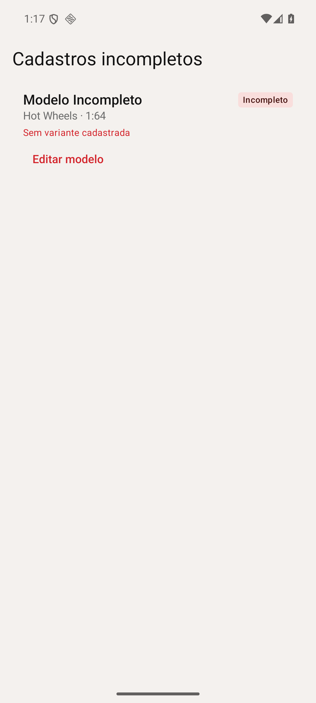
<figcaption>Figura 10.1 — Incompletos com item</figcaption>
</figure>

<figure>
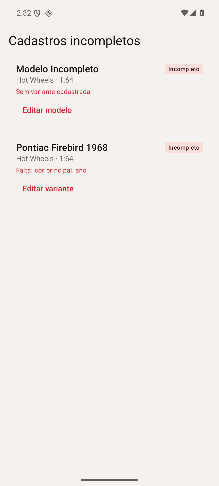
<figcaption>Figura 10.2 — Incompletos com um modelo sem variante e uma variante sem cor/ano</figcaption>
</figure>
</div>

### Finalidade

Listar modelos e variantes que ficaram sem dados obrigatórios e oferecer o atalho de correção.

### Como acessar

No **Catálogo**, toque em **Incompletos (N)**. O botão só aparece quando há pendências.

### Identificação visual

Título **Cadastros incompletos**. Cada item mostra nome do modelo, fabricante e escala, o selo
**Incompleto**, a lista do que falta e o botão de edição.

### Elementos da tela

| Elemento | Tipo | Onde fica | O que faz | Resultado |
|---|---|---|---|---|
| **Incompleto** | selo | item | indica pendência | — |
| «Sem variante cadastrada» | texto | item | modelo sem variante | — |
| «Falta: cor principal, ano» | texto | item | campos pendentes | — |
| **Editar modelo** | botão | item | abre o modelo | tela Modelo e veículo real |
| **Editar variante** | botão | item | abre a variante | tela Editar variante |
| item do modelo | área tocável | item | abre a variante para completar | tela Cadastrar variante |

### Como utilizar

1. Abra **Incompletos**.
2. Para modelo sem variante, toque no item ou em **Editar modelo**.
3. Para variante com campos faltando, toque em **Editar variante**.
4. Complete os dados e salve; a mensagem de confirmação aparece na lista.

### Exemplos

`Modelo Incompleto` · `Hot Wheels · 1:64` · **Incompleto** · «Sem variante cadastrada» ·
**Editar modelo**.

### Regras e validações

- Campos considerados: cor principal e ano da variante; existência de variante.
- Concluir um cadastro remove o item da lista; a mensagem «Modelo atualizado.» ou
  «Variante atualizada.» aparece ao voltar.

### Mensagens e situações especiais

| Mensagem | Quando aparece | O que fazer |
|---|---|---|
| «Nenhum cadastro incompleto. Todo modelo cadastrado já tem variante.» | lista vazia | — |
| «Modelo atualizado.» / «Variante atualizada.» | após salvar | — |

### Dicas

- Use esta tela como fila de pendências depois de uma sessão de cadastro.

### Problemas comuns

| Sintoma | Causa provável | O que fazer |
|---|---|---|
| O item continua na lista | falta outro campo | leia «Falta: …» |
| Não há botão **Editar variante** | o modelo ainda não tem variante | conclua a variante |

---

# 11. Edição de modelo

> **Tela**: `catalog/model/{modelId}` · **Arquivo**: `feature/catalog/ModelFormScreen.kt` · **Acesso**: **Editar modelo** em Incompletos · **Capturas**: `capturas/11-edicao-modelo.png`

<div class="fig-row">
<figure>
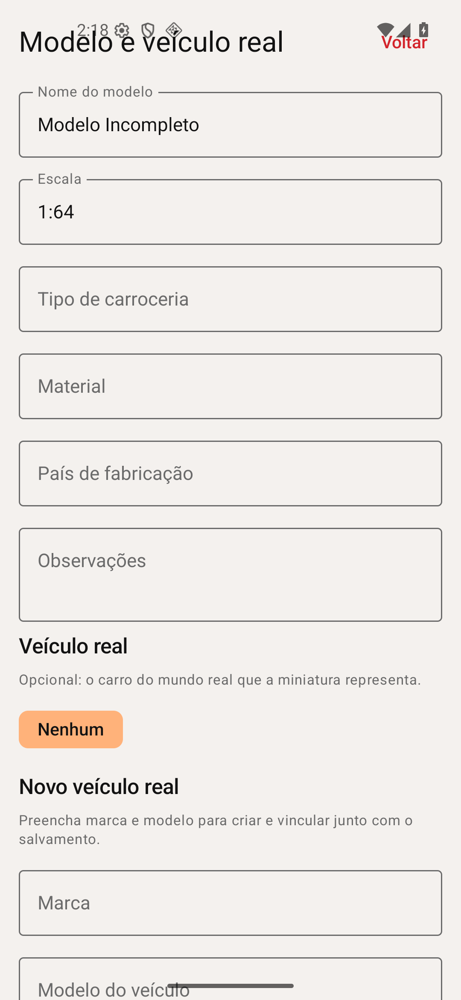
<figcaption>Figura 11.1 — Edicao modelo</figcaption>
</figure>
</div>

### Finalidade

Corrigir os dados do modelo e, opcionalmente, cadastrar o veículo real que ele representa.

### Como acessar

**Incompletos** → **Editar modelo**.

### Identificação visual

Título **Modelo e veículo real**, barra com **Voltar**, campos do modelo, seção
**Veículo real** e botão **Salvar**.

### Elementos da tela

| Elemento | Tipo | Onde fica | O que faz | Resultado |
|---|---|---|---|---|
| **Voltar** | botão | barra superior | descarta e volta | lista de incompletos |
| **Nome do modelo** | campo | corpo, 1º | corrige o nome | — |
| **Escala** | campo | corpo | corrige a escala | — |
| **Tipo de carroceria** | campo | corpo | carroceria | — |
| **Material** | campo | corpo | material | — |
| **País de fabricação** | campo | corpo | país | — |
| **Observações** | campo | corpo | notas | — |
| **Veículo real** | seletor | corpo | **Nenhum** ou veículo existente | vínculo |
| **Novo veículo real** | seção | corpo | **Marca**, **Modelo do veículo**, **Ano**, **País** | cria e vincula |
| **Salvar** | botão | fim | grava | volta com «Modelo atualizado.» |

### Como utilizar

1. Abra o modelo em **Incompletos**.
2. Corrija nome, escala e demais campos.
3. Para vincular o carro real, preencha **Marca** e **Modelo do veículo** em
   **Novo veículo real**.
4. Toque em **Salvar**.

### Exemplos

Modelo `Nissan Skyline GT-R R34`, veículo real marca `Nissan`, modelo `Skyline GT-R R34`,
ano `1999`.

### Regras e validações

- Nome obrigatório e com até 120 caracteres; escala `1:N`.
- Já existe modelo com o mesmo nome e escala? «Já existe um modelo com esse nome e escala.»
- Ano do veículo real validado («Ano do veículo real inválido.»).

### Mensagens e situações especiais

| Mensagem | Quando aparece | O que fazer |
|---|---|---|
| «Informe o nome do modelo.» | nome vazio | preencha |
| «Escala deve estar no formato 1:N.» | escala inválida | corrija |
| «Já existe um modelo com esse nome e escala.» | duplicidade | altere o nome ou a escala |
| «Não foi possível salvar. Tente de novo.» | falha de gravação | tente novamente |

### Dicas

- Corrija o modelo, não a variante, quando o erro for no nome do carro.

### Problemas comuns

| Sintoma | Causa provável | O que fazer |
|---|---|---|
| Salvar não conclui | validação pendente | confira as mensagens |
| Veículo real não aparece na lista | ainda não cadastrado | use **Novo veículo real** |

---

# 12. Edição de variante

> **Tela**: `catalog/variant/{variantId}/edit` · **Arquivo**: `feature/catalog/VariantFormScreen.kt` (`VariantEditScreen`) · **Acesso**: **Editar variante** em Incompletos · **Capturas**: `capturas/12-edicao-variante.png`

<div class="fig-row">
<figure>
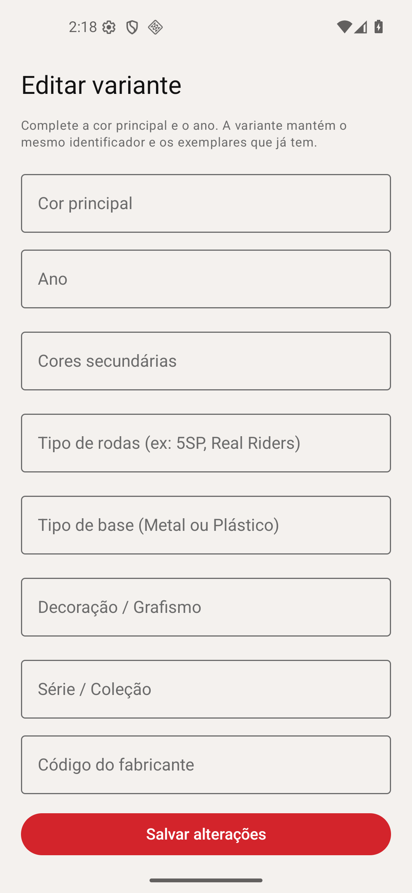
<figcaption>Figura 12.1 — Editar variante de um item de Incompletos</figcaption>
</figure>
</div>

### Finalidade

Completar ou corrigir a variante (cor principal e ano) sem criar uma nova unidade física.
A tela também reúne as ações **Arquivar variante**, **Unir com outra variante** e
**Separar exemplares**.

### Como acessar

**Incompletos** → **Editar variante**. O botão só existe para variante já criada.

### Identificação visual

Título **Editar variante**, aviso «Complete a cor principal e o ano…», os mesmos campos do
cadastro (sem a seção do exemplar), o botão **Salvar alterações** e a seção **Ações da variante**.

### Elementos da tela

| Elemento | Tipo | Onde fica | O que faz | Resultado |
|---|---|---|---|---|
| **Cor principal** | campo | corpo | corrige a cor | — |
| **Ano** | campo | corpo | corrige o ano | — |
| **Cores secundárias** a **Código do fabricante** | campos | corpo | demais atributos da variante | — |
| **Salvar alterações** | botão | fim | grava sem criar exemplar | volta com «Variante atualizada.» |
| **Arquivar variante** | ação | seção de ações | tira a variante das listas | exemplares e histórico preservados |
| **Unir com outra variante** | ação | seção de ações | move exemplares para outra variante | variante atual arquivada |
| **Separar exemplares** | ação | seção de ações | cria outra variante com os selecionados | histórico acompanha cada exemplar |

### Como utilizar

1. Abra a variante em **Incompletos**.
2. Preencha **Cor principal** e **Ano**.
3. Toque em **Salvar alterações**.
4. Para corrigir duplicidade de cadastro, use **Unir com outra variante** e escolha o destino.
5. Para dividir um grupo, use **Separar exemplares**, marque as unidades e confirme.

### Exemplos

Variante cadastrada sem ano: preencha `2025` e salve; o item sai dos incompletos.

### Regras e validações

- A edição **não** cria exemplar.
- Arquivar não apaga: exemplares, fotos, aquisições e histórico continuam guardados.
- Unir move os exemplares e arquiva a variante de origem.
- Separar cria uma nova variante e leva aquisição, avaliações, fotos e movimentações de cada
  exemplar selecionado.

### Mensagens e situações especiais

| Mensagem | Quando aparece | O que fazer |
|---|---|---|
| «Arquivar esta variante?» | ação de arquivar | confirme em **Arquivar** |
| «Não há outra variante ativa deste modelo para receber a união.» | unir sem destino | cadastre outra variante |
| «Esta variante não tem exemplares ativos para separar.» | separar sem unidades | — |

### Dicas

- Prefira **Unir** a excluir quando descobrir que duas variantes são a mesma.

### Problemas comuns

| Sintoma | Causa provável | O que fazer |
|---|---|---|
| A tela não abre pelo catálogo | o acesso existe só em **Incompletos** | abra por **Incompletos**, quando a variante estiver sem cor principal ou sem ano |
| O item continua em Incompletos | cor principal ou ano ainda vazios | preencha os dois campos e salve |

---

# 13. Adicionar exemplar

> **Tela**: `exemplar/add/{variantId}` · **Arquivo**: `feature/catalog/AddExemplarScreen.kt` · **Acesso**: toque na variante no Catálogo; **+ Exemplar** na lista · **Capturas**: `capturas/13-adicionar-exemplar.png`

<div class="fig-row">
<figure>

<figcaption>Figura 13.1 — Adicionar exemplar</figcaption>
</figure>
</div>

### Finalidade

Registrar uma nova unidade física de uma variante que já existe, com condição, localização e
aquisição.

### Como acessar

- **Catálogo** → toque no cartão da variante.
- **Exemplares** → **+ Exemplar**.

### Identificação visual

Título **Novo exemplar**, aviso «Esta variante já tem N exemplar(es).», condição,
localização, dados de compra e o botão **Salvar exemplar**.

### Elementos da tela

| Elemento | Tipo | Onde fica | O que faz | Resultado |
|---|---|---|---|---|
| **Condição** | chips | corpo | **Lacrado**, **Solto**, **Danificado**, **Restaurado**, **Incompleto** | condição da unidade |
| **Localização** | seletor | corpo | escolhe onde está | vínculo com localização |
| **Preço pago (R$)** | campo | corpo | valor da compra | — |
| **Frete (R$)** | campo | corpo | frete | — |
| **Desconto (R$)** | campo | corpo | desconto | — |
| **Data da compra** | campo de data | corpo | data da aquisição | — |
| **Loja** | campo | corpo | onde comprou | — |
| **Observações** | campo | corpo | notas | — |
| **Salvar exemplar** | botão | fim | grava a unidade | volta à tela anterior |

### Como utilizar

1. Abra a variante e toque em **+ Exemplar** (ou no cartão).
2. Escolha a **Condição**.
3. Selecione a **Localização** (ou deixe «Sem localização»).
4. Preencha preço, frete, desconto, data e loja, se quiser registrar a compra.
5. Toque em **Salvar exemplar**.

### Exemplos

Segunda unidade do Skyline: condição `Lacrado` e preço `19,90`. Em
`13-adicionar-exemplar.png` nenhuma localização estava cadastrada ainda, por isso o seletor
mostra «Sem localização» e o aviso «Nenhuma localização cadastrada ainda.».
O catálogo passa a mostrar «2 exemplares».

### Regras e validações

- O código interno é gerado automaticamente e é único (`HW-000001`, `HW-000002`…).
- O aviso «Esta variante já tem N exemplar(es).» é informativo, não bloqueia.
- Sem localização cadastrada, o seletor mostra «Nenhuma localização cadastrada ainda.» e a
  unidade fica «Sem localização».
- **Preço pago**, **Frete** e **Desconto** abrem teclado numérico com separador decimal, então
  dá para digitar `19,90` sem trocar de teclado.
- Data da compra inválida impede salvar.

### Mensagens e situações especiais

| Mensagem | Quando aparece | O que fazer |
|---|---|---|
| «Abra esta tela a partir de uma variante para vincular o exemplar.» | rota sem variante | volte e abra pela variante |
| «Nenhuma localização cadastrada ainda.» | sem localizações | crie em **Ajustes → Localizações** |

### Dicas

- Cadastre a localização antes; depois basta selecioná-la.
- Você pode registrar a aquisição agora ou depois, no detalhe.

### Problemas comuns

| Sintoma | Causa provável | O que fazer |
|---|---|---|
| Não salva | data inválida | use `dd/mm/aaaa` |
| Localização não aparece | nenhuma cadastrada | crie em Localizações |

---

# 14. Lista de exemplares

> **Tela**: `catalog/variant/{variantId}/exemplars` · **Arquivo**: `feature/catalog/ExemplarListScreen.kt` · **Acesso**: **Ver exemplares** no Catálogo · **Capturas**: `capturas/14-lista-exemplares.png`, `capturas/14c-lista-dois-exemplares.png`

<div class="fig-row">
<figure>
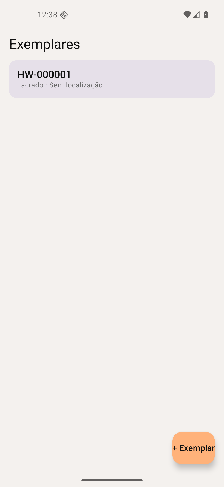
<figcaption>Figura 14.1 — Lista exemplares</figcaption>
</figure>

<figure>
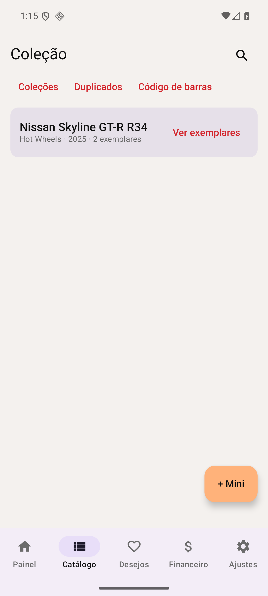
<figcaption>Figura 14.2 — Lista com dois exemplares</figcaption>
</figure>
</div>
<div class="fig-row">
<figure>
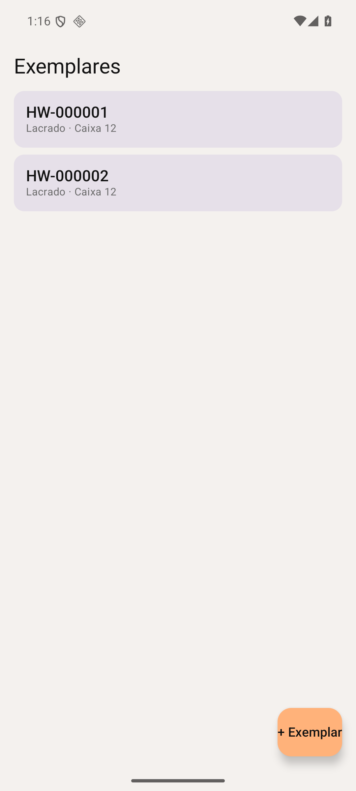
<figcaption>Figura 14.3 — Lista com dois exemplares, detalhe</figcaption>
</figure>
</div>

### Finalidade

Listar as unidades físicas de uma variante e abrir o detalhe de cada uma.

### Como acessar

**Catálogo** → **Ver exemplares** no cartão da variante.

### Identificação visual

Título **Exemplares**. Cada linha mostra código interno, condição e localização. No canto
inferior direito, **+ Exemplar**.

### Elementos da tela

| Elemento | Tipo | Onde fica | O que faz | Resultado |
|---|---|---|---|---|
| linha do exemplar | item | corpo | abre o detalhe | tela do exemplar |
| código interno | texto | linha | identifica a unidade | — |
| «Lacrado · Sem localização» | texto | linha | condição e localização | — |
| **+ Exemplar** | botão | canto inferior direito | adiciona unidade | tela Novo exemplar |

### Como utilizar

1. Abra **Ver exemplares**.
2. Toque em uma unidade para editar condição, aquisição, avaliações e localização.
3. Use **+ Exemplar** para registrar outra unidade da mesma variante.

### Exemplos

`HW-000001 · Lacrado · Caixa 12` e `HW-000004 · Lacrado · Sem localização`. Em `14b` o
segundo exemplar apareceu antes de ser movido; em `14c` o primeiro já está na `Caixa 12`.

### Regras e validações

- A lista mostra apenas exemplares **ativos**; arquivados não aparecem.
- A ordem segue o cadastro.

### Mensagens e situações especiais

| Mensagem | Quando aparece | O que fazer |
|---|---|---|
| «Nenhum exemplar ativo» | todas as unidades arquivadas | restaure/arquive corretamente |
| «Toque em + Exemplar para registrar a primeira unidade desta variante.» | lista vazia | cadastre a unidade |

### Dicas

- O código interno é a forma mais segura de diferenciar unidades iguais.

### Problemas comuns

| Sintoma | Causa provável | O que fazer |
|---|---|---|
| Unidade não aparece | foi arquivada | consulte o histórico pelo detalhe |

---

# 15. Detalhe do exemplar

> **Tela**: `exemplar/{exemplarId}` · **Arquivo**: `feature/catalog/ExemplarDetailScreen.kt` · **Acesso**: lista de exemplares · **Capturas**: `capturas/15-detalhe-exemplar.png` a `capturas/15e-detalhe-exemplar-movido.png`

<div class="fig-row">
<figure>
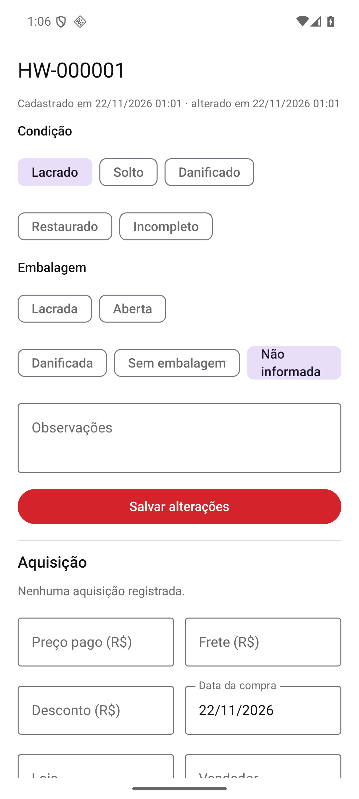
<figcaption>Figura 15.1 — Detalhe do exemplar</figcaption>
</figure>

<figure>

<figcaption>Figura 15.2 — Aquisição registrada</figcaption>
</figure>
</div>
<div class="fig-row">
<figure>
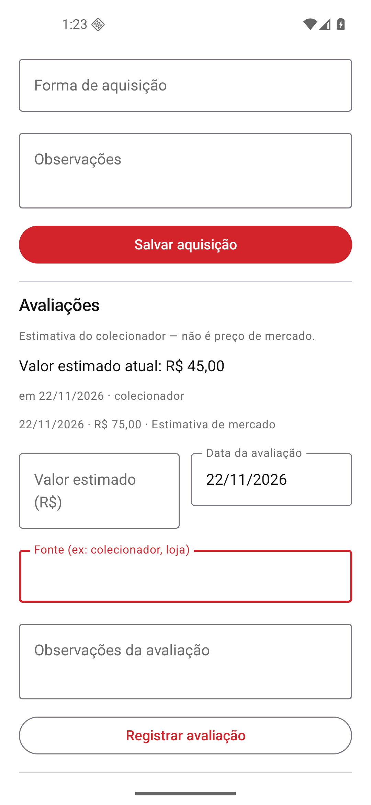
<figcaption>Figura 15.3 — Avaliação registrada</figcaption>
</figure>

<figure>
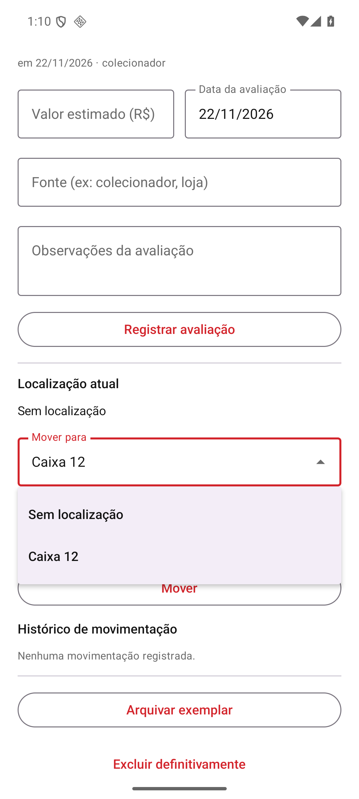
<figcaption>Figura 15.4 — Movimentação em andamento</figcaption>
</figure>
</div>
<div class="fig-row">
<figure>
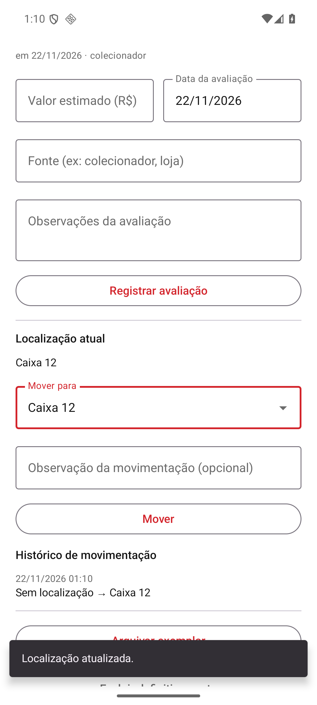
<figcaption>Figura 15.5 — Exemplar movido de localização</figcaption>
</figure>

<figure>
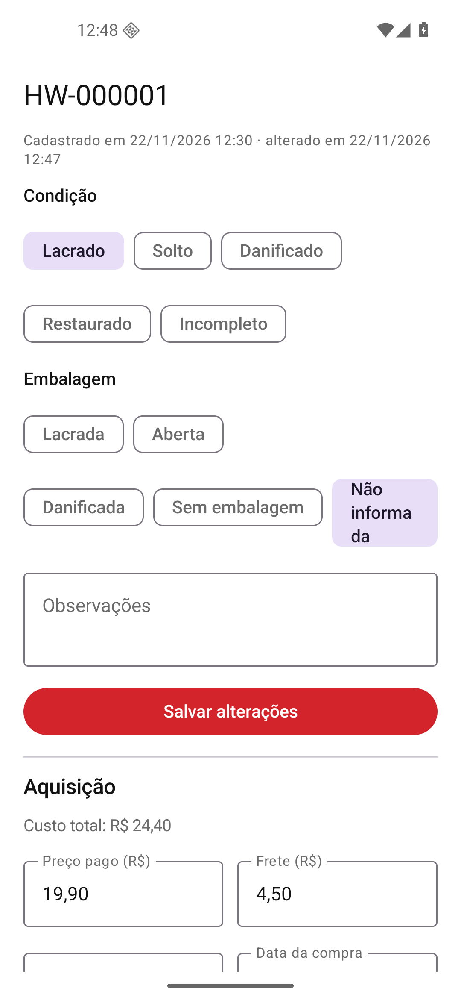
<figcaption>Figura 15.6 — Detalhe de um exemplar criado com foto: a imagem não aparece nesta tela</figcaption>
</figure>
</div>

### Finalidade

Concentrar tudo sobre uma unidade física: condição e embalagem, aquisição, avaliações,
localização, movimentação, arquivamento e exclusão.

### Como acessar

**Catálogo** → **Ver exemplares** → toque no código interno.

### Identificação visual

Título com o código interno (`HW-000001`), datas de cadastro/alteração, chips de condição,
embalagem, seção **Aquisição**, **Avaliações**, **Localização atual**, **Histórico de
movimentação** e as ações de arquivar/excluir.

### Elementos da tela

| Elemento | Tipo | Onde fica | O que faz | Resultado |
|---|---|---|---|---|
| **Condição** | chips | corpo | altera a condição | salva com **Salvar alterações** |
| **Embalagem** | chips | corpo | **Lacrada**, **Aberta**, **Danificada**, **Sem embalagem**, **Não informada** | idem |
| **Observações** | campo | corpo | notas da unidade | idem |
| **Salvar alterações** | botão | corpo | grava condição/embalagem/notas | confirmação |
| **Preço pago (R$)**, **Frete (R$)**, **Desconto (R$)** | campos | Aquisição | dados da compra | — |
| **Data da compra**, **Loja**, **Vendedor**, **Forma de aquisição** | campos | Aquisição | dados da compra | — |
| **Salvar aquisição** | botão | Aquisição | grava a aquisição | «Custo total: R$ …» |
| **Valor estimado (R$)** | campo | Avaliações | valor da estimativa | — |
| **Data da avaliação** | campo | Avaliações | data | — |
| **Fonte (ex: colecionador, loja)** | campo | Avaliações | origem da estimativa | — |
| **Observações da avaliação** | campo | Avaliações | notas | — |
| **Registrar avaliação** | botão | Avaliações | acrescenta avaliação | «Valor estimado atual: R$ …» |
| **Localização atual** | indicador | corpo | mostra onde está | — |
| **Mover para** | seletor | corpo | escolhe o destino | — |
| **Observação da movimentação (opcional)** | campo | corpo | nota da mudança | — |
| **Mover** | botão | corpo | registra a movimentação | entrada no histórico |
| **Disponibilidade** | botão | seção **Negociação** | define se a unidade está para venda, troca, ambas ou indisponível | estado mostrado na ficha e nas listas |
| **Negociar** | botão | seção **Negociação** | abre a negociação desta unidade | tela **Negociação** (capítulo 22) |
| **Arquivar exemplar** | ação | fim | tira do acervo sem apagar | badge «Arquivado — fora do acervo» |
| **Excluir definitivamente** | ação | fim | exclui se não houver vínculos | mensagem de bloqueio quando há vínculos |

### Como utilizar

1. Abra a unidade.
2. Ajuste condição e embalagem e toque em **Salvar alterações**.
3. Em **Aquisição**, informe preço, frete, desconto, data, loja, vendedor e forma; toque em
   **Salvar aquisição**. O app exibe o custo total.
4. Em **Avaliações**, informe valor, data, fonte e observações; toque em **Registrar avaliação**.
5. Em **Localização atual**, escolha o destino em **Mover para** e toque em **Mover**.
6. Em **Negociação**, use **Disponibilidade** para marcar venda/troca e **Negociar** para
   abrir a negociação (capítulo 22) — funciona mesmo quando esta é a única unidade da variante.
7. Se precisar retirar do acervo, use **Arquivar exemplar**.

### Exemplos

Aquisição `19,90 + 4,50` → «Custo total: R$ 24,40»; avaliação `45,00` em `22/11/2026`,
fonte `colecionador` → «Valor estimado atual: R$ 45,00»; movimentação
`Sem localização → Caixa 12`.

### Regras e validações

- Avaliações são **histórico**: cada registro é acrescentado; o valor atual é o mais recente.
- A estimativa é do colecionador, não preço de mercado — o app declara isso na tela.
- Exclusão é bloqueada quando há vínculos: «Exclusão bloqueada: este exemplar tem vínculos.»
- Arquivar preserva fotos, aquisição, avaliações e histórico.
- A aquisição sem valor é registrada, mas não entra no investido.
- **Preço pago**, **Frete** e **Desconto** abrem teclado numérico com separador decimal.
- O detalhe **não** exibe as fotos anexadas no cadastro: elas ficam vinculadas ao exemplar,
  entram no backup e são contadas nele, mas não têm galeria nesta tela (Figura 15.6).
- A seção **Negociação** mostra **Disponibilidade** e **Negociar** para qualquer unidade
  possuída, inclusive a única da variante (Figura 22.2); nada aqui exige duplicata.

### Mensagens e situações especiais

| Mensagem | Quando aparece | O que fazer |
|---|---|---|
| «Exemplar não encontrado. Ele pode ter sido arquivado.» | rota inválida | volte à lista |
| «Nenhuma aquisição registrada.» | sem aquisição | preencha a seção |
| «Aquisição registrada sem valor informado.» | preço em branco | informe o preço |
| «Nenhuma avaliação registrada.» | sem estimativa | registre uma |
| «Nenhuma movimentação registrada.» | sem mudança de local | use **Mover** |

### Dicas

- Registre data e fonte da avaliação; isso permite recalcular o estimado depois.

### Problemas comuns

| Sintoma | Causa provável | O que fazer |
|---|---|---|
| Não consigo excluir | existem vínculos | use **Arquivar exemplar** |
| Custo total não aparece | falta preço | informe **Preço pago (R$)** |

---

# 16. Coleções

> **Tela**: `catalog/collections` · **Arquivo**: `feature/organization/CollectionsScreen.kt` · **Acesso**: **Coleções** no Catálogo · **Capturas**: `capturas/16-colecoes-vazio.png`, `capturas/16b-colecoes-com-uma.png`

<div class="fig-row">
<figure>
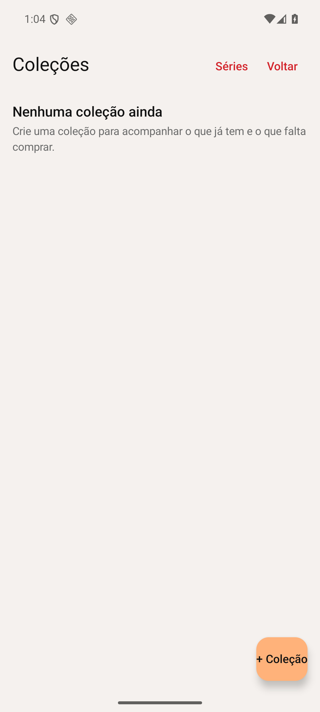
<figcaption>Figura 16.1 — Colecoes vazio</figcaption>
</figure>

<figure>
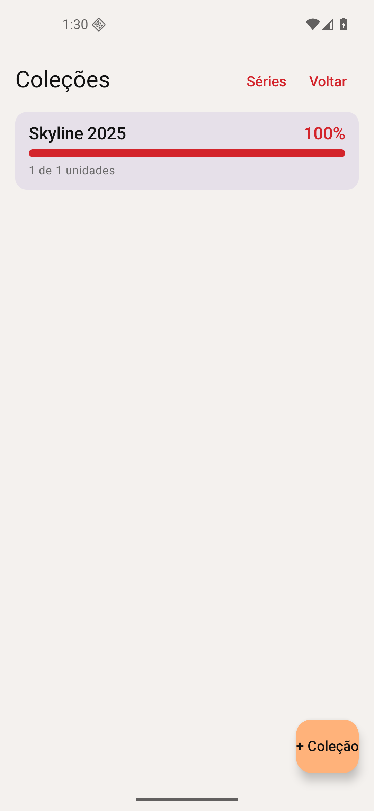
<figcaption>Figura 16.2 — Colecoes com uma</figcaption>
</figure>
</div>

### Finalidade

Acompanhar o que já existe e o que falta em cada coleção planejada, com percentual e unidades.

### Como acessar

**Catálogo** → **Coleções**.

### Identificação visual

Título **Coleções**, ação **Séries** no topo, lista de coleções com percentual e
«N de M unidades», **+ Coleção** no canto inferior direito e **Voltar**.

### Elementos da tela

| Elemento | Tipo | Onde fica | O que faz | Resultado |
|---|---|---|---|---|
| **Séries** | botão | barra superior | abre as séries do fabricante | tela Séries |
| **Voltar** | botão | barra superior | retorna ao catálogo | — |
| **+ Coleção** | botão | canto inferior direito | cria coleção | tela Nova coleção |
| item da coleção | área tocável | corpo | abre o detalhe | tela da coleção |
| **%** | indicador | item | progresso em unidades | — |
| «N de M unidades» | texto | item | atendido/esperado | — |
| «Sem itens ainda» | texto | item | coleção vazia | — |

### Como utilizar

1. Toque em **+ Coleção**, dê um nome e salve.
2. Abra a coleção e adicione itens (**+ Item**).
3. Acompanhe o percentual na lista.

### Exemplos

`Skyline 2025` · `100%` · `1 de 1 unidades`.

### Regras e validações

- O percentual considera **unidades** esperadas, não o número de linhas.
- Item marcado como não colecionável não conta como unidade esperada.
- Coleções arquivadas não aparecem na lista.

### Mensagens e situações especiais

| Mensagem | Quando aparece | O que fazer |
|---|---|---|
| «Nenhuma coleção ainda» | lista vazia | toque em **+ Coleção** |
| «Crie uma coleção para acompanhar o que já tem e o que falta comprar.» | idem | idem |
| «Carregando coleções…» | leitura | aguarde |

### Dicas

- Use uma coleção por tema (série, ano, edição) para ver o que falta.

### Problemas comuns

| Sintoma | Causa provável | O que fazer |
|---|---|---|
| Percentual não sobe | item não vinculado a variante possuída | confira o item na coleção |

---

# 17. Detalhe de coleção

> **Tela**: `collections/{collectionId}` · **Arquivo**: `feature/organization/CollectionDetailScreen.kt` · **Acesso**: item da lista de coleções · **Capturas**: `capturas/17-detalhe-colecao-vazio.png`, `capturas/17b-adicionar-item-colecao.png`, `capturas/17c-detalhe-colecao-com-item.png`

<div class="fig-row">
<figure>
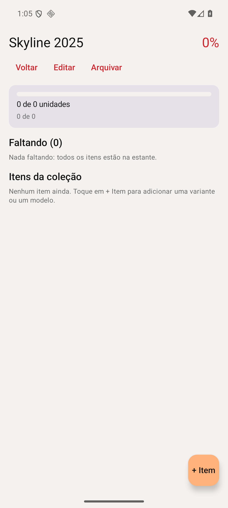
<figcaption>Figura 17.1 — Detalhe colecao vazio</figcaption>
</figure>

<figure>

<figcaption>Figura 17.2 — Adicionar item colecao</figcaption>
</figure>
</div>
<div class="fig-row">
<figure>
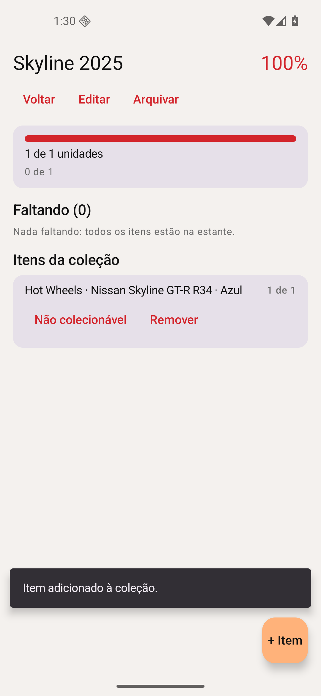
<figcaption>Figura 17.3 — Detalhe colecao com item</figcaption>
</figure>
</div>

### Finalidade

Mostrar o progresso da coleção, o que falta e os itens, permitindo editar, arquivar e
adicionar/remover itens.

### Como acessar

**Catálogo** → **Coleções** → toque na coleção.

### Identificação visual

Título com o nome da coleção, percentual à direita, **Voltar**, **Editar**, **Arquivar**,
«N de M unidades», seção **Faltando** e **Itens da coleção**, **+ Item** no canto inferior.

### Elementos da tela

| Elemento | Tipo | Onde fica | O que faz | Resultado |
|---|---|---|---|---|
| **Voltar** | botão | topo | retorna | lista de coleções |
| **Editar** | botão | topo | abre o formulário | tela Editar coleção |
| **Arquivar** | botão | topo | arquiva a coleção | sai da lista e das contagens |
| **+ Item** | botão | canto inferior direito | abre o seletor de itens | folha «Adicionar item» |
| **Variante** / **Modelo** | opções | folha | tipo do item | busca correspondente |
| **Buscar…** | campo | folha | procura variante/modelo | lista |
| **Fechar** | botão | folha | fecha sem adicionar | — |
| **Não colecionável** / **Colecionável** | botão | item | alterna se o item conta | recálculo |
| **Remover** | botão | item | remove o item da coleção | recálculo |

### Como utilizar

1. Abra a coleção.
2. Toque em **+ Item**, escolha **Variante** ou **Modelo**, busque e toque no item.
3. Ajuste itens com **Não colecionável** ou **Remover**, se necessário.
4. Use **Editar** para nome/descrição e **Arquivar** para tirar a coleção das listas.

### Exemplos

Coleção `Skyline 2025` com um item: `100%`, `1 de 1 unidades`, «Nada faltando: todos os itens
estão na estante.».

### Regras e validações

- Item não colecionável conta 0 unidades esperadas e 0 atendidas.
- O item só conta como atendido se existir exemplar possuído da variante (ou de alguma
  variante do modelo).
- Arquivar não apaga itens nem variantes.

### Mensagens e situações especiais

| Mensagem | Quando aparece | O que fazer |
|---|---|---|
| «Coleção não encontrada. Ela pode ter sido arquivada.» | rota inválida | volte à lista |
| «Nada faltando: todos os itens estão na estante.» | tudo atendido | — |
| «Nenhum item ainda. Toque em + Item…» | coleção vazia | adicione item |
| «Item adicionado à coleção.» | após adicionar | — |
| «Arquivar coleção?» | ação de arquivar | confirme |

### Dicas

- Use **Modelo** como item quando quiser “qualquer variante deste modelo”.

### Problemas comuns

| Sintoma | Causa provável | O que fazer |
|---|---|---|
| Item aparece faltando | nenhum exemplar possuído | cadastre a unidade |
| Percentual > 100% | não ocorre: o cálculo limita ao esperado | — |

---

# 18. Formulário de coleção

> **Tela**: `collections/form` · **Arquivo**: `feature/organization/CollectionFormScreen.kt` · **Acesso**: **+ Coleção**; **Editar** no detalhe · **Capturas**: `capturas/18-formulario-colecao.png`

<div class="fig-row">
<figure>
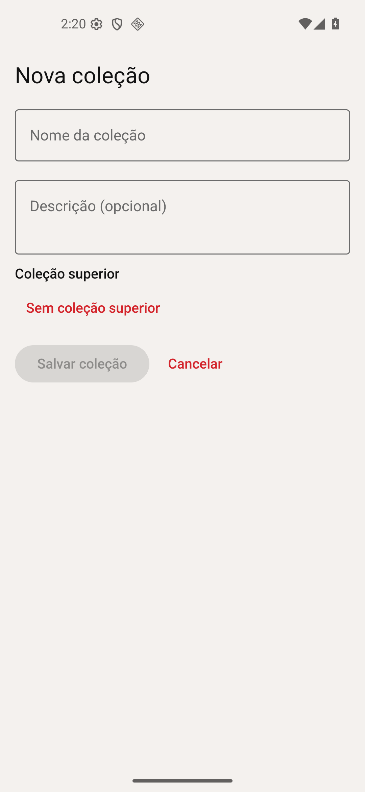
<figcaption>Figura 18.1 — Formulario colecao</figcaption>
</figure>
</div>

### Finalidade

Criar ou editar uma coleção, com nome, descrição e coleção superior.

### Como acessar

- **Coleções** → **+ Coleção**.
- **Detalhe da coleção** → **Editar**.

### Identificação visual

Título **Nova coleção** ou **Editar coleção**, campos, seletor **Coleção superior** e os
botões **Salvar coleção** e **Cancelar**.

### Elementos da tela

| Elemento | Tipo | Onde fica | O que faz | Resultado |
|---|---|---|---|---|
| **Nome da coleção** | campo | corpo | nome | — |
| **Descrição (opcional)** | campo | corpo | descrição | — |
| **Coleção superior** | seletor | corpo | hierarquia | **Sem coleção superior** ou outra coleção |
| **Salvar coleção** | botão | fim | grava | volta à lista/detalhe |
| **Cancelar** | botão | fim | descarta | volta |

### Como utilizar

1. Informe o nome.
2. Opcionalmente, descreva e escolha uma coleção superior.
3. Toque em **Salvar coleção**.

### Exemplos

`Skyline 2025`, sem descrição, sem coleção superior.

### Regras e validações

- O nome é obrigatório.
- A coleção superior não pode criar ciclo (o seletor lista apenas coleções válidas).

### Mensagens e situações especiais

| Mensagem | Quando aparece | O que fazer |
|---|---|---|
| «Sem coleção superior» | nenhuma hierarquia | comportamento normal |

### Dicas

- Use coleções superiores para agrupar temas (ex.: “JDM” → “Skyline”).

### Problemas comuns

| Sintoma | Causa provável | O que fazer |
|---|---|---|
| Não salva | nome vazio | preencha o nome |

---

# 19. Séries

> **Tela**: `catalog/series` · **Arquivo**: `feature/organization/SeriesScreen.kt` · **Acesso**: **Séries** em Coleções · **Capturas**: `capturas/19-series.png`

<div class="fig-row">
<figure>
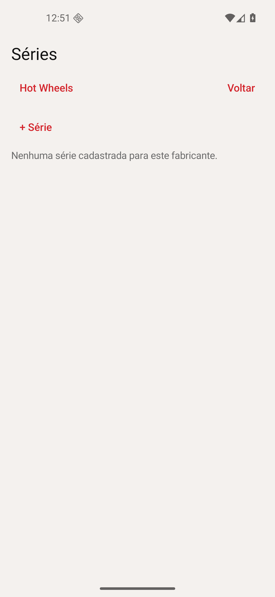
<figcaption>Figura 19.1 — Series</figcaption>
</figure>
</div>

### Finalidade

Ver e manter as séries do fabricante, com hierarquia, renomeação e arquivamento.

### Como acessar

**Catálogo** → **Coleções** → **Séries**.

### Identificação visual

Título **Séries**, seletor de fabricante no topo (o nome do fabricante em vermelho),
**+ Série** logo abaixo e **Voltar** à direita; cada série tem as ações **Renomear** e
**Arquivar**.

### Elementos da tela

| Elemento | Tipo | Onde fica | O que faz | Resultado |
|---|---|---|---|---|
| seletor de **Fabricante** | seletor | topo | escolhe o fabricante | lista daquele fabricante |
| **+ Série** | botão | topo, sob o seletor de fabricante | cria série | diálogo |
| **Renomear** | botão | item | abre o diálogo de edição | — |
| **Arquivar** | botão | item | arquiva a série | variantes perdem o agrupamento |
| **Voltar** | botão | topo | retorna às coleções | — |
| **Nome da série** | campo | diálogo | nome | — |
| **Série superior** | seletor | diálogo | hierarquia | **Sem série superior** |
| **Salvar série** | botão | diálogo | grava | — |

### Como utilizar

1. Escolha o **Fabricante**.
2. Toque em **+ Série**, informe o nome e, se quiser, a série superior.
3. Use **Renomear** ou **Arquivar** nos itens existentes.

### Exemplos

Fabricante `Hot Wheels`, série `Mainline 2025`, sem série superior.

### Regras e validações

- A série pertence a um fabricante.
- Arquivar a série não apaga as variantes; elas apenas deixam de estar agrupadas.

### Mensagens e situações especiais

| Mensagem | Quando aparece | O que fazer |
|---|---|---|
| «Nenhuma série cadastrada para este fabricante.» | lista vazia | crie com **+ Série** |
| «Arquivar série?» | ação | confirme |
| «As variantes continuam existindo; elas só perdem o agrupamento por série.» | diálogo | — |

### Dicas

- Cadastre a série antes da variante para aparecer no seletor **Série / Coleção**.

### Problemas comuns

| Sintoma | Causa provável | O que fazer |
|---|---|---|
| Série não aparece na variante | outro fabricante selecionado | confira o fabricante |

---

# 20. Leitura de código de barras

> **Tela**: `catalog/barcode` · **Arquivo**: `feature/recognition/BarcodeScanScreen.kt` · **Acesso**: **Código de barras** no Catálogo · **Capturas**: `capturas/20-codigo-barras.png`

<div class="fig-row">
<figure>
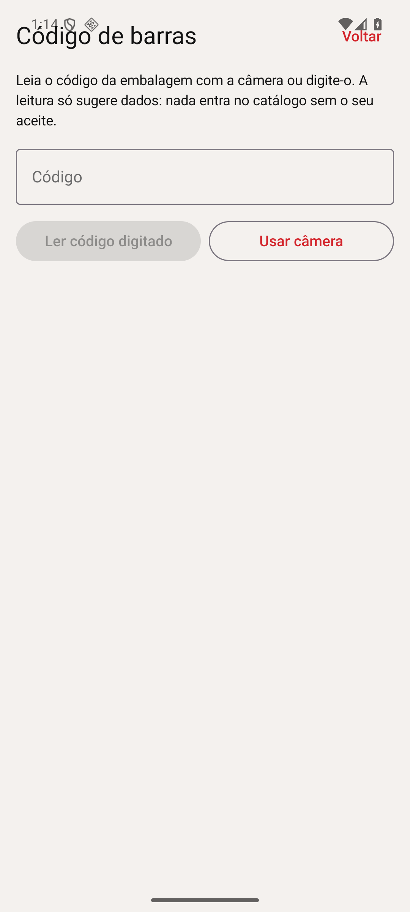
<figcaption>Figura 20.1 — Codigo barras</figcaption>
</figure>
</div>

### Finalidade

Ler o código da embalagem e **sugerir** dados. Nada entra no catálogo sem confirmação.

### Como acessar

**Catálogo** → **Código de barras**.

### Identificação visual

Título **Código de barras**, aviso de que a leitura só sugere dados, campo **Código**,
**Ler código digitado**, **Usar câmera** e, após a leitura, sugestões e correspondências.

### Elementos da tela

| Elemento | Tipo | Onde fica | O que faz | Resultado |
|---|---|---|---|---|
| **Código** | campo | corpo | digita o código | — |
| **Ler código digitado** | botão | corpo | processa o código | sugestões ou «Não identificado» |
| **Usar câmera** | botão | corpo | abre a câmera | leitura |
| **Sugestões da leitura** | seção | corpo | campos sugeridos | — |
| **Revisar e aplicar** | botão | corpo | abre a revisão | — |
| **Salvar leitura** | botão | revisão | registra a leitura | mensagem de registrado |
| **Descartar** | botão | revisão | descarta | — |
| **Correspondências no catálogo** | seção | corpo | variantes parecidas | — |
| **Adicionar exemplar desta variante** | botão | corpo | abre o cadastro de exemplar | tela Novo exemplar |
| **Cadastrar manualmente** | botão | corpo | abre o cadastro com o código | tela Nova miniatura |
| **Confiança: N%** | indicador | revisão | confiança da sugestão | — |

### Como utilizar

1. Digite o código e toque em **Ler código digitado**, ou use **Usar câmera**.
2. Se a leitura for conclusiva, revise as **Sugestões da leitura**.
3. Toque em **Salvar leitura** para registrar, ou **Descartar**.
4. Se houver correspondência, use **Adicionar exemplar desta variante**.
5. Se preferir, use **Cadastrar manualmente**; o código lido vira **Código do fabricante**.

### Exemplos

Código `7891234567890`: na captura `20-codigo-barras.png` a leitura não achou variante
parecida, então mostra «Nenhuma correspondência no catálogo.» e oferece **Cadastrar
manualmente**; a sugestão traz o próprio código em **Sugestões da leitura**.

### Regras e validações

- Leitura é **assistente**: produz sugestão com confiança e origem; exige confirmação.
- A decodificação óptica por câmera não foi executada nesta documentação — ver `lac-01` em
  `LIMITACOES_DOCUMENTACAO.md`; a tela, a entrada manual e as mensagens foram verificadas.
- «Não identificado» não preenche campo algum.
- Nenhum exemplar é criado automaticamente.
- Recusa de câmera mantém o código digitado funcionando.

### Mensagens e situações especiais

| Mensagem | Quando aparece | O que fazer |
|---|---|---|
| «Não foi possível ler o código» | falha de leitura | digite o código |
| «A leitura não foi conclusiva…» | sem identificação | preencha manualmente |
| «Nenhuma correspondência no catálogo.» | sem variante parecida | cadastre manualmente |
| «Leitura registrada com o código lido.» | após salvar | — |
| «Sem permissão de câmera…» | permissão negada | digite o código |

### Dicas

- A leitura não substitui a conferência do carrinho: confirme os dados.

### Problemas comuns

| Sintoma | Causa provável | O que fazer |
|---|---|---|
| Nada foi cadastrado | leitura só sugere | use **Cadastrar manualmente** |
| Câmera não abre | permissão | digite o código |

---

# 21. Duplicados

> **Tela**: `duplicates` · **Arquivo**: `feature/duplicates/DuplicatesScreen.kt` · **Acesso**: **Duplicados** no Catálogo · **Capturas**: `capturas/21-duplicados.png`, `capturas/21b-duplicados-com-grupo.png`, `capturas/21c-disponibilidade.png`

<div class="fig-row">
<figure>
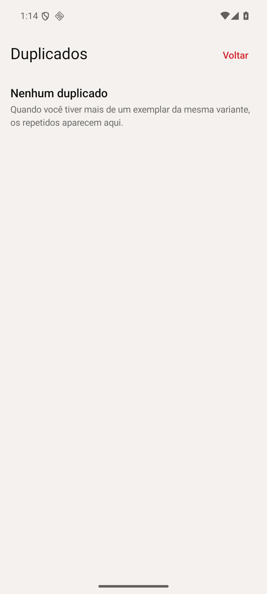
<figcaption>Figura 21.1 — Duplicados</figcaption>
</figure>

<figure>
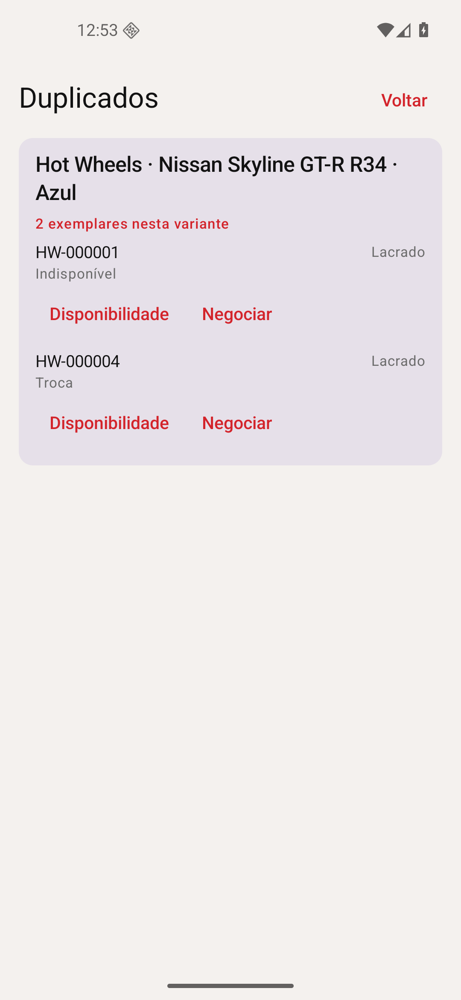
<figcaption>Figura 21.2 — Duplicados com grupo</figcaption>
</figure>
</div>
<div class="fig-row">
<figure>
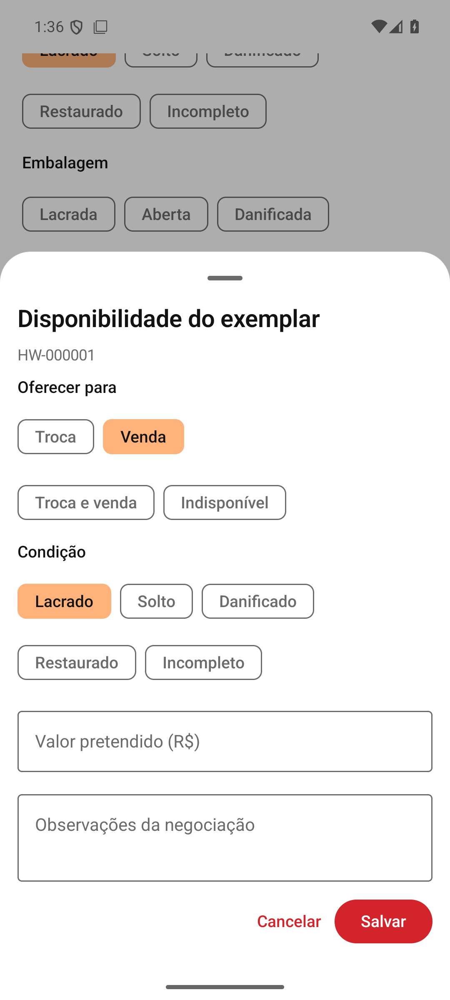
<figcaption>Figura 21.3 — Folha «Disponibilidade do exemplar», com Troca, Venda,
Troca e venda e Indisponível, condição, valor pretendido e observações</figcaption>
</figure>
</div>

### Finalidade

Mostrar variantes com mais de um exemplar e abrir a negociação de cada unidade.
Duplicidade aqui é um recorte de consulta: **não** é pré-condição para disponibilizar nem
negociar. A mesma disponibilidade e a mesma negociação existem na lista de exemplares e na
ficha do exemplar (capítulo 22).

### Como acessar

**Catálogo** → **Duplicados**.

### Identificação visual

Título **Duplicados**, **Voltar**, agrupamento por variante com «N exemplares nesta
variante» e, por unidade, código, condição, disponibilidade e **Negociar**.

### Elementos da tela

| Elemento | Tipo | Onde fica | O que faz | Resultado |
|---|---|---|---|---|
| **Voltar** | botão | topo | retorna | catálogo |
| grupo da variante | cabeçalho | corpo | identifica fabricante/modelo/cor | — |
| **Disponibilidade** | botão | unidade | define troca/venda/ambas/indisponível | — |
| **Negociar** | botão | unidade | abre a negociação | tela Negociação |
| **Indisponível** / **Em negociação** | indicador | unidade | estado atual | — |

### Como utilizar

1. Abra **Duplicados**.
2. Confira o grupo e as unidades.
3. Use **Disponibilidade** para marcar se a unidade está para troca, venda, ambas ou
   indisponível.
4. Toque em **Negociar** para abrir o histórico e registrar a negociação.

### Exemplos

`Hot Wheels · Nissan Skyline GT-R R34 · Azul` — «2 exemplares nesta variante»:
`HW-000001` **Indisponível** e `HW-000004` **Troca**.

### Regras e validações

- Duplicado = mesma **variante**; variantes diferentes do mesmo modelo não entram.
- Unidade reservada por negociação ativa aparece «Em negociação» e não pode entrar em outra.
- Quem tem uma só unidade da variante também pode disponibilizar ou negociar: a ficha e a
  lista de exemplares mostram **Disponibilidade** e **Negociar**, com o aviso «Último
  exemplar da variante» antes de gravar ou de abrir a negociação.

### Mensagens e situações especiais

| Mensagem | Quando aparece | O que fazer |
|---|---|---|
| «Nenhum duplicado» | nenhuma variante repetida | — |
| «Quando você tiver mais de um exemplar da mesma variante, os repetidos aparecem aqui.» | lista vazia | cadastre outra unidade |
| «Carregando duplicados…» | leitura | aguarde |

### Dicas

- Marque a disponibilidade antes de negociar para não esquecer o estado.

### Problemas comuns

| Sintoma | Causa provável | O que fazer |
|---|---|---|
| Meu “duplicado” não aparece | é outra variante | confira cor/ano |

---

# 22. Negociação

> **Tela**: `duplicates/{exemplarId}/negotiation` · **Arquivo**: `feature/duplicates/NegotiationScreen.kt` · **Acesso**: **Negociar** em Duplicados, na lista de exemplares ou na ficha · **Capturas**: `capturas/22-negociacao.png`, `capturas/22b-ultimo-exemplar.png`, `capturas/22c-negociar-na-ficha.png`

<div class="fig-row">
<figure>
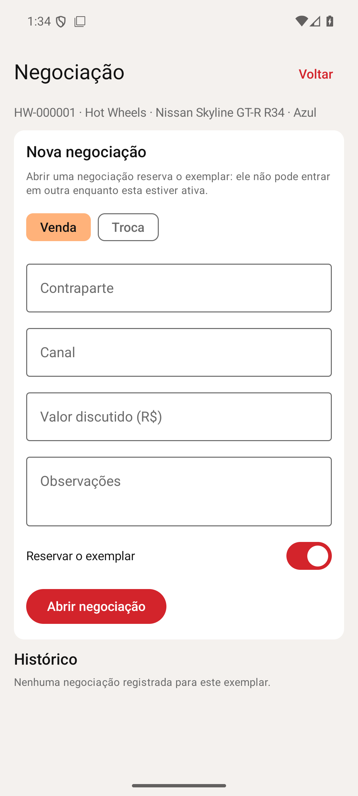
<figcaption>Figura 22.1 — Negociação de uma unidade</figcaption>
</figure>

<figure>
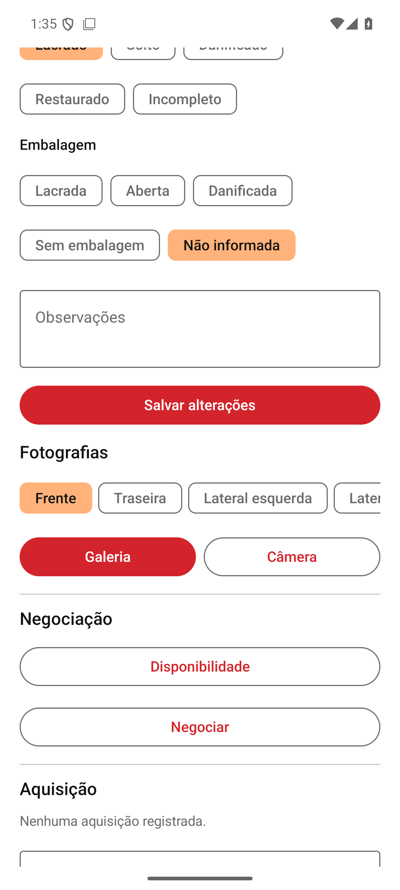
<figcaption>Figura 22.2 — A seção Negociação na ficha da unidade, com Disponibilidade e
Negociar mesmo quando ela é a única da variante</figcaption>
</figure>
</div>
<div class="fig-row">
<figure>
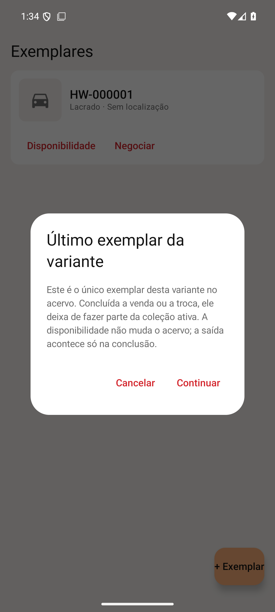
<figcaption>Figura 22.3 — Aviso «Último exemplar da variante» antes de abrir a negociação</figcaption>
</figure>
</div>

### Finalidade

Abrir, acompanhar e concluir a venda ou troca de **qualquer exemplar do acervo**, com
histórico. Duplicidade não é pré-condição: o exemplar único da variante também pode ser
vendido ou trocado, com o aviso de preservação da coleção.

### Como acessar

**Duplicados** → **Negociar** na unidade, ou **Negociar** na lista de exemplares de uma
variante, ou **Negociar** na seção **Negociação** da ficha do exemplar. As três origens
levam à mesma tela.

### Identificação visual

Título **Negociação**, código e identificação da variante, seção **Nova negociação** com
**Venda**/**Troca**, campos, **Reservar o exemplar**, **Abrir negociação** e **Histórico**.

### Elementos da tela

| Elemento | Tipo | Onde fica | O que faz | Resultado |
|---|---|---|---|---|
| **Venda** / **Troca** | opções | corpo | tipo da negociação | — |
| **Contraparte** | campo | corpo | com quem negocia | — |
| **Canal** | campo | corpo | onde negocia | — |
| **Valor discutido (R$)** | campo | corpo | valor | — |
| **Observações** | campo | corpo | notas | — |
| **Reservar o exemplar** | interruptor | corpo | marca a unidade como reservada ao abrir | — |
| **Abrir negociação** | botão | corpo | cria negociação | estado ativo |
| **Concluir venda** | ação | ativa | fecha como venda | exemplar sai do acervo |
| **Concluir troca** | ação | ativa | fecha como troca | exemplar sai e outro entra |
| **Cancelar negociação** | ação | ativa | cancela | unidade volta a ficar disponível |
| **Valor recebido (R$)**, **Data**, **Exemplar recebido**, **Observação da troca** | campos | diálogos de conclusão | dados finais | — |
| **Confirmar cancelamento** / **Manter** | botões | diálogo | confirmam/recusam | — |

### Como utilizar

1. Escolha **Venda** ou **Troca**.
2. Preencha contraparte, canal, valor e observações.
3. Toque em **Abrir negociação** (ou **Reservar o exemplar** para apenas reservar).
4. Ao concluir, use **Concluir venda** ou **Concluir troca** e informe valor/data.
5. Para desistir, use **Cancelar negociação**.

### Exemplos

Venda de `HW-000001` por `R$ 50,00`, contraparte `Colecionador Demo`, canal `WhatsApp`;
concluída, a unidade sai do investido e aparece em **Vendas e trocas** no Financeiro. O
mesmo fluxo vale para o único exemplar de uma variante (Figuras 22.2 e 22.3): o aviso só
explica a saída do acervo e não impede a venda nem a troca.

### Regras e validações

- Abrir negociação reserva o exemplar; ele não pode entrar em outra enquanto ativa.
- Quando a variante tem um único exemplar no acervo, o aviso «Último exemplar da variante»
  aparece antes de abrir a negociação: **Cancelar** não navega nem grava, **Continuar** segue.
  Com negociação já ativa o aviso não aparece.
- O tipo (**Venda**/**Troca**) é pré-selecionado pela disponibilidade registrada do exemplar
  (`Venda` → venda, `Troca` → troca, demais casos → venda) e continua editável.
- Disponibilidade e negociação convivem: com negociação ativa, «Em negociação» aparece junto
  do estado registrado, e a disponibilidade continua editável.
- Concluir venda/troca altera o status do exemplar (vendido/trocado), retirando-o do acervo.
- Cancelar mantém o registro no histórico e devolve a disponibilidade.
- O custo histórico de aquisição não muda.

### Mensagens e situações especiais

| Mensagem | Quando aparece | O que fazer |
|---|---|---|
| «Carregando negociação…» | leitura | aguarde |
| «Negociação Aberta/Reservada/Concluída/Cancelada» | histórico | — |
| «O exemplar volta a ficar disponível e o cancelamento continua no histórico.» | cancelar | confirme |
| «Nenhuma negociação registrada para este exemplar.» | sem histórico | abra uma |

### Dicas

- Registre o valor discutido desde o início; o histórico mostra a evolução.

### Problemas comuns

| Sintoma | Causa provável | O que fazer |
|---|---|---|
| Unidade “Em negociação” | negociação ativa | conclua ou cancele |
| Não aparece no investido | vendida/trocada | comportamento esperado |

---

# 23. Lista de desejos

> **Tela**: `wishlist` · **Arquivo**: `feature/wishlist/WishlistScreen.kt` · **Acesso**: aba **Desejos** · **Capturas**: `capturas/23-desejos-vazio.png`, `capturas/23b-desejos-com-item.png`

<div class="fig-row">
<figure>

<figcaption>Figura 23.1 — Desejos vazio</figcaption>
</figure>

<figure>
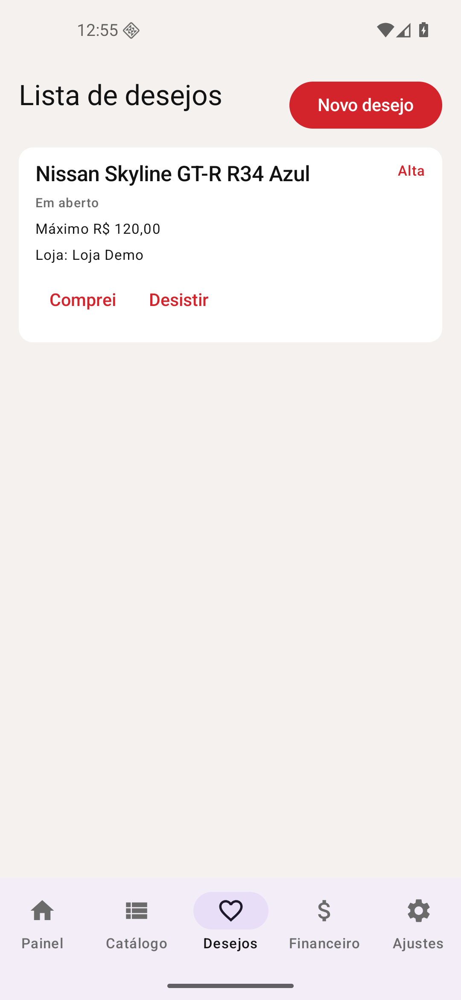
<figcaption>Figura 23.2 — Desejos com item</figcaption>
</figure>
</div>

### Finalidade

Registrar o que você procura, com prioridade, valor máximo, loja e link, e converter em
exemplar quando comprar.

### Como acessar

Toque na aba **Desejos**.

### Identificação visual

Título **Lista de desejos**, **Novo desejo** no topo, cartões com título, prioridade, status,
valores e ações **Comprei**, **Abrir link** e **Desistir**.

### Elementos da tela

| Elemento | Tipo | Onde fica | O que faz | Resultado |
|---|---|---|---|---|
| **Novo desejo** | botão | topo | abre o formulário | tela Novo desejo |
| cartão do desejo | área tocável | corpo | abre para editar | tela Editar desejo |
| **Alta** / **Média** / **Baixa** | indicador | cartão | prioridade | — |
| **Em aberto** / **Adquirido** / **Desistido** | indicador | cartão | status | — |
| **Máximo R$ …** / **Encontrado por R$ …** | texto | cartão | valores | — |
| **Loja: …** | texto | cartão | loja | — |
| **Comprei** | botão | cartão | inicia a conversão | fluxo de compra |
| **Abrir link** | botão | cartão | abre o link em outro app | — |
| **Desistir** | botão | cartão | marca como desistido | mantém histórico |

### Como utilizar

1. Toque em **Novo desejo** e preencha (capítulo 24).
2. Acompanhe por prioridade e status.
3. Ao comprar, toque em **Comprei** e conclua o cadastro do exemplar.
4. Se desistir, toque em **Desistir**.

### Exemplos

`Nissan Skyline GT-R R34 Azul` · **Alta** · **Em aberto** · **Máximo R$ 120,00** ·
`Loja: Loja Demo`.

### Regras e validações

- Prioridade: 1 alta, 2 média, 3 baixa.
- Desistir não apaga o item; muda o status e preserva o histórico.
- Converter em compra cria o exemplar e mantém o vínculo com o desejo.

### Mensagens e situações especiais

| Mensagem | Quando aparece | O que fazer |
|---|---|---|
| «Nada na lista de desejos» | lista vazia | **Novo desejo** |
| «Registre o que você procura…» | idem | idem |
| «Carregando desejos…» | leitura | aguarde |
| «Desejo sem título» | item sem texto | edite e informe |

### Dicas

- Informe o valor máximo para comparar com o valor encontrado.

### Problemas comuns

| Sintoma | Causa provável | O que fazer |
|---|---|---|
| Link não abre | URL inválida | corrija no formulário |
| Item não aparece em aberto | status adquirido/desistido | confira o status |

---

# 24. Formulário de desejo

> **Tela**: `wishlist/form` · **Arquivo**: `feature/wishlist/WishlistFormScreen.kt` · **Acesso**: **Novo desejo**; cartão da lista · **Capturas**: `capturas/24-formulario-desejo.png`

<div class="fig-row">
<figure>
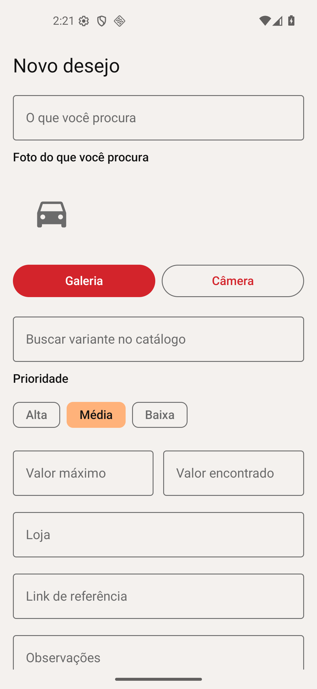
<figcaption>Figura 24.1 — Formulario desejo</figcaption>
</figure>
</div>

### Finalidade

Criar ou editar um desejo, com vínculo opcional a uma variante do catálogo.

### Como acessar

- **Desejos** → **Novo desejo**.
- **Desejos** → toque no cartão.

### Identificação visual

Título **Novo desejo** ou **Editar desejo**, campo **O que você procura**, busca de variante,
prioridade, valores, loja, link, observações e **Salvar desejo**.

### Elementos da tela

| Elemento | Tipo | Onde fica | O que faz | Resultado |
|---|---|---|---|---|
| **O que você procura** | campo | corpo | descrição livre | — |
| **Buscar variante no catálogo** | campo | corpo | procura variante | **Variante: …** |
| **Remover vínculo** | botão | corpo | desfaz o vínculo | — |
| **Prioridade** | opções | corpo | **Alta**, **Média**, **Baixa** | — |
| **Valor máximo** | campo | corpo | orçamento | — |
| **Valor encontrado** | campo | corpo | preço visto | — |
| **Loja** | campo | corpo | onde viu | — |
| **Link de referência** | campo | corpo | URL | — |
| **Observações** | campo | corpo | notas | — |
| **Salvar desejo** | botão | fim | grava | volta à lista |

### Como utilizar

1. Descreva o que procura.
2. Opcionalmente, busque e vincule uma variante.
3. Escolha a prioridade e informe valores, loja e link.
4. Toque em **Salvar desejo**.

### Exemplos

`Nissan Skyline GT-R R34 Azul`, prioridade **Alta**, valor máximo `120,00`.

### Regras e validações

- A prioridade é validada entre 1 e 3 (alta/média/baixa).
- Valores são opcionais e monetários.
- O link só abre em outro app quando você toca em **Abrir link** na lista.

### Mensagens e situações especiais

| Mensagem | Quando aparece | O que fazer |
|---|---|---|
| «Variante: …» | vínculo ativo | — |
| «Remover vínculo» | vínculo ativo | desfaz |
| «Informe o que você procura.» | descrição vazia | preencha ou vincule variante |

### Dicas

- Vincule a variante quando já souber exatamente qual edição quer.

### Problemas comuns

| Sintoma | Causa provável | O que fazer |
|---|---|---|
| Não salva | descrição vazia e sem vínculo | preencha um dos dois |

---

# 25. Financeiro

> **Tela**: `finance` · **Arquivo**: `feature/finance/FinanceScreen.kt` · **Acesso**: aba **Financeiro** · **Capturas**: `capturas/25-financeiro.png`

<div class="fig-row">
<figure>
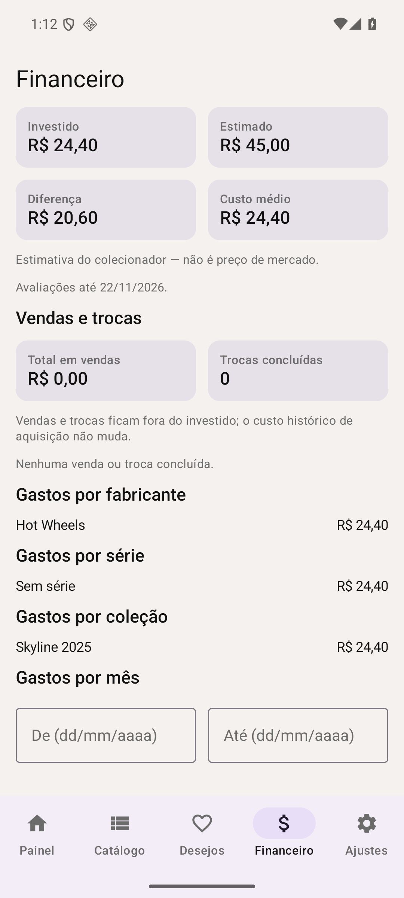
<figcaption>Figura 25.1 — Financeiro</figcaption>
</figure>
</div>

### Finalidade

Mostrar investido, estimado, diferença, custo médio, gastos por fabricante/série/coleção/mês e
o histórico de vendas e trocas.

### Como acessar

Toque na aba **Financeiro**.

### Identificação visual

Título **Financeiro**, cartões de valores, aviso de estimativa, seção **Vendas e trocas**,
listas de gastos e filtro de período **De**/**Até**.

### Elementos da tela

| Elemento | Tipo | Onde fica | O que faz | Resultado |
|---|---|---|---|---|
| **Investido** | indicador | topo | soma do custo de aquisição | R$ |
| **Estimado** | indicador | topo | soma das últimas avaliações | R$ |
| **Diferença** | indicador | topo | estimado − investido | R$ |
| **Custo médio** | indicador | topo | investido ÷ exemplares com valor | R$ ou **Sem valor** |
| **Estimativa do colecionador — não é preço de mercado.** | aviso | corpo | identifica estimativa | — |
| **Avaliações até …** / «N exemplar(es) sem avaliação…» | texto | corpo | cobertura da estimativa | — |
| **Total em vendas** / **Trocas concluídas** | indicadores | corpo | histórico | — |
| **Gastos por fabricante** / **por série** / **por coleção** / **por mês** | listas | corpo | distribuição do custo | — |
| **De (dd/mm/aaaa)** / **Até (dd/mm/aaaa)** | campos | corpo | período | — |
| **Aplicar** / **Limpar** | botões | corpo | aplica/limpa o período | — |

### Como utilizar

1. Leia os quatro valores principais.
2. Confira o aviso de estimativa e a data da última avaliação.
3. Use **De**/**Até** + **Aplicar** para restringir os gastos ao período.
4. Consulte **Vendas e trocas** para o que saiu do acervo.

### Exemplos

Investido `R$ 44,30`; estimado `R$ 45,00`; diferença `R$ 0,70`; custo médio `R$ 22,15`.
Gastos por fabricante: `Hot Wheels R$ 44,30`.

### Regras e validações

- Investido = Σ(preço + frete − desconto) de exemplares possuídos; aquisição sem preço = 0.
- Estimado = Σ da última avaliação de cada exemplar possuído.
- Diferença pode ser negativa; não é lucro realizado.
- Vendas e trocas concluídas ficam fora do investido.
- Valores em BRL, com centavos.

### Mensagens e situações especiais

| Mensagem | Quando aparece | O que fazer |
|---|---|---|
| «Nenhuma venda ou troca concluída.» | sem histórico | — |
| «Nenhuma aquisição com valor.» | gastos sem preço | informe preço nas aquisições |
| «Sem valor» | sem exemplar com valor | registre aquisição |
| «Avaliações até dd/mm/aaaa.» | data da última avaliação (no Financeiro, `22/11/2026`) | — |

### Dicas

- Registre avaliações periódicas para o estimado acompanhar o acervo.

### Problemas comuns

| Sintoma | Causa provável | O que fazer |
|---|---|---|
| Investido menor que a soma das compras | frete/desconto ou exemplar não possuído | confira aquisição e status |
| Estimado zero | sem avaliações | registre no detalhe |

---

# 26. Localizações

> **Tela**: `locations` · **Arquivo**: `feature/locations/LocationsScreen.kt` · **Acesso**: Ajustes → Localizações · **Capturas**: `capturas/26-localizacoes-vazio.png`, `capturas/26b-localizacao-nova.png`, `capturas/26c-localizacoes-com-caixa.png`

<div class="fig-row">
<figure>
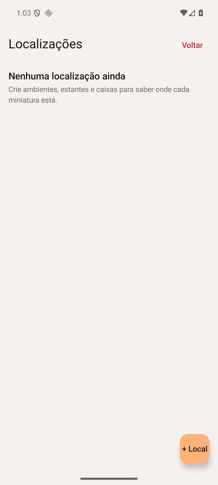
<figcaption>Figura 26.1 — Localizacoes vazio</figcaption>
</figure>

<figure>
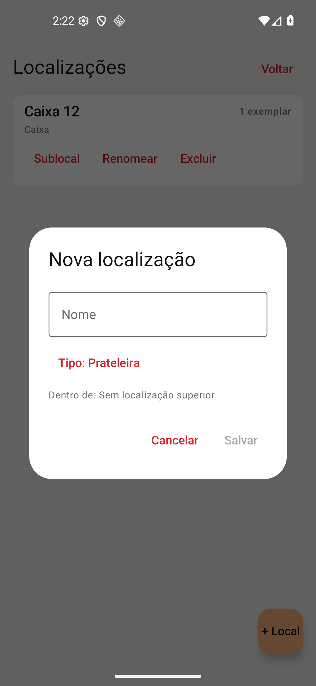
<figcaption>Figura 26.2 — Localizacao nova</figcaption>
</figure>
</div>
<div class="fig-row">
<figure>
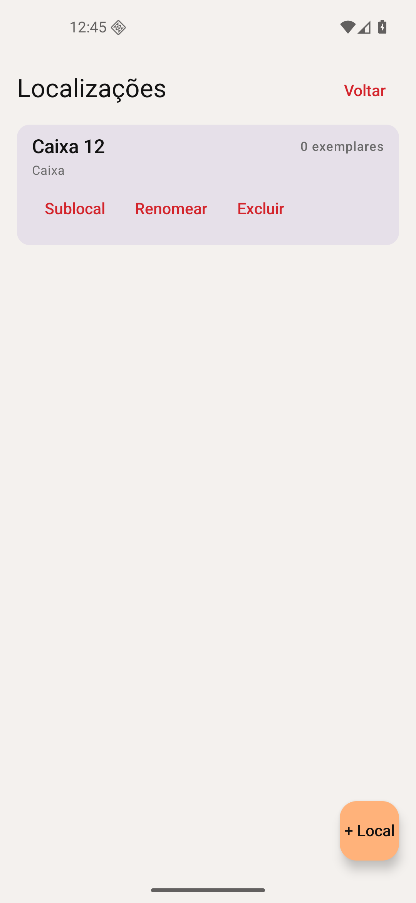
<figcaption>Figura 26.3 — Localizacoes com caixa</figcaption>
</figure>
</div>

### Finalidade

Criar e manter a árvore de lugares (ambiente, armário, estante, caixa etc.) e ver quantos
exemplares há em cada subárvore.

### Como acessar

**Ajustes** → **Localizações**.

### Identificação visual

Título **Localizações**, **Voltar**, árvore com nome, tipo, contagem e ações
**Sublocal**, **Renomear**, **Excluir**, e **+ Local** no canto inferior.

### Elementos da tela

| Elemento | Tipo | Onde fica | O que faz | Resultado |
|---|---|---|---|---|
| **+ Local** | botão | canto inferior | cria localização raiz | diálogo |
| **Sublocal** | botão | item | cria sublocalização | diálogo |
| **Renomear** | botão | item | renomeia | diálogo |
| **Excluir** | botão | item | exclui com política | diálogo |
| **Nome** | campo | diálogo | nome | — |
| **Tipo** | seletor | diálogo | **Ambiente**, **Armário**, **Estante**, **Prateleira**, **Caixa**, **Gaveta**, **Vitrine**, **Compartimento**, **Personalizado** | — |
| **Dentro de** | seletor | diálogo | localização superior | **Sem localização superior** |
| **Salvar** / **Cancelar** | botões | diálogo | confirmam/descartam | — |
| **(%d na subárvore)** | indicador | item | total incluindo filhas | — |

### Como utilizar

1. Toque em **+ Local** para criar a raiz (ex.: `Armário`).
2. Use **Sublocal** para criar `Caixa 12` dentro dela.
3. Ao excluir, escolha **Mover os exemplares para outra localização** ou
   **Arquivar os exemplares**.

### Exemplos

`Caixa 12` · tipo `Caixa` · `0 exemplares`, depois `1 exemplar` após mover a unidade.

### Regras e validações

- Tipos disponíveis são os listados no seletor.
- Excluir localização vazia remove da árvore; com exemplares, exige mover ou arquivar.
- A contagem da subárvore soma as filhas.

### Mensagens e situações especiais

| Mensagem | Quando aparece | O que fazer |
|---|---|---|
| «Nenhuma localização ainda» | árvore vazia | crie com **+ Local** |
| «Localização excluída.» | após excluir vazia | — |
| «Esta localização está vazia e sai da árvore. Nada mais é afetado.» | excluir vazia | confirme |

### Dicas

- Use a hierarquia armário → prateleira → caixa para achar rápido.

### Problemas comuns

| Sintoma | Causa provável | O que fazer |
|---|---|---|
| Não consigo excluir | há exemplares | escolha mover ou arquivar |
| Contagem estranha | inclui sublocalizações | comportamento esperado |

---

# 27. Conteúdo da localização

> **Tela**: `locations/{locationId}` · **Arquivo**: `feature/locations/LocationContentsScreen.kt` · **Acesso**: item da árvore de Localizações · **Capturas**: `capturas/27-inventario-localizacao.png`

<div class="fig-row">
<figure>
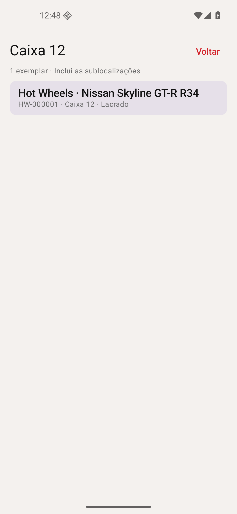
<figcaption>Figura 27.1 — Inventario localizacao</figcaption>
</figure>
</div>

### Finalidade

Listar os exemplares guardados em uma localização, incluindo as sublocalizações.

### Como acessar

**Ajustes** → **Localizações** → toque em uma localização.

### Identificação visual

Título com o nome da localização, «N exemplares · Inclui as sublocalizações», lista com
variante e «código · localização · condição» e **Voltar**.

### Elementos da tela

| Elemento | Tipo | Onde fica | O que faz | Resultado |
|---|---|---|---|---|
| **Voltar** | botão | topo | retorna à árvore | — |
| item do inventário | área tocável | corpo | abre o detalhe do exemplar | tela do exemplar |
| «Inclui as sublocalizações» | indicador | topo | escopo da contagem | — |

### Como utilizar

1. Abra a localização.
2. Confira a contagem e a lista.
3. Toque em um item para abrir o exemplar e movê-lo, se necessário.

### Exemplos

`Caixa 12` — «1 exemplar · Inclui as sublocalizações» — `HW-000001 · Caixa 12 · Lacrado`.

### Regras e validações

- A lista inclui exemplares das sublocalizações.
- Somente exemplares ativos aparecem.

### Mensagens e situações especiais

| Mensagem | Quando aparece | O que fazer |
|---|---|---|
| «Nenhum exemplar nesta localização.» | vazia | mova unidades para cá |
| «Carregando inventário…» | leitura | aguarde |

### Dicas

- Use esta tela para conferir uma caixa antes de guardar ou vender.

### Problemas comuns

| Sintoma | Causa provável | O que fazer |
|---|---|---|
| Item não aparece | está em outra localização | confira no detalhe do exemplar |

---

# 28. Ajustes

> **Tela**: `settings` · **Arquivo**: `feature/settings/SettingsScreen.kt` · **Acesso**: aba **Ajustes** · **Capturas**: `capturas/28-ajustes.png`, `capturas/28b-aparencia-escuro.png`

<div class="fig-row">
<figure>

<figcaption>Figura 28.1 — Ajustes em modo claro, com o cartão Aparência no topo</figcaption>
</figure>

<figure>

<figcaption>Figura 28.2 — Os mesmos Ajustes em modo escuro, com Escuro selecionado</figcaption>
</figure>
</div>

### Finalidade

Reunir as opções do aplicativo: aparência, localizações, backup, relatórios, importação,
dados, informações e privacidade, além do lembrete de backup.

### Como acessar

Toque na aba **Ajustes**.

### Identificação visual

Título **Ajustes**, cartão **Aparência** no topo (com as opções **Sistema**, **Claro** e
**Escuro**), cartão **Lembrete de backup** e sete entradas com título e subtítulo. No fim,
a nota de funcionamento offline.

### Elementos da tela

| Elemento | Tipo | Onde fica | O que faz | Resultado |
|---|---|---|---|---|
| **Aparência** | cartão | topo | escolhe o tema do app | aplica na hora e guarda a escolha |
| **Sistema** | opção | cartão Aparência | acompanha o tema do Android | paleta do Android |
| **Claro** | opção | cartão Aparência | força a paleta clara | paleta clara |
| **Escuro** | opção | cartão Aparência | força a paleta escura | paleta escura |
| **Lembrete de backup** | cartão | abaixo da aparência | mostra intervalo e último backup | diálogo de configuração |
| **A cada 30 dias · nenhum backup** | texto | cartão | estado do lembrete | — |
| **Localizações** | entrada | lista, 1ª | abre a árvore de lugares | tela Localizações |
| **Backup e restauração** | entrada | lista, 2ª | abre o backup | tela Backup |
| **Relatórios** | entrada | lista, 3ª | abre os relatórios | tela Relatórios |
| **Importar planilha** | entrada | lista, 4ª | abre a importação CSV | tela Importar |
| **Dados da coleção** | entrada | lista, 5ª | exportar/excluir | tela Dados da coleção |
| **Sobre o app** | entrada | lista, 6ª | versão e pacote | tela Sobre |
| **Política de privacidade** | entrada | lista, 7ª | texto de privacidade | tela Privacidade |
| **Intervalo do lembrete** | seletor | diálogo do lembrete | frequência | **Desligado** ou intervalo |
| **Fazer backup agora** | botão | diálogo do lembrete | abre o backup | tela Backup |
| **Fechar** | botão | diálogo do lembrete | fecha | — |

### Como utilizar

1. Toque na entrada desejada.
2. Em **Aparência**, toque em **Sistema**, **Claro** ou **Escuro**: a tela muda na hora e a
   escolha continua valendo na próxima abertura do app.
3. No cartão de lembrete, escolha **Intervalo do lembrete** ou **Fazer backup agora**.
4. Use **Localizações** antes de mover exemplares.

### Exemplos

«A cada 30 dias · nenhum backup» indica lembrete ativo e nenhum pacote criado ainda.

Com o Android no modo escuro e **Sistema** escolhido, o app fica escuro como o sistema; ao
marcar **Claro**, ele volta à paleta clara mesmo com o Android escuro, como nas Figuras 28.1
e 28.2 — o cartão **Aparência** mostra a opção marcada e a troca é imediata.

### Regras e validações

- A aparência é uma preferência local (DataStore, fora do banco e fora do pacote de
  backup) com três valores: **Sistema**, **Claro** e **Escuro**. Ausência ou valor
  ilegível equivale a **Sistema**.
- O lembrete é uma preferência local (SharedPreferences), fora do banco.
- O app não tem conta, login nem internet; a nota «Nada do acervo sai do aparelho» resume isso.

### Mensagens e situações especiais

| Mensagem | Quando aparece | O que fazer |
|---|---|---|
| «Nenhum backup feito ainda.» | sem pacote | crie um backup |
| «Sem backup, a coleção existe só neste aparelho.» | lembrete sem backup | faça o backup |
| «atrasado» / «em dia» / «nenhum backup» | estado do lembrete | — |
| «Desligado» | lembrete desativado | reative se quiser |

### Dicas

- Faça o backup pelo cartão de lembrete quando ele indicar atraso.
- Use **Escuro** à noite e **Claro** sob luz forte; **Sistema** evita ter de trocar à mão.

### Problemas comuns

| Sintoma | Causa provável | O que fazer |
|---|---|---|
| Lembrete não aparece | app recém-instalado | configure no cartão |
| Backup “não inclui fotos” | backup automático do Android | use o pacote do app |

---

# 29. Backup e restauração

> **Tela**: `settings/backup` · **Arquivo**: `feature/transfer/BackupScreen.kt` · **Acesso**: Ajustes → Backup e restauração · **Capturas**: `capturas/29-backup.png`, `capturas/29b-backup-criado.png`, `capturas/29c-salvar-backup.png`, `capturas/29d-escolher-backup.png`, `capturas/29e-restaurar-opcoes.png`, `capturas/29f-restauracao-concluida.png`

<div class="fig-row">
<figure>

<figcaption>Figura 29.1 — Backup</figcaption>
</figure>

<figure>

<figcaption>Figura 29.2 — Backup criado</figcaption>
</figure>
</div>
<div class="fig-row">
<figure>

<figcaption>Figura 29.3 — Seletor do sistema para gravar o pacote</figcaption>
</figure>

<figure>

<figcaption>Figura 29.4 — Escolha do pacote na restauração</figcaption>
</figure>
</div>
<div class="fig-row">
<figure>

<figcaption>Figura 29.5 — Diálogo «Como aplicar este backup?» com Cancelar, Mesclar e Substituir</figcaption>
</figure>

<figure>

<figcaption>Figura 29.6 — «Restauração concluída» e o botão Reabrir o app</figcaption>
</figure>
</div>

### Finalidade

Gerar um pacote portátil com banco, fotos, manifesto com hash e cópias CSV/JSON, e restaurar
esse pacote em outro aparelho (ou no mesmo).

### Como acessar

**Ajustes** → **Backup e restauração**.

### Identificação visual

Título **Backup e restauração**, texto explicativo, aviso sobre o backup automático do
Android, **Criar backup** e **Restaurar backup**.

### Elementos da tela

| Elemento | Tipo | Onde fica | O que faz | Resultado |
|---|---|---|---|---|
| **Criar backup** | botão | corpo | abre o seletor de destino | pacote gravado |
| **Restaurar backup** | botão | corpo | abre o seletor de arquivo | diálogo de confirmação |
| **Voltar** | botão | topo | retorna aos Ajustes | — |
| **Mesclar** | botão | diálogo de restauração | junta sem sobrescrever | dados mesclados |
| **Substituir** | botão | diálogo de restauração | troca pelos dados do pacote | dados substituídos |
| **Cancelar** | botão | diálogo | cancela | — |
| **Reabrir o app** | botão | resultado da restauração | reabre o aplicativo | dados visíveis |
| **Fechar** | botão | resultado | fecha o diálogo | — |

### Como utilizar

1. Toque em **Criar backup**.
2. No seletor do sistema, escolha a pasta e confirme; o nome sugerido é
   `colecao-backup-AAAAMMDD-HHMMSS.zip`.
3. Aguarde «Backup criado» e confira data, contagem e tamanho.
4. Copie o arquivo para fora do aparelho.
5. Para restaurar, toque em **Restaurar backup**, escolha o pacote e decida entre
   **Mesclar** e **Substituir**.
6. Ao final, toque em **Reabrir o app**.

### Exemplos

Backup do exemplo: «Criado em 22/11/2026 13:25», «6 exemplares · 1 foto», «Tamanho: 478 KB».
A restauração com **Substituir** respondeu «Restauração concluída» e, após **Reabrir o app**, o
painel voltou com os mesmos 6 exemplares — confirmando que o pacote leva banco e fotos.

### Regras e validações

- O pacote contém banco, fotos, manifesto com hash e cópias CSV/JSON.
- A restauração valida: pacote reconhecível, formato suportado, arquivos presentes, tamanho,
  checksum, contagens, banco válido, esquema não mais novo e chaves estrangeiras.
- **Substituir** troca os dados atuais; uma cópia do estado anterior fica guardada no aparelho.
- **Mesclar** não sobrescreve: itens novos entram e os existentes são mantidos.
- Restaurar fecha e reabre o banco; o app precisa ser reaberto.
- O backup automático do Android copia o banco, mas **não** as fotos.

### Mensagens e situações especiais

| Mensagem | Quando aparece | O que fazer |
|---|---|---|
| «Backup criado» | pacote gravado | copie para fora do aparelho |
| «Backups mesclados» | mesclagem concluída | reabra o app |
| «Restauração concluída» | substituição concluída | reabra o app |
| «O arquivo escolhido não é um pacote de backup.» | arquivo errado | escolha o `.zip` do app |
| «Este pacote foi criado em um formato que este app não lê.» | formato incompatível | use um pacote da mesma versão/mais antigo |
| «O pacote está incompleto: falta um arquivo listado no manifesto.» | pacote corrompido | use outra cópia |
| «Um arquivo do pacote tem tamanho diferente do registrado no manifesto.» | corrupção | use outra cópia |
| «Um arquivo do pacote está corrompido (hash diferente do manifesto).» | corrupção | use outra cópia |
| «As contagens do pacote não conferem com o banco.» | pacote inconsistente | use outra cópia |
| «O banco dentro do pacote está inválido.» | corrupção | use outra cópia |
| «O pacote é de uma versão mais nova do app. Atualize o app antes de restaurar.» | versão maior | atualize o app |
| «O banco do pacote tem vínculos quebrados.» | pacote inválido | use outra cópia |
| «Não foi possível gravar a restauração. Os dados atuais foram mantidos.» | falha de escrita | tente de novo |

### Dicas

- Guarde mais de um pacote, em locais diferentes.
- Faça backup antes de atualizações grandes.

### Problemas comuns

| Sintoma | Causa provável | O que fazer |
|---|---|---|
| Fotos não aparecem após restaurar backup do Android | backup automático não leva fotos | use o pacote do app |
| App fecha ao restaurar | banco fechado durante a troca | reabra o app (**Reabrir o app**) |
| “Formato não suportado” | pacote de versão mais nova | atualize o app |

---

# 30. Relatórios

> **Tela**: `settings/reports` · **Arquivo**: `feature/reports/ReportsScreen.kt` · **Acesso**: Ajustes → Relatórios · **Capturas**: `capturas/30-relatorios.png`, `capturas/30b-salvar-relatorio.png`, `capturas/30c-relatorio-gerado.png`, `capturas/30d-relatorio-csv.png`, `capturas/30e-relatorio-xlsx.png`

<div class="fig-row">
<figure>

<figcaption>Figura 30.1 — Relatórios</figcaption>
</figure>

<figure>

<figcaption>Figura 30.2 — Seletor do sistema com o nome sugerido `colecao-inventario-AAAAMMDD-HHMMSS.pdf`</figcaption>
</figure>
</div>
<div class="fig-row">
<figure>

<figcaption>Figura 30.3 — PDF gerado: arquivo e «6 exemplares · 1 páginas»</figcaption>
</figure>

<figure>

<figcaption>Figura 30.4 — CSV gerado: resumo só com a contagem de exemplares</figcaption>
</figure>
</div>
<div class="fig-row">
<figure>

<figcaption>Figura 30.5 — XLSX gerado, também sem contagem de páginas</figcaption>
</figure>
</div>

### Finalidade

Gerar o **inventário** do acervo no próprio aparelho, sem conexão, em PDF, CSV ou XLSX.

### Como acessar

**Ajustes** → **Relatórios**.

### Identificação visual

Título **Relatórios**, texto explicativo, seletor **Formato**, botão **Gerar relatório** e
mensagens de andamento/resultado.

### Elementos da tela

| Elemento | Tipo | Onde fica | O que faz | Resultado |
|---|---|---|---|---|
| **Formato** | seletor | corpo | **PDF**, **CSV** ou **XLSX** | formato escolhido |
| **Gerar relatório** | botão | corpo | abre o destino e gera | arquivo gravado |
| **Voltar** | botão | topo | retorna aos Ajustes | — |
| **Relatório gerado** | cartão | corpo | mostra arquivo e resumo | — |
| **Fechar** | botão | cartão | fecha | — |

### Como utilizar

1. Escolha o **Formato**.
2. Toque em **Gerar relatório**.
3. Escolha onde salvar no seletor do sistema e confirme.
4. Confira «Relatório gerado», o nome do arquivo e o resumo.

### Exemplos

PDF do exemplo: «Relatório gerado», «Arquivo: colecao-inventario-AAAAMMDD-HHMMSS.pdf»,
«6 exemplares · 1 páginas». CSV e XLSX mostram apenas «6 exemplares».

O conteúdo dos três arquivos é o mesmo inventário, com as colunas **Código**, **Modelo**,
**Variante**, **Condição** e **Fotos**:

```text
Código      Modelo                    Variante        Condição  Fotos
HW-000002   Dodge Charger 1970        Laranja         SEALED    0
HW-900002   Ford GT40 1966            Azul            SEALED    0
HW-900001   Ford Mustang 1965         Vermelho        SEALED    0
HW-000001   Nissan Skyline GT-R R34   Azul            SEALED    1
HW-000004   Nissan Skyline GT-R R34   Azul            SEALED    0
HW-000003   Pontiac Firebird 1968     não informado   SEALED    0
Total de exemplares: 6
```

No PDF o total aparece como «Total de exemplares: 6»; no CSV e no XLSX o total não é escrito —
só as linhas. O CSV é gravado com BOM e quebras CRLF, e o XLSX traz uma planilha chamada
**Inventário** com esses mesmos valores como texto.

Os três arquivos gerados nesta sessão estão preservados em `exemplos/inventario-exemplo.pdf`,
`exemplos/inventario-exemplo.csv` e `exemplos/inventario-exemplo.xlsx`.

### Regras e validações

- O conteúdo é o **inventário de exemplares**; não há outros tipos de relatório.
- PDF informa páginas; CSV e XLSX não.
- As colunas são fixas: código interno, modelo, variante, condição e número de fotos.
- A coluna **Condição** sai com o código interno em maiúsculas (`SEALED`, `LOOSE`, …), não com o
  rótulo em português que a tela mostra.
- A geração ocorre no aparelho, sem internet.

### Mensagens e situações especiais

| Mensagem | Quando aparece | O que fazer |
|---|---|---|
| «Gerando relatório…» | durante a geração | aguarde |
| «Não foi possível gerar o relatório» | falha | tente outro destino/formato |
| «Relatório gerado» | sucesso | — |

### Dicas

- Use CSV para abrir em planilha e PDF para arquivar/imprimir.

### Problemas comuns

| Sintoma | Causa provável | O que fazer |
|---|---|---|
| Relatório vazio | nenhum exemplar possuído | cadastre unidades |
| Todos os itens importados viraram pendência | CSV sem `cor_principal`/`ano_lancamento` | preencha os campos ou complete em **Incompletos** |
| Coluna digitada errada não aparece em lugar nenhum | coluna desconhecida é ignorada | corrija o cabeçalho e importe de novo |
| Condição aparece em inglês | o relatório usa o código interno | considere `SEALED` = **Lacrado**, `LOOSE` = **Solto** |
| Esperava “11 relatórios” | documento antigo | o app gera o inventário nos 3 formatos |

---

# 31. Importação

> **Tela**: `settings/import` · **Arquivo**: `feature/transfer/ImportScreen.kt` · **Acesso**: Ajustes → Importar planilha · **Capturas**: `capturas/31-importacao.png`, `capturas/31b-previa-com-erros.png`, `capturas/31c-importacao-concluida.png`

<div class="fig-row">
<figure>

<figcaption>Figura 31.1 — Importação</figcaption>
</figure>

<figure>

<figcaption>Figura 31.2 — Prévia de um CSV com 9 linhas, 7 inválidas e 1 duplicata</figcaption>
</figure>
</div>
<div class="fig-row">
<figure>

<figcaption>Figura 31.3 — «2 exemplares importados · 1 pulados por duplicata»</figcaption>
</figure>
</div>

### Finalidade

Importar um arquivo **CSV** com pré-visualização de válidas, inválidas e duplicatas antes de
gravar.

### Como acessar

**Ajustes** → **Importar planilha**.

### Identificação visual

Título **Importar**, texto explicativo, botão **Escolher arquivo CSV** e, após a leitura,
cartão **Pré-visualização** com resumo e ações.

### Elementos da tela

| Elemento | Tipo | Onde fica | O que faz | Resultado |
|---|---|---|---|---|
| **Escolher arquivo CSV** | botão | corpo | abre o seletor | leitura do arquivo |
| **Voltar** | botão | topo | retorna aos Ajustes | — |
| **Pré-visualização** | cartão | corpo | mostra total/válidas/inválidas/duplicatas | — |
| **Salvar relatório de erros** | botão | cartão | grava CSV de erros | arquivo |
| **Importar válidas** | botão | cartão | grava as linhas válidas | «Importação concluída» |
| **Fechar** | botão | diálogo | fecha | — |

### Como utilizar

1. Toque em **Escolher arquivo CSV** e selecione o arquivo.
2. Confira o resumo: «Total: N · Válidas: N · Inválidas: N · Duplicatas: N».
3. Opcionalmente, salve o relatório de erros.
4. Toque em **Importar válidas**.
5. Leia o resultado: «N exemplares importados · N pulados por duplicata».

### Exemplos

CSV com cabeçalho `fabricante;modelo;escala` (ou vírgula) e duas linhas válidas →
«Total: 2 · Válidas: 2 · Inválidas: 0 · Duplicatas: 0» → «2 exemplares importados».

CSV de teste desta documentação (9 linhas, uma coluna desconhecida `cor_errada`):
«Total: 9 · Válidas: 2 · Inválidas: 7 · Duplicatas: 1» → «2 exemplares importados ·
1 pulados por duplicata». O arquivo de erros gravado tinha:

```text
linha,campo,codigo,mensagem,valor_informado
3,fabricante,E001,Campo obrigatório vazio,
4,modelo,E001,Campo obrigatório vazio,
5,condicao,E004,Valor fora do domínio,novo
6,data_aquisicao,E003,Data inválida,31/02/2026
7,preco,E002,Número inválido,abc
8,codigo_interno,E005,Código interno duplicado,HW-000001
9,localizacao,E007,Hierarquia inválida (use > entre níveis),Caixa >> Prateleira
```

Os arquivos usados estão em `exemplos/importacao-com-erros.csv` (entrada) e
`exemplos/import-erros.csv` (relatório de erros gravado pelo app).

### Regras e validações

- Formato aceito: CSV com cabeçalho. Colunas conhecidas incluem fabricante, marca, modelo,
  escala, série, coleção, cor principal, condição, código interno, preço, frete, desconto,
  loja, localização e observações.
- **Fabricante** e **modelo** são obrigatórios.
- Condição aceita: lacrado, solto, danificado, restaurado, incompleto.
- Linhas inválidas não são gravadas; duplicatas são puladas e contadas.
- A gravação só ocorre após a pré-visualização.
- Duplicata também entra na contagem de **inválidas**; no exemplo, 1 duplicata dentro 7 inválidas.
- O relatório de erros é um CSV com as colunas `linha`, `campo`, `codigo`, `mensagem` e
  `valor_informado`, com códigos `E001` (obrigatório vazio), `E002` (número inválido), `E003`
  (data inválida), `E004` (fora do domínio), `E005` (código duplicado) e `E007` (hierarquia de
  localização inválida).
- Colunas desconhecidas são **ignoradas sem aviso na tela**: o texto de apresentação promete
  «o motivo de cada erro», mas a pré-visualização mostra só os totais; os motivos ficam no
  arquivo de erros.

### Mensagens e situações especiais

| Mensagem | Quando aparece | O que fazer |
|---|---|---|
| «Lendo o arquivo…» | leitura | aguarde |
| «Não foi possível importar» | erro de leitura/gravação | confira o CSV |
| «Importação concluída» | sucesso | — |
| «N exemplares importados · N pulados por duplicata» | resultado | — |
| — (sem mensagem) | ao salvar o relatório de erros | o arquivo é gravado sem confirmação na tela; confira no seletor de arquivos |

### Dicas

- Exporte um CSV pelo próprio app para usar como modelo de cabeçalho.

### Problemas comuns

| Sintoma | Causa provável | O que fazer |
|---|---|---|
| Todas inválidas | falta fabricante/modelo | corrija o CSV |
| Planilha XLSX não abre | formato não suportado | salve como CSV |
| Duplicatas não importadas | já existem no acervo | comportamento esperado |

---

# 32. Dados da coleção

> **Tela**: `settings/data` · **Arquivo**: `feature/settings/DataControlScreen.kt` · **Acesso**: Ajustes → Dados da coleção · **Capturas**: `capturas/32-dados-da-colecao.png`

<div class="fig-row">
<figure>

<figcaption>Figura 32.1 — Dados da colecao</figcaption>
</figure>
</div>

### Finalidade

Exportar tudo em formato aberto (banco, fotos, JSON e CSV) e excluir todos os dados do
aparelho com confirmação dupla.

### Como acessar

**Ajustes** → **Dados da coleção**.

### Identificação visual

Título **Dados da coleção**, texto explicativo, **O que está no aparelho** com contagens,
**Exportar tudo** e **Excluir todos os dados**.

### Elementos da tela

| Elemento | Tipo | Onde fica | O que faz | Resultado |
|---|---|---|---|---|
| **Exportar tudo** | botão | corpo | grava pacote aberto | «Exportação concluída» |
| **Excluir todos os dados** | botão | corpo | inicia exclusão | primeira confirmação |
| **Exportar antes de excluir** | botão | confirmação | exporta e segue | — |
| **Continuar** | botão | confirmação | avança | segunda confirmação |
| **Excluir definitivamente** | botão | confirmação final | apaga | «Dados excluídos» |
| **Cancelar** | botão | confirmação | cancela | — |
| **Voltar aos Ajustes** | botão | resultado | retorna | — |
| **Fechar** | botão | resultado | fecha | — |
| **Voltar** | botão | topo | retorna aos Ajustes | — |

### Como utilizar

1. Para exportar, toque em **Exportar tudo**, escolha o destino e confirme.
2. Para excluir, toque em **Excluir todos os dados**.
3. Leia o aviso, considere **Exportar antes de excluir** e toque em **Continuar**.
4. Na última confirmação, toque em **Excluir definitivamente**.

### Exemplos

Exportação do exemplo: «Pacote de 478 KB gravado no local escolhido. Guarde-o fora do aparelho.»

### Regras e validações

- A exportação usa o mesmo pacote do backup (banco, fotos, JSON e CSV).
- A exclusão remove registros e fotos; **não há como desfazer**.
- São duas confirmações; a segunda é explícita.
- Exportar antes de excluir é oferecido, não obrigatório.

### Mensagens e situações especiais

| Mensagem | Quando aparece | O que fazer |
|---|---|---|
| «Não há dados no aparelho.» | acervo vazio | — |
| «Trabalhando…» | exportação/exclusão | aguarde |
| «Exportação concluída» | sucesso | guarde o arquivo |
| «Dados excluídos» | exclusão concluída | — |
| «Não foi possível gravar a exportação. Nada foi apagado.» | falha | tente outro destino |
| «A exclusão não terminou. Tente de novo para remover o que restou.» | falha parcial | repita |
| «Excluir todos os dados?» / «Última confirmação» | antes de apagar | leia e confirme |

### Dicas

- Exporte antes de excluir; o pacote permite reconstruir o acervo.

### Problemas comuns

| Sintoma | Causa provável | O que fazer |
|---|---|---|
| Exportação falha | destino sem permissão/espaço | escolha outra pasta |
| Dados “voltaram” | restauração/backup do Android | desative o backup automático ou limpe de novo |

---

# 33. Sobre

> **Tela**: `settings/about` · **Arquivo**: `feature/settings/AboutScreen.kt` · **Acesso**: Ajustes → Sobre o app · **Capturas**: `capturas/33-sobre.png`

<div class="fig-row">
<figure>

<figcaption>Figura 33.1 — Sobre</figcaption>
</figure>
</div>

### Finalidade

Mostrar versão, código de build, data de compilação e pacote instalado, além de um resumo do
aplicativo.

### Como acessar

**Ajustes** → **Sobre o app**.

### Identificação visual

Título **Sobre**, texto de apresentação, «Versão X (build Y)», «Compilado em …» e
«Pacote: …».

### Elementos da tela

| Elemento | Tipo | Onde fica | O que faz | Resultado |
|---|---|---|---|---|
| **Voltar** | botão | topo | retorna aos Ajustes | — |
| **Versão … (build …)** | texto | corpo | versão instalada | — |
| **Compilado em …** | texto | corpo | data do build | — |
| **Pacote: …** | texto | corpo | applicationId | — |

### Como utilizar

1. Abra **Sobre o app** para conferir a versão antes de relatar um problema.

### Exemplos

«Versão 0.1.0-debug (build 1)», «Compilado em 22/11/2026 11:48»,
«Pacote: br.com.diecastcollector.debug» (no build de debug).

### Regras e validações

- Os valores são lidos da instalação; não são editáveis.

### Mensagens e situações especiais

- Nenhuma mensagem própria; a tela é informativa.

### Dicas

- Informe versão e pacote ao relatar um defeito.

### Problemas comuns

| Sintoma | Causa provável | O que fazer |
|---|---|---|
| Versão diferente da manual | build mais novo/antigo | confira o commit documentado |

---

# 34. Privacidade

> **Tela**: `settings/privacy` · **Arquivo**: `feature/settings/PrivacyPolicyScreen.kt` · **Acesso**: Ajustes → Política de privacidade · **Capturas**: `capturas/34-privacidade.png`

<div class="fig-row">
<figure>

<figcaption>Figura 34.1 — Privacidade</figcaption>
</figure>
</div>

### Finalidade

Explicar, em texto fixo, que os dados ficam no aparelho e o que o aplicativo não coleta.

### Como acessar

**Ajustes** → **Política de privacidade**.

### Identificação visual

Título **Privacidade** e texto corrido em várias seções.

### Elementos da tela

| Elemento | Tipo | Onde fica | O que faz | Resultado |
|---|---|---|---|---|
| **Voltar** | botão | topo | retorna aos Ajustes | — |
| texto da política | texto | corpo | informações de privacidade | — |

### Como utilizar

1. Leia o texto; ele não depende de internet nem de aceite.

### Exemplos

Trechos exibidos: «Seus dados ficam apenas neste aparelho.»; «O app não tem cadastro, login,
anúncio, telemetria nem chamada de rede para servidores próprios.»; a câmera só é usada quando
você escolhe tirar ou anexar uma foto.

### Regras e validações

- O texto é fixo no app; não é carregado de servidor.
- Desinstalar remove os dados, salvo backup do sistema Android.

### Mensagens e situações especiais

- Nenhuma mensagem própria.

### Dicas

- Combine com o capítulo 32 (Dados da coleção) para exportar antes de desinstalar.

### Problemas comuns

| Sintoma | Causa provável | O que fazer |
|---|---|---|
| Texto cortado | rolagem | role a tela |

---

# 35. Exemplo completo: Nissan Skyline GT-R R34

> **Tela**: exemplo transversal · **Acesso**: capítulos 8–15 e 25 · **Capturas**: `capturas/07-catalogo-com-miniatura.png`, `capturas/15b-detalhe-exemplar-aquisicao.png`, `capturas/17c-detalhe-colecao-com-item.png`, `capturas/05b-painel-com-dados.png`, `capturas/25-financeiro.png`

<div class="fig-row">
<figure>

<figcaption>Figura 35.1 — Painel com dados</figcaption>
</figure>

<figure>

<figcaption>Figura 35.2 — Detalhe exemplar</figcaption>
</figure>
</div>
<div class="fig-row">
<figure>

<figcaption>Figura 35.3 — Financeiro</figcaption>
</figure>
</div>

### Finalidade

Mostrar o mesmo registro aparecendo no catálogo, no detalhe, na coleção, no painel e no
financeiro, com números que o leitor pode recalcular.

### Como acessar

Execute o roteiro do capítulo 3 usando os valores abaixo.

### Identificação visual

O registro aparece como `Nissan Skyline GT-R R34` no catálogo, `HW-000001` no detalhe e
`Skyline 2025` na coleção.

### Dados do exemplo

| Campo | Valor |
|---|---|
| Fabricante | `Hot Wheels` |
| Modelo | `Nissan Skyline GT-R R34` |
| Escala | `1:64` |
| Cor principal | `Azul` |
| Ano | `2025` |
| Condição | `Lacrado` |
| Código interno | `HW-000001` (gerado) |
| Localização | `Caixa 12` |
| Preço pago | `R$ 19,90` |
| Frete | `R$ 4,50` |
| Desconto | `R$ 0,00` |
| Custo total | `R$ 24,40` |
| Avaliação | `R$ 45,00` em `22/11/2026`, fonte `colecionador` |
| Coleção | `Skyline 2025`, 1 unidade esperada |

### Como utilizar

1. Cadastre fabricante e modelo (capítulo 8).
2. Crie a variante azul 2025 e o primeiro exemplar (capítulo 9).
3. No detalhe, registre aquisição e avaliação (capítulo 15).
4. Crie a localização e mova o exemplar (capítulos 26 e 15).
5. Crie a coleção e adicione o item (capítulos 16–17).
6. Confira painel e financeiro (capítulos 5 e 25).

### Exemplos de conferência

- Catálogo: «Hot Wheels · 2025 · 1 exemplar».
- Detalhe: «Custo total: R$ 24,40»; «Valor estimado atual: R$ 45,00».
- Coleção: «100%», «1 de 1 unidades».
- Painel (Figura 35.1, com o acervo completo do manual): `6` Exemplares, `5` Modelos,
  `5` Variantes, `1` Fabricante, `0` Séries, `1` Coleção, `1` Variante repetida,
  `1` Na lista de desejos, Investido `R$ 44,30`, Estimado `R$ 45,00`, Diferença `R$ 0,70`.
- Financeiro (Figura 35.3): Investido `R$ 44,30`, Estimado `R$ 45,00`, Diferença `R$ 0,70`,
  Custo médio `R$ 22,15`; Gastos por fabricante `Hot Wheels R$ 44,30`.

### Regras e validações

- O investido usa preço + frete − desconto.
- O estimado usa a avaliação mais recente.
- A diferença é estimativa, não lucro realizado.
- Ao cadastrar um segundo exemplar igual, o painel passa a **2 exemplares** e a
  **1 variante repetida**; a variante continua uma só.

### Mensagens e situações especiais

- Se o painel mostrar «1 exemplar(es) sem avaliação ficam de fora da estimativa», o segundo
  exemplar está sem avaliação — é o comportamento esperado.

### Dicas

- Use este exemplo como teste após restaurar um backup.

### Problemas comuns

| Sintoma | Causa provável | O que fazer |
|---|---|---|
| Valores diferentes | frete/desconto ou avaliação diferente | reconfira os campos |
| Coleção em 0% | item não adicionado ou variante não possuída | adicione o item correto |

## Revisões do manual

| Data | O que mudou |
|---|---|
| 28/11/2026 | *5*: datas exibidas em `dd/mm/aaaa`; *8*: campos abrem vazios, sugestões só depois de digitar e o cartão de sugestões fecha ao escolher; *13* e *15*: teclado numérico decimal em preço, frete e desconto; *15*, *21*, *22* e *28*: capturas regeradas com a Aparência (claro/escuro) e a negociação de qualquer exemplar; *5*, *8*, *9*, *11*, *12*, *13*, *18*, *24* e *26*: capturas do Painel e dos formulários regeradas com o layout atual. |
| 22/11/2026 | Capturas regeradas após a renomeação para **Diecast Collector**. |

## Apêndice A — Registro de evidências

Todas as capturas abaixo foram feitas no emulador `diecast_test` (API 36), com o APK de
debug da árvore de trabalho após a renomeação para **Diecast Collector** (22/11/2026).
O Painel e os formulários foram regerados em 28/11/2026. Todas usam apenas dados fictícios.

| Arquivo | Tela / estado | Origem | Data | Commit | Dados fictícios |
|---|---|---|---|---|---|
| `01-painel-vazio.png` | Painel vazio | emulador `diecast_test` | 28/11/2026 | `árvore local` | sim |
| `02-catalogo-vazio.png` | Catálogo vazio | emulador `diecast_test` | 22/11/2026 | `árvore local` | sim |
| `02b-catalogo-com-incompleto.png` | Catálogo com incompleto | emulador `diecast_test` | 22/11/2026 | `árvore local` | sim |
| `03-cadastro-inicial.png` | Cadastro inicial | emulador `diecast_test` | 28/11/2026 | `árvore local` | sim |
| `04-cadastro-preenchido.png` | Cadastro preenchido | emulador `diecast_test` | 28/11/2026 | `árvore local` | sim |
| `05-formulario-variante-vazio.png` | Formulario variante vazio | emulador `diecast_test` | 28/11/2026 | `árvore local` | sim |
| `05b-painel-com-dados.png` | Painel com dados | emulador `diecast_test` | 28/11/2026 | `árvore local` | sim |
| `06-formulario-variante-preenchido.png` | Formulario variante preenchido | emulador `diecast_test` | 28/11/2026 | `árvore local` | sim |
| `06b-seletor-de-fotos.png` | Seletor de fotos | emulador `diecast_test` | 28/11/2026 | `árvore local` | sim |
| `06c-variante-com-foto.png` | Variante com foto | emulador `diecast_test` | 28/11/2026 | `árvore local` | sim |
| `07-busca.png` | Busca | emulador `diecast_test` | 22/11/2026 | `árvore local` | sim |
| `07-catalogo-com-miniatura.png` | Catálogo com miniatura | emulador `diecast_test` | 22/11/2026 | `árvore local` | sim |
| `07b-catalogo-com-foto.png` | Catálogo com foto | emulador `diecast_test` | 22/11/2026 | `árvore local` | sim |
| `10b-incompletos-com-item.png` | Incompletos com item | emulador `diecast_test` | 22/11/2026 | `árvore local` | sim |
| `10c-incompletos-com-variante.png` | Incompletos com variante | emulador `diecast_test` | 22/11/2026 | `árvore local` | sim |
| `11-edicao-modelo.png` | Edição modelo | emulador `diecast_test` | 28/11/2026 | `árvore local` | sim |
| `12-edicao-variante.png` | Edição variante | emulador `diecast_test` | 28/11/2026 | `árvore local` | sim |
| `13-adicionar-exemplar.png` | Adicionar exemplar | emulador `diecast_test` | 28/11/2026 | `árvore local` | sim |
| `14-lista-exemplares.png` | Lista de exemplares | emulador `diecast_test` | 22/11/2026 | `árvore local` | sim |
| `14b-lista-dois-exemplares.png` | Lista com dois exemplares | emulador `diecast_test` | 22/11/2026 | `árvore local` | sim |
| `14c-lista-dois-exemplares.png` | Lista com dois exemplares | emulador `diecast_test` | 22/11/2026 | `árvore local` | sim |
| `15-detalhe-exemplar.png` | Detalhe do exemplar | emulador `diecast_test` | 22/11/2026 | `árvore local` | sim |
| `15b-detalhe-exemplar-aquisicao.png` | Detalhe do exemplar: aquisição | emulador `diecast_test` | 22/11/2026 | `árvore local` | sim |
| `15c-detalhe-exemplar-avaliacao.png` | Detalhe do exemplar: avaliação | emulador `diecast_test` | 22/11/2026 | `árvore local` | sim |
| `15d-detalhe-exemplar-movimentacao.png` | Detalhe do exemplar: movimentação | emulador `diecast_test` | 22/11/2026 | `árvore local` | sim |
| `15e-detalhe-exemplar-movido.png` | Detalhe do exemplar: movido | emulador `diecast_test` | 22/11/2026 | `árvore local` | sim |
| `15f-exemplar-com-foto.png` | Exemplar com foto | emulador `diecast_test` | 22/11/2026 | `árvore local` | sim |
| `16-colecoes-vazio.png` | Coleções vazio | emulador `diecast_test` | 22/11/2026 | `árvore local` | sim |
| `16b-colecoes-com-uma.png` | Coleções com uma | emulador `diecast_test` | 22/11/2026 | `árvore local` | sim |
| `17-detalhe-colecao-vazio.png` | Detalhe da coleção vazio | emulador `diecast_test` | 22/11/2026 | `árvore local` | sim |
| `17b-adicionar-item-colecao.png` | Adicionar item à coleção | emulador `diecast_test` | 22/11/2026 | `árvore local` | sim |
| `17c-detalhe-colecao-com-item.png` | Detalhe da coleção com item | emulador `diecast_test` | 22/11/2026 | `árvore local` | sim |
| `18-formulario-colecao.png` | Formulário de coleção | emulador `diecast_test` | 28/11/2026 | `árvore local` | sim |
| `19-series.png` | Séries | emulador `diecast_test` | 22/11/2026 | `árvore local` | sim |
| `20-codigo-barras.png` | Código de barras | emulador `diecast_test` | 22/11/2026 | `árvore local` | sim |
| `21-duplicados.png` | Duplicados | emulador `diecast_test` | 22/11/2026 | `árvore local` | sim |
| `21b-duplicados-com-grupo.png` | Duplicados com grupo | emulador `diecast_test` | 22/11/2026 | `árvore local` | sim |
| `21c-disponibilidade.png` | Folha Disponibilidade | emulador `hotwheels_test` | 28/11/2026 | `árvore local` | sim |
| `22-negociacao.png` | Negociação | emulador `hotwheels_test` | 28/11/2026 | `árvore local` | sim |
| `22b-ultimo-exemplar.png` | Aviso «Último exemplar da variante» | emulador `hotwheels_test` | 28/11/2026 | `árvore local` | sim |
| `22c-negociar-na-ficha.png` | Seção Negociação da ficha | emulador `hotwheels_test` | 28/11/2026 | `árvore local` | sim |
| `23-desejos-vazio.png` | Desejos vazio | emulador `diecast_test` | 22/11/2026 | `árvore local` | sim |
| `23b-desejos-com-item.png` | Desejos com item | emulador `diecast_test` | 22/11/2026 | `árvore local` | sim |
| `24-formulario-desejo.png` | Formulário de desejo | emulador `diecast_test` | 28/11/2026 | `árvore local` | sim |
| `25-financeiro.png` | Financeiro | emulador `diecast_test` | 22/11/2026 | `árvore local` | sim |
| `26-localizacoes-vazio.png` | Localizações vazio | emulador `diecast_test` | 22/11/2026 | `árvore local` | sim |
| `26b-localizacao-nova.png` | Nova localização | emulador `diecast_test` | 28/11/2026 | `árvore local` | sim |
| `26c-localizacoes-com-caixa.png` | Localizações com caixa | emulador `diecast_test` | 22/11/2026 | `árvore local` | sim |
| `27-inventario-localizacao.png` | Inventário por localização | emulador `diecast_test` | 22/11/2026 | `árvore local` | sim |
| `28-ajustes.png` | Ajustes (modo claro, cartão Aparência) | emulador `hotwheels_test` | 28/11/2026 | `árvore local` | sim |
| `28b-aparencia-escuro.png` | Ajustes em modo escuro | emulador `hotwheels_test` | 28/11/2026 | `árvore local` | sim |
| `29-backup.png` | Backup | emulador `diecast_test` | 22/11/2026 | `árvore local` | sim |
| `29b-backup-criado.png` | Backup criado | emulador `diecast_test` | 22/11/2026 | `árvore local` | sim |
| `29c-salvar-backup.png` | Salvar backup | emulador `diecast_test` | 22/11/2026 | `árvore local` | sim |
| `29d-escolher-backup.png` | Escolher backup | emulador `diecast_test` | 22/11/2026 | `árvore local` | sim |
| `29e-restaurar-opcoes.png` | Restaurar opções | emulador `diecast_test` | 22/11/2026 | `árvore local` | sim |
| `29f-restauracao-concluida.png` | Restauração concluída | emulador `diecast_test` | 22/11/2026 | `árvore local` | sim |
| `30-relatorios.png` | Relatórios | emulador `diecast_test` | 22/11/2026 | `árvore local` | sim |
| `30b-salvar-relatorio.png` | Salvar relatório | emulador `diecast_test` | 22/11/2026 | `árvore local` | sim |
| `30c-relatorio-gerado.png` | Relatório gerado | emulador `diecast_test` | 22/11/2026 | `árvore local` | sim |
| `30d-relatorio-csv.png` | Relatório CSV | emulador `diecast_test` | 22/11/2026 | `árvore local` | sim |
| `30e-relatorio-xlsx.png` | Relatório XLSX | emulador `diecast_test` | 22/11/2026 | `árvore local` | sim |
| `31-importacao.png` | Importação | emulador `diecast_test` | 22/11/2026 | `árvore local` | sim |
| `31b-previa-com-erros.png` | Prévia com erros | emulador `diecast_test` | 22/11/2026 | `árvore local` | sim |
| `31c-importacao-concluida.png` | Importação concluída | emulador `diecast_test` | 22/11/2026 | `árvore local` | sim |
| `32-dados-da-colecao.png` | Dados da coleção | emulador `diecast_test` | 22/11/2026 | `árvore local` | sim |
| `33-sobre.png` | Sobre | emulador `diecast_test` | 22/11/2026 | `árvore local` | sim |
| `34-privacidade.png` | Privacidade | emulador `diecast_test` | 22/11/2026 | `árvore local` | sim |

## Apêndice B — Decisões de demonstração

- Fabricante `Hot Wheels`; modelo `Nissan Skyline GT-R R34`; variante `Azul`/`2025`.
- Dois exemplares do Skyline, um deles com foto, para demonstrar **Duplicados** e **Negociação**.
- Um modelo sem variante (`Modelo Incompleto`) e uma variante sem cor nem ano (`Pontiac Firebird
  1968`), esta criada pelo próprio formulário de variante, para demonstrar **Incompletos** e a
  edição da variante.
- Localização `Caixa 12`; coleção `Skyline 2025`; desejo `Nissan Skyline GT-R R34 Azul`.
- Aquisição de `R$ 19,90` + `R$ 4,50` no primeiro exemplar e de `R$ 19,90` no segundo;
  avaliação de `R$ 45,00` em `22/11/2026`, fonte `colecionador`.
- Miniaturas extras (`Dodge Charger 1970` e os dois modelos do CSV de exemplo, `Ford Mustang
  1965` e `Ford GT40 1966`) entraram para capturar catálogo, relatórios e importação: o acervo
  final tem **6 exemplares**, **5 modelos** e **5 variantes**.
- O pacote de backup final é real: «6 exemplares · 1 foto» (478 KB) e foi restaurado com
  **Substituir**.

## Apêndice C — Glossário

| Termo | Significado no app |
|---|---|
| **Modelo** | Identidade do veículo em miniatura, independente de pintura ou edição. |
| **Variante** | Versão específica do modelo (cor, rodas, série, ano). |
| **Exemplar** | Unidade física que você possui, com condição, localização e histórico. |
| **Coleção** | Agrupamento planejado de itens, com quantidade esperada. |
| **Localização** | Onde o exemplar está guardado (caixa, estante, armário). |
| **Aquisição** | Registro da compra: data, preço, frete, desconto e loja. |
| **Avaliação** | Estimativa de valor de um exemplar em uma data. |
