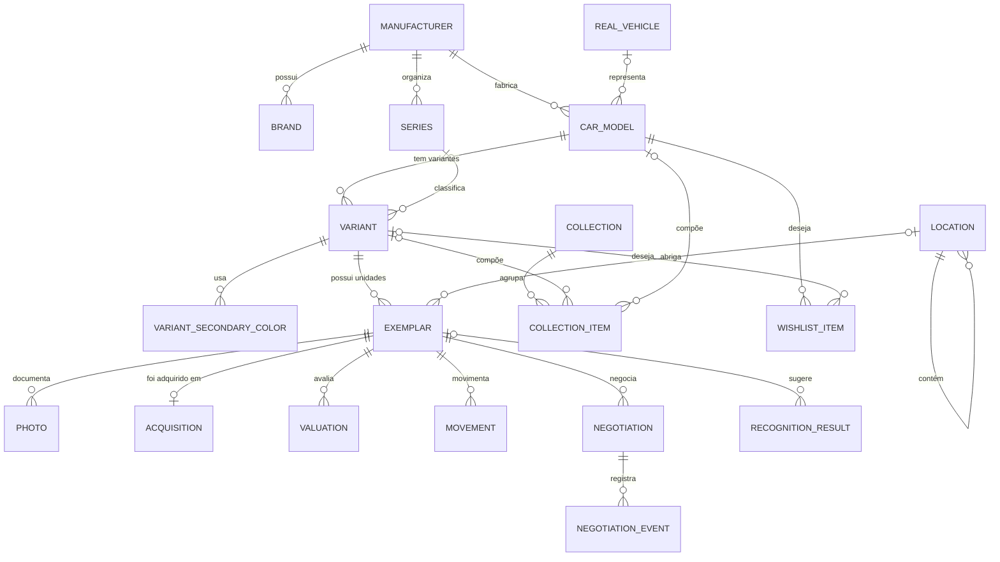

# Phase 1 — Data Model: Diecast Collector

**Data**: 2026-11-16 · **Plano**: [`plan.md`](./plan.md) · **Spec**: [`spec.md`](./spec.md)

Schema relacional em SQLite (Room), normalizado, com integridade referencial declarada. Os nomes de tabela e coluna são em inglês (código); os rótulos de interface são em português.

## Convenções globais

- **Chave primária**: `id` TEXT contendo UUID v4 gerado no aparelho (Art. VI.11, D13). Nenhuma tabela usa autoincremento como identidade de negócio.
- **Dinheiro**: `*_cents` INTEGER (centavos) + `currency` TEXT ISO-4217, padrão `BRL` (Art. I.11, D12). Nunca `REAL`/`Double`.
- **Data de evento** (aquisição, avaliação, nascimento do item): `TEXT` ISO `YYYY-MM-DD`, sem fuso — representa o dia para o colecionador.
- **Timestamp de auditoria** (`created_at`, `updated_at`, `at`): INTEGER epoch millis UTC.
- **Desconhecido**: coluna `NULL`. Proibido sentinela `0`, `''`, `'N/A'` (Art. I.9, FR-015).
- **Arquivamento**: `archived_at` INTEGER NULL em entidades com histórico; `NULL` = ativo. Nenhuma exclusão física de exemplar, aquisição, avaliação, movimentação ou negociação (Art. I.7).
- **Integridade referencial**: toda FK declarada com `onDelete = RESTRICT` (ou `NO_ACTION`); `PRAGMA foreign_keys = ON` na abertura do banco (Art. I.5).
- **Nada derivado é armazenado**: totais, percentuais de conclusão, contagem de duplicados e custo médio são consultas (evita redundância e divergência — Art. I.2).

## Catálogo de entidades

### 1. Fabricante — `manufacturer` (FR-047)
`id` PK · `name` NOT NULL, UNIQUE · `country` NULL · `archived_at` NULL · `created_at`, `updated_at` NOT NULL

### 2. Marca da miniatura — `brand` (FR-014)
`id` PK · `manufacturer_id` FK → `manufacturer` NOT NULL · `name` NOT NULL · `archived_at` NULL
Índice único: (`manufacturer_id`, `name`).

### 3. Veículo real — `real_vehicle` (FR-014)
`id` PK · `make` NOT NULL · `model` NOT NULL · `year` NULL · `country` NULL
Reutilizável entre modelos de miniaturas diferentes.

### 4. Modelo — `car_model` (Art. I.1–I.2, FR-033–FR-036)
`id` PK · `manufacturer_id` FK NOT NULL · `brand_id` FK NULL · `real_vehicle_id` FK NULL · `name` NOT NULL · `scale` NOT NULL DEFAULT `'1:64'` · `body_type` NULL · `material` NULL · `country_of_manufacture` NULL · `notes` NULL · `archived_at` NULL · `created_at`, `updated_at` NOT NULL
Índice único: (`manufacturer_id`, `name`, `scale`).

### 5. Série — `series` (FR-048–FR-049)
`id` PK · `manufacturer_id` FK NOT NULL · `parent_id` FK → `series` NULL · `name` NOT NULL · `kind` NULL · `year` NULL · `archived_at` NULL · timestamps
Hierarquia livre: nenhuma taxonomia da Mattel é presumida (Art. VI.2).

### 6. Coleção — `collection` (FR-049–FR-056)
`id` PK · `name` NOT NULL · `description` NULL · `parent_id` FK → `collection` NULL · `manufacturer_id` FK NULL (NULL = coleção multi-fabricante) · `archived_at` NULL · timestamps

### 7. Cor — `color` (FR-017)
`id` PK · `name` NOT NULL UNIQUE · `hex` NULL

### 8. Variante — `variant` (Art. I.1–I.3, FR-035, FR-039–FR-042)
`id` PK · `model_id` FK NOT NULL · `series_id` FK NULL · `primary_color_id` FK → `color` NULL · `wheels_type` NULL · `base_type` NULL · `decoration` NULL · `release_year` NULL · `collection_number` NULL · `series_number` NULL · `edition` NULL · `manufacturer_code` NULL · `packaging_type` NULL · `fingerprint` NOT NULL · `archived_at` NULL · timestamps
`fingerprint` = hash estável dos atributos distintivos normalizados (modelo, cor, rodas, base, decoração, edição/série, ano). Índice único em `fingerprint` (parcial: `WHERE archived_at IS NULL`) é o que implementa FR-040 sem proibir variantes legítimas.
Índices: (`model_id`), (`series_id`), (`manufacturer_code`).

### 9. Cor secundária da variante — `variant_secondary_color` (FR-017)
`variant_id` FK · `color_id` FK · PK composta (`variant_id`, `color_id`)

### 10. Exemplar — `exemplar` (Art. I.1, I.12; FR-036–FR-046, FR-019)
`id` PK · `variant_id` FK NOT NULL · `internal_code` NOT NULL UNIQUE · `condition` NOT NULL (SEALED, LOOSE, DAMAGED, RESTORED, INCOMPLETE) · `packaging_condition` NULL (SEALED, OPENED, DAMAGED, NONE) · `location_id` FK → `location` NULL · `status` NOT NULL DEFAULT `OWNED` (OWNED, SOLD, TRADED, ARCHIVED) · `notes` NULL · `row_version` INTEGER NOT NULL DEFAULT 0 · timestamps
Índices: (`variant_id`, `status`), (`location_id`). `row_version` implementa detecção de escrita concorrente (Art. I.12).

### 11. Fotografia — `photo` (FR-020–FR-021, R.2–R.3, FR-096–FR-101)
`id` PK · `exemplar_id` FK NOT NULL · `angle` NOT NULL (FRONT, BACK, LEFT, RIGHT, TOP, BASE, PACKAGING, DETAIL) · `path` NOT NULL (relativo a `filesDir`) · `is_primary` INTEGER NOT NULL DEFAULT 0 · `sort_order` INTEGER NOT NULL DEFAULT 0 · `width` · `height` · `bytes` · `checksum` NOT NULL · `captured_at` NULL
Índice: (`exemplar_id`, `angle`, `sort_order`). Regra: no máximo uma foto primária por exemplar, garantida em transação.

### 12. Aquisição — `acquisition` (FR-074–FR-076)
`id` PK · `exemplar_id` FK NOT NULL UNIQUE (1:1) · `date` TEXT NOT NULL · `price_cents` NULL · `shipping_cents` NULL · `discount_cents` NULL · `currency` NOT NULL DEFAULT `'BRL'` · `store` NULL · `seller` NULL · `method` NULL · `notes` NULL · timestamps
CHECK: valores monetários `>= 0` quando não nulos. Custo é sempre `price + shipping - discount`, nunca armazenado.

### 13. Avaliação — `valuation` (FR-082–FR-086)
`id` PK · `exemplar_id` FK NOT NULL · `value_cents` NOT NULL, `>= 0` · `currency` NOT NULL · `date` TEXT NOT NULL · `source` NULL · `notes` NULL · `created_at` NOT NULL
Índice: (`exemplar_id`, `date` DESC, `created_at` DESC). "Valor atual" = primeira linha dessa ordenação; histórico completo preservado (FR-083).

### 14. Item de desejo — `wishlist_item` (FR-057–FR-064)
`id` PK · `model_id` FK NULL · `variant_id` FK NULL · `free_text` NULL · `priority` INTEGER NOT NULL DEFAULT 2 (`1..3`) · `max_price_cents` NULL · `found_price_cents` NULL · `store` NULL · `reference_url` NULL · `notes` NULL · `status` NOT NULL DEFAULT `WANTED` (WANTED, ACQUIRED, DISMISSED) · `converted_exemplar_id` FK NULL · `created_at`, `updated_at` NOT NULL
CHECK: `model_id IS NOT NULL OR variant_id IS NOT NULL OR free_text IS NOT NULL`. CHECK: `priority BETWEEN 1 AND 3`.

### 15. Negociação — `negotiation` (FR-068–FR-073)
`id` PK · `exemplar_id` FK NOT NULL · `type` NOT NULL (SALE, TRADE) · `counterparty` NULL · `channel` NULL · `status` NOT NULL DEFAULT `OPEN` (OPEN, RESERVED, CLOSED, CANCELLED) · `started_at` NOT NULL · `closed_at` NULL · `amount_cents` NULL · `currency` NULL · `notes` NULL
Índice parcial único: um exemplar não pode ter duas negociações em `OPEN`/`RESERVED` (FR-068).

### 16. Evento de negociação — `negotiation_event` (FR-069, FR-073)
`id` PK · `negotiation_id` FK NOT NULL · `at` NOT NULL · `description` NULL · `amount_cents` NULL
Nunca apagado, nem ao concluir ou cancelar (FR-073).

### 17. Localização — `location` (FR-088–FR-095)
`id` PK · `parent_id` FK → `location` NULL · `type` NOT NULL (ENVIRONMENT, CABINET, RACK, SHELF, CRATE, DRAWER, DISPLAY, COMPARTMENT, CUSTOM) · `name` NOT NULL · `archived_at` NULL · timestamps
Índice: (`parent_id`). Profundidade não é limitada pelo schema; ciclo é impedido na camada de domínio.

O valor persistido é sempre o enum em inglês; o português existe só na camada de apresentação (`strings.xml`): `ENVIRONMENT` = Ambiente · `CABINET` = Armário · `RACK` = Estante · `SHELF` = Prateleira · `CRATE` = Caixa · `DRAWER` = Gaveta · `DISPLAY` = Expositor · `COMPARTMENT` = Compartimento · `CUSTOM` = Personalizado. Os oito primeiros cobrem os níveis exigidos por FR-088; `CUSTOM` cobre níveis criados pelo usuário (FR-089).

### 18. Movimentação — `movement` (FR-091)
`id` PK · `exemplar_id` FK NOT NULL · `from_location_id` FK NULL · `to_location_id` FK NULL · `at` NOT NULL · `note` NULL
Índice: (`exemplar_id`, `at` DESC). Registro imutável.

### 19. Item de coleção — `collection_item` (FR-051–FR-055)
`id` PK · `collection_id` FK NOT NULL · `variant_id` FK NULL · `model_id` FK NULL · `expected` INTEGER NOT NULL DEFAULT 1 · `non_collectible` INTEGER NOT NULL DEFAULT 0 · `notes` NULL
CHECK: exatamente um entre `variant_id` e `model_id` é não nulo.
Índices únicos parciais: (`collection_id`, `variant_id`) e (`collection_id`, `model_id`).

### 20. Histórico de alterações — `history_entry` (Art. I.8, FR-027)
`id` PK · `entity_type` NOT NULL · `entity_id` NOT NULL · `field` NOT NULL · `old_value` NULL · `new_value` NULL · `at` NOT NULL · `source` NULL
Índice: (`entity_type`, `entity_id`, `at` DESC). Appende-only.

### 21. Resultado de reconhecimento — `recognition_result` (FR-102–FR-107)
`id` PK · `exemplar_id` FK NULL · `draft_id` TEXT NULL · `source` NOT NULL (PHOTO, OCR, BARCODE) · `provider` NOT NULL · `payload_json` NOT NULL · `confidence` REAL NULL · `applied_fields` NULL · `created_at` NOT NULL
Nada aqui alimenta o catálogo sem aceite explícito (FR-104); `applied_fields` registra o que o usuário confirmou.

### 22. Preferência — `app_setting` (FR-145, FR-171)
`key` TEXT PK · `value` TEXT NOT NULL
Exemplos: `photo_max_bytes`, `backup_interval_days`, `last_backup_at`, `theme`, `min_scale`.

### 23. Índice de busca — `search_index` (FTS4) (FR-114–FR-122)
Virtual table FTS4 sobre conteúdo (não persistente em paralelo): `variant_id` (rowid lógico), `model_name`, `real_vehicle_name`, `series_name`, `collection_names`, `manufacturer_name`, `manufacturer_code`, `notes`
`tokenizer=unicode61 remove_diacritics=1`. Mantida por gatilhos em `car_model`, `variant`, `series`, `collection_item`.
## Relacionamentos

| De | Para | Cardinalidade | Regra |
|---|---|---|---|
| `brand` | `manufacturer` | N:1 | marca pertence a um fabricante |
| `car_model` | `manufacturer` | N:1 | `ON DELETE RESTRICT` |
| `car_model` | `real_vehicle` | N:1 opcional | veículo real pode ser desconhecido |
| `series` | `manufacturer` | N:1 | taxonomia por fabricante, hierarquia própria |
| `series` | `series` | N:1 opcional | subcoleção de série |
| `collection` | `collection` | N:1 opcional | hierarquia criada pelo usuário |
| `variant` | `car_model` | N:1 | **obrigatório**; variante não existe sem modelo |
| `variant` | `series` | N:1 opcional | item pode não ter série identificada |
| `variant_secondary_color` | `variant`, `color` | N:N | cores secundárias múltiplas |
| `exemplar` | `variant` | N:1 | **obrigatório**; é a unidade física |
| `exemplar` | `location` | N:1 opcional | localização atual; histórico em `movement` |
| `photo` | `exemplar` | N:1 | uma foto pertence a um exemplar |
| `acquisition` | `exemplar` | 1:1 | no máximo uma aquisição por exemplar |
| `valuation` | `exemplar` | N:1 | várias avaliações, históricas |
| `wishlist_item` | `car_model` / `variant` | N:1 opcional | desejo pode ser texto livre |
| `negotiation` | `exemplar` | N:1 | no máximo uma negociação ativa por exemplar |
| `negotiation_event` | `negotiation` | N:1 | histórico imutável |
| `movement` | `exemplar`, `location` | N:1 | origem e destino opcionais (entrada/saída) |
| `collection_item` | `collection` + (`variant` \| `model`) | N:1 | item esperado ou possuído na coleção |
| `history_entry` | qualquer entidade | polimórfico por (`entity_type`, `entity_id`) | sem FK física, por design |
| `recognition_result` | `exemplar` (ou rascunho) | N:1 opcional | sugestão, não catálogo |

## Diagrama entidade-relacionamento



## Consultas derivadas (nada disso é coluna)

| Indicador | Regra de cálculo | FR |
|---|---|---|
| Exemplares possuídos | `COUNT(exemplar WHERE status='OWNED' AND archived_at IS NULL)` | FR-001 |
| Modelos distintos | `COUNT(DISTINCT variant.model_id)` sobre os exemplares possuídos | FR-001 |
| Variantes distintas | `COUNT(DISTINCT exemplar.variant_id)` sobre possuídos | FR-002 |
| Fabricantes/coleções/séries | contagens distintas sobre itens possuídos | FR-003–FR-004 |
| Duplicados | grupos por `variant_id` com `COUNT(*) > 1` entre possuídos | FR-005, FR-065 |
| Total investido | `SUM(price_cents + shipping_cents - discount_cents)` das aquisições de exemplares possuídos | FR-007, FR-077 |
| Valor estimado | soma da avaliação mais recente de cada exemplar possuído; conta quantos não têm avaliação | FR-008, FR-084 |
| Custo médio | total investido / nº de exemplares **com** valor informado; informa excluídos | FR-081 |
| Progresso de coleção | `possuídos / (esperados - não colecionáveis)` | FR-052 |
| Faltantes | `collection_item` sem exemplar possuído da variante/modelo | FR-053 |
| Gastos por período/série/fabricante | agregação sobre aquisições com `date` no intervalo | FR-078–FR-080 |

## Máquinas de estado

```text
exemplar.status
  OWNED ──(venda concluída)──► SOLD
  OWNED ──(troca concluída)──► TRADED
  OWNED ──(arquivar)────────► ARCHIVED
  SOLD/TRADED ──(desfazer com histórico)──► OWNED
  Regra: sair de OWNED exige negociação CLOSED ou ação explícita com histórico; nunca automático.

negotiation.status
  OPEN ──(reservar)──► RESERVED ──(concluir)──► CLOSED
  OPEN/RESERVED ──(cancelar)──► CANCELLED
  Regra: CLOSED e CANCELLED são finais e imutáveis; o histórico em negotiation_event permanece.

wishlist_item.status
  WANTED ──(converter em aquisição)──► ACQUIRED
  WANTED ──(descartar)──► DISMISSED
  Regra: conversão preenche converted_exemplar_id e preserva prioridade/valores originais (FR-063).
```

## Regras de validação (rejeitadas com mensagem em pt-BR)

| Regra | Origem |
|---|---|
| `car_model.name` e `manufacturer.name` não vazios, aparados, ≤ 120 caracteres | FR-013, FR-022 |
| `scale` no formato `1:N` (padrão `1:64`) | FR-016 |
| `condition` ∈ {SEALED, LOOSE, DAMAGED, RESTORED, INCOMPLETE} | FR-018 |
| `packaging_condition` ∈ {SEALED, OPENED, DAMAGED, NONE} | FR-019 |
| `photo.angle` ∈ conjunto de 8 ângulos | FR-020, FR-097 |
| Valores monetários ≥ 0 e ≤ 9.999.999,99 | FR-076 |
| `acquisition.date` e `valuation.date` em ISO `YYYY-MM-DD`, não futuras além de hoje | FR-074, FR-082 |
| `priority` entre 1 e 3 | FR-058 |
| `internal_code` único no banco | FR-038 |
| Exatamente uma foto primária por exemplar com fotos | FR-021 |
| `collection_item` com exatamente um entre `variant_id`/`model_id` | FR-051 |
| `variant.fingerprint` único entre variantes ativas | FR-040 |
| URL de referência do desejo válida (`http`/`https`) | FR-061 |

## Regras transacionais (o que precisa ser atômico)

1. **Criar exemplar**: insere `exemplar` + `acquisition` (se houver) + `movement` inicial + entradas de auditoria na mesma transação; se a gravação de imagem falhar, o exemplar não fica com foto parcial (FR-153).
2. **Unir variantes** (FR-041): move todos os `exemplar`, `collection_item` e referências de desejo; recalcula `fingerprint`; grava `history_entry` da união; arquiva a variante absorvida — nada é apagado.
3. **Separar exemplares para nova variante** (FR-042): cria variante, atualiza vínculos, preserva FKs de aquisição/avaliação/fotos, registra auditoria por exemplar.
4. **Mover exemplar** (FR-091): atualiza `exemplar.location_id` e insere `movement` na mesma transação; falha em qualquer um dos dois reverte ambos.
5. **Concluir venda/troca** (FR-070–FR-071): atualiza `negotiation`, insere `negotiation_event`, muda `exemplar.status`, insere evento financeiro; recusa se outra negociação ativa existir.
6. **Converter desejo em aquisição** (FR-063): cria exemplar, cria aquisição, atualiza desejo para ACQUIRED com `converted_exemplar_id`; se o exemplar já existente for reaproveitado, apenas vincula.
7. **Definir foto principal** (FR-021): desmarca a anterior e marca a nova na mesma transação.
8. **Excluir/arquivar localização com exemplares** (FR-093): bloqueia até o usuário escolher mover ou arquivar; nunca cascateia.
9. **Restaurar backup** (FR-141, FR-144): valida manifesto e hashes, executa em transação única; conflito de ID resolvido por decisão do usuário; aborta sem gravar em caso de erro.
10. **Importar lote** (FR-139): valida todas as linhas, aplica em transação única; erro inesperado reverte o lote inteiro.

## Estratégia de migração

- `exportSchema = true`, diretório `core/data/schemas/` versionado junto ao código (permite revisar o schema em cada mudança).
- Cada alteração incrementa a versão e recebe `Migration(n, n+1)` nomeada e documentada (ex.: `MIGRATION_2_3_add_collection_item_notes`).
- `fallbackToDestructiveMigration()` é **proibido** (R.8); falha de migração aborta a abertura e informa o usuário, preservando o banco original.
- Toda migração tem teste `MigrationTestHelper`: cria banco na versão anterior, popula dados representativos (exemplar com fotos, aquisição, avaliação, movimentação), migra e confere contagens, FKs e integridade.
- Índices e tabela FTS são criados/atualizados na mesma migração que altera as tabelas de origem; reconstrução do FTS por `INSERT INTO search_index(search_index) VALUES('rebuild')` ao final.
- Antes de migração que altera estrutura de imagens ou formato de arquivo, o app oferece exportação prévia (Art. I.10).

## Rastreabilidade spec → modelo

| Módulo | Entidades principais |
|---|---|
| M1 Dashboard | consultas derivadas (nenhuma tabela própria) |
| M2 Cadastro | `car_model`, `variant`, `exemplar`, `photo`, `real_vehicle`, `color` |
| M3 Modelo/Variante/Exemplar | `car_model`, `variant`, `exemplar` + `history_entry` |
| M4 Séries/Coleções | `manufacturer`, `series`, `collection`, `collection_item` |
| M5 Desejos | `wishlist_item` → `acquisition` + `exemplar` |
| M6 Duplicados/Negociação | consulta de duplicados, `negotiation`, `negotiation_event` |
| M7 Financeiro | `acquisition`, `valuation` |
| M8 Localização | `location`, `movement` |
| M9 Fotos/IA | `photo`, `recognition_result` |
| M10 Código de barras | `recognition_result` + `variant.manufacturer_code` |
| M11 Busca/Filtros | `search_index` FTS4 + índices secundários |
| M12 Relatórios | consultas derivadas + `app_setting` |
| Importação/Backup | todas, com `app_setting.last_backup_at` |
